# かけいぼっと（Kakeibot）

見返すのが楽しい、iOS・Android の家計簿アプリ。

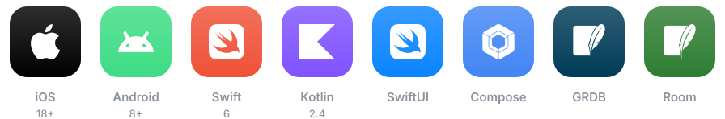

## ✨ 機能

<table>
<tr><th>ホーム</th><th>締めのレポート</th><th>レシートの読み取り</th></tr>
<tr>
<td>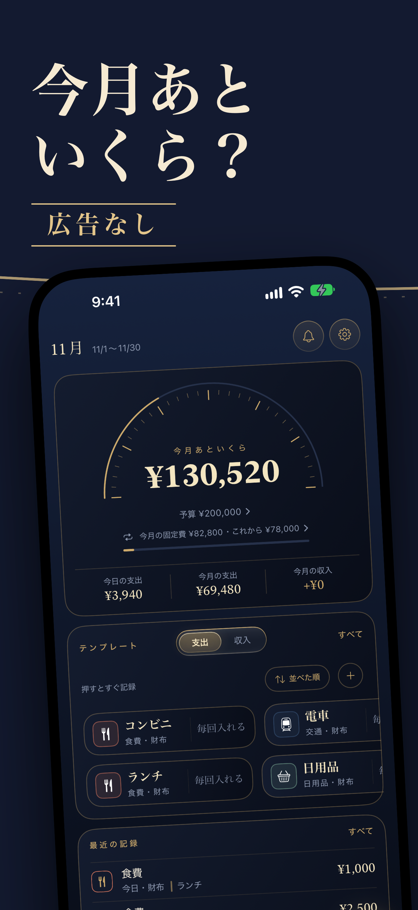</td>
<td>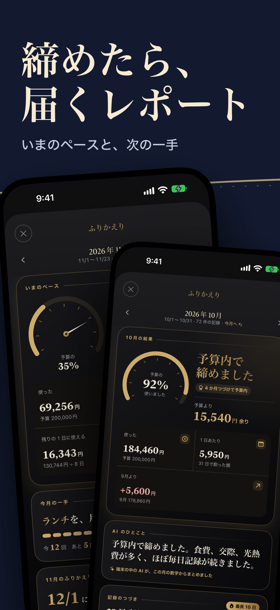</td>
<td>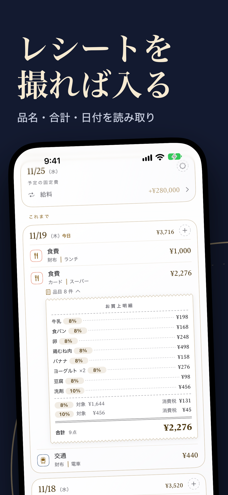</td>
</tr>
<tr><th>1 タップの記録</th><th>着せ替えのテーマ</th><th>声で記録</th></tr>
<tr>
<td>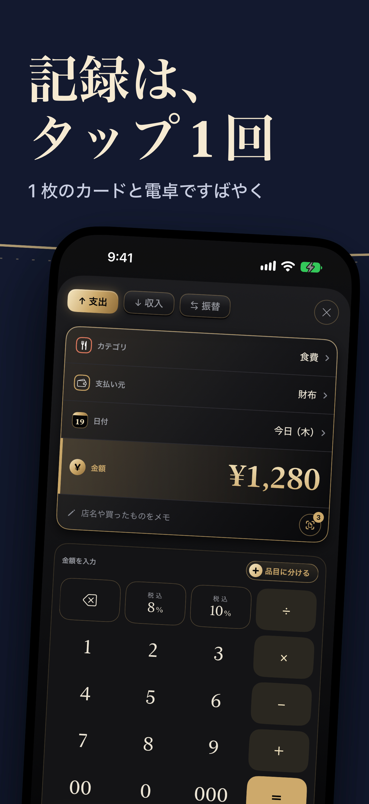</td>
<td>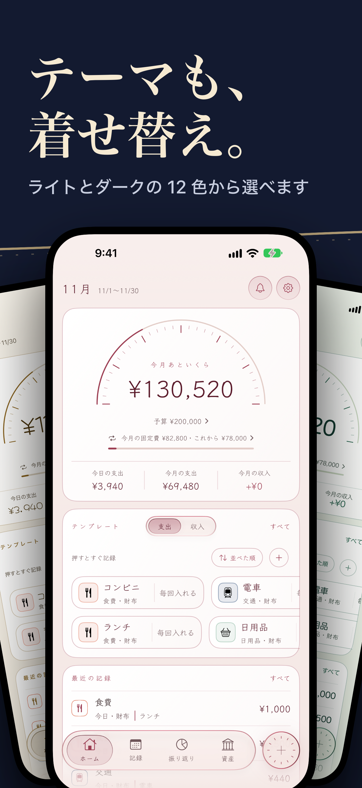</td>
<td>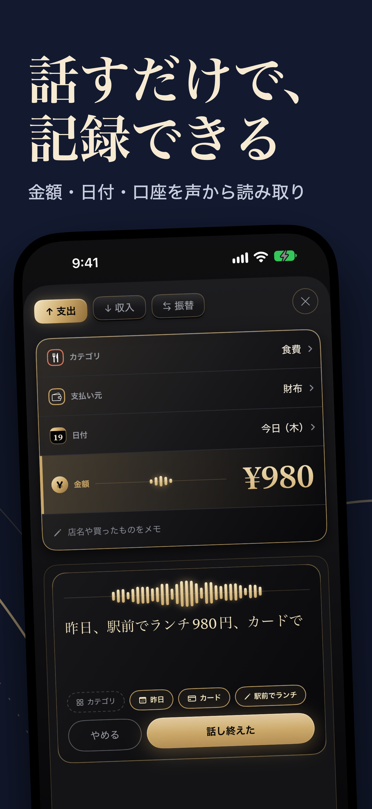</td>
</tr>
<tr><th>ふたりで共有</th><th>月末の見込み</th><th>残高と引き落とし</th></tr>
<tr>
<td>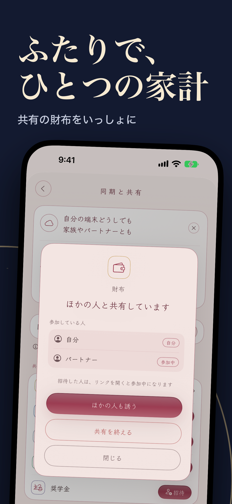</td>
<td>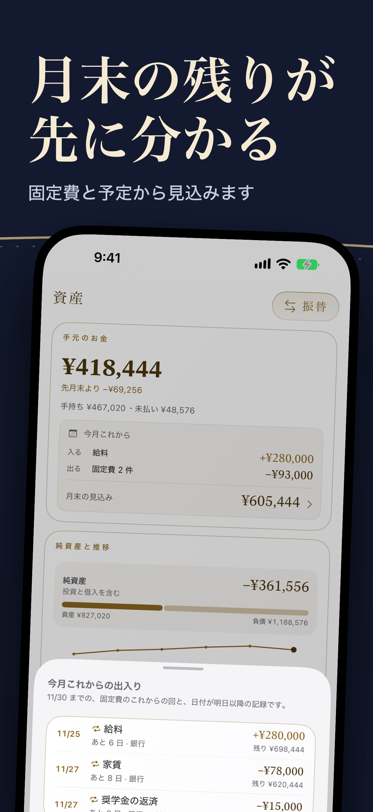</td>
<td>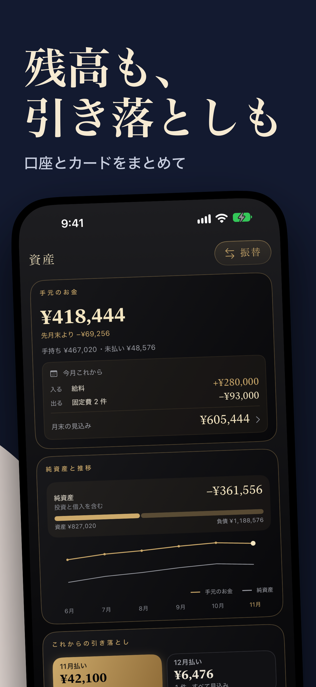</td>
</tr>
</table>

## 🗺️ 全体像

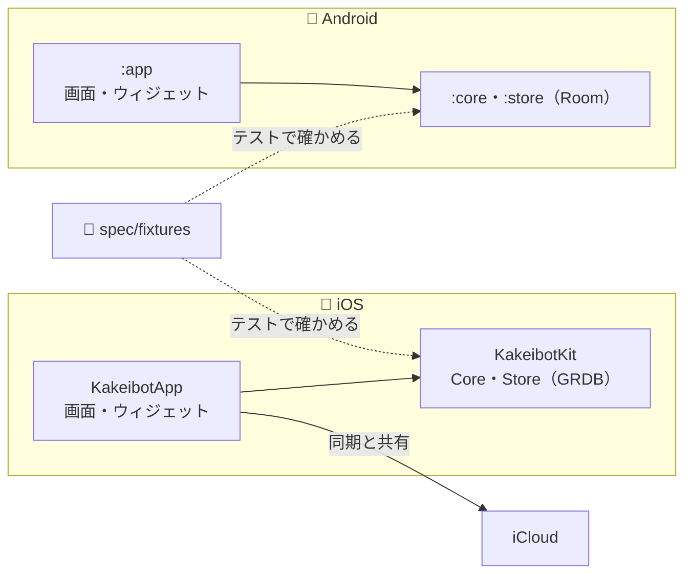

| 部分 | 中身 |
| --- | --- |
| 計算 | 両 OS のテストが `spec/fixtures/` を読み、結果をそろえる |
| iOS のパッケージ | [architecture-packages](docs/architecture-packages.md)、[architecture-packages-app](docs/architecture-packages-app.md) |
| Android のモジュール | [architecture-android](docs/architecture-android.md) |

## 💻 実行環境

| 対象 | 🍎 iOS | 🤖 Android |
| --- | --- | --- |
| 対応 OS | iOS 18 以上 | Android 8 以上（minSdk 26） |
| 言語 | Swift 6 | Kotlin 2.4 |
| 開発の道具 | Xcode 27、Homebrew | Android Studio、JDK 17 |

[道具とコマンド](docs/development.md)

## 📚 文書

| 知りたいこと | 文書 |
| --- | --- |
| 何を作るか | [docs/overview.md](docs/overview.md) |
| どう作るか | [docs/architecture.md](docs/architecture.md) |
| 道具とコマンド | [docs/development.md](docs/development.md) |
| パッケージの依存と KakeibotKit のフォルダの木 | [docs/architecture-packages.md](docs/architecture-packages.md) |
| KakeibotApp のフォルダの木と中身 | [docs/architecture-packages-app.md](docs/architecture-packages-app.md) |
| 名前とファイルの置き場所 | [docs/architecture-naming.md](docs/architecture-naming.md) |
| Android の構成 | [docs/architecture-android.md](docs/architecture-android.md) |
| Android の保存のモジュールと iOS との対応 | [docs/architecture-android-store.md](docs/architecture-android-store.md) |
| Android の画面とモデル | [docs/architecture-android-app.md](docs/architecture-android-app.md) |
| Android の画面とモデルのやり取り | [docs/architecture-android-flow.md](docs/architecture-android-flow.md) |
| 画面の組み立て・通知とウィジェット・画面のフォルダ | [docs/architecture-screens.md](docs/architecture-screens.md) |
| 画面とモデルのやり取り・監視・外からの入口 | [docs/architecture-screens-flow.md](docs/architecture-screens-flow.md) |
| 複数の画面で使う部品 | [docs/architecture-parts.md](docs/architecture-parts.md) |
| 設定の一覧の画面の足し方 | [docs/architecture-parts-settings.md](docs/architecture-parts-settings.md) |
| モデルの State の組み方 | [docs/architecture-parts-state.md](docs/architecture-parts-state.md) |
| 保存・並べ替え・非表示の共通の関数 | [docs/architecture-parts-writes.md](docs/architecture-parts-writes.md) |
| データの形 | [docs/data.md](docs/data.md) |
| 予算・固定費・ごほうび・スタンプの表 | [docs/data-budget.md](docs/data-budget.md) |
| 設定とテーマの表 | [docs/data-settings.md](docs/data-settings.md) |
| 同期のための表 | [docs/data-sync.md](docs/data-sync.md) |
| なぜそう決めたか（決定の索引） | [docs/decisions/README.md](docs/decisions/README.md) |
| 何をどの順で作るか | [docs/roadmap.md](docs/roadmap.md) |
| 記録と入力シートの言葉とコードの名前 | [docs/glossary.md](docs/glossary.md) |
| 固定費から振り返りまでの言葉とコードの名前 | [docs/glossary-features.md](docs/glossary-features.md) |
| 書き出しの形式 | [spec/export-format.md](spec/export-format.md) |
| fixtures の形式 | [spec/fixtures.md](spec/fixtures.md) |
| 画面のモデルのテストの突き合わせ | [spec/scenarios.md](spec/scenarios.md) |
| 作業と文書の決まり | [CLAUDE.md](CLAUDE.md) |
| 文書の役割 | [.claude/rules/doc-roles.md](.claude/rules/doc-roles.md) |
| 全リポジトリ共通の決まり | [claude-config](https://github.com/yossibank/claude-config) |

## 🔤 フォント

| 字体 | フォント | 見本 |
| --- | --- | --- |
| ドット | [DotGothic16](https://github.com/fontworks-fonts/DotGothic16) |  |
| ポップ | [Hachi Maru Pop](https://github.com/noriokanisawa/HachiMaruPop) |  |

| フォント | 著作権者 | ライセンス |
| --- | --- | --- |
| DotGothic16 | The DotGothic16 Project Authors | [OFL 1.1](https://openfontlicense.org/) |
| Hachi Maru Pop | The Hachi Maru Pop Project Authors | [OFL 1.1](https://openfontlicense.org/) |
