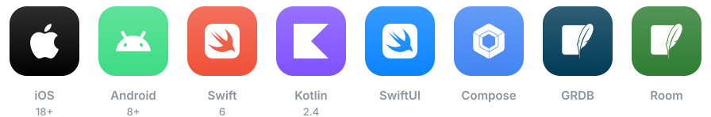
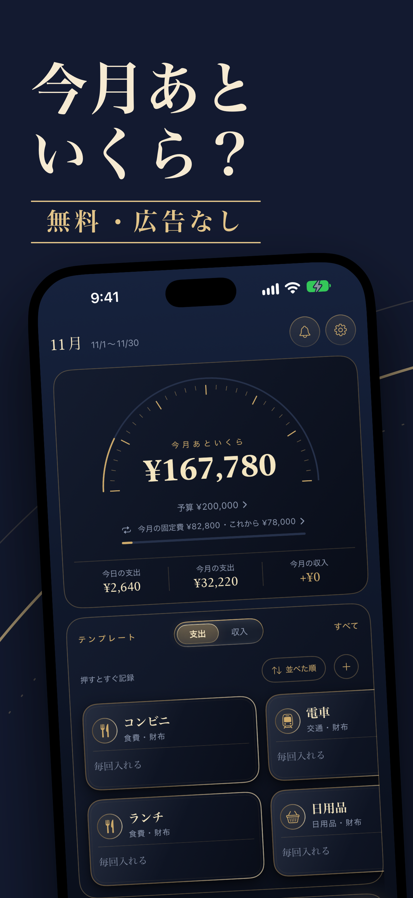
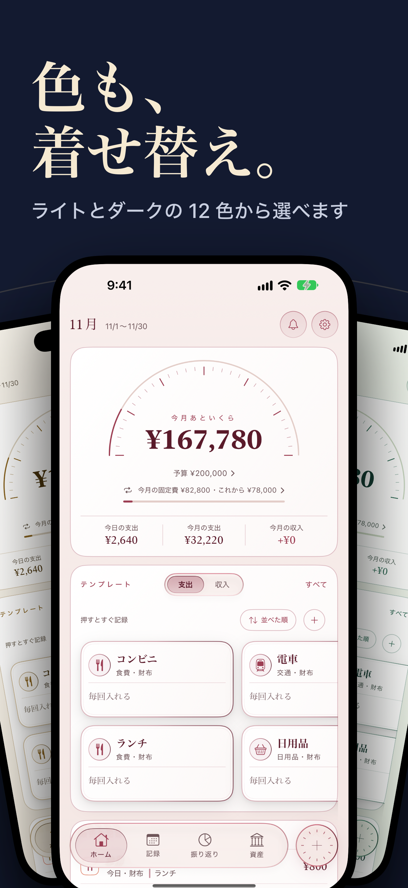
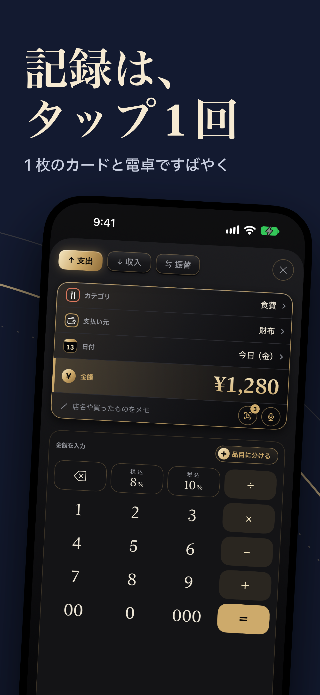
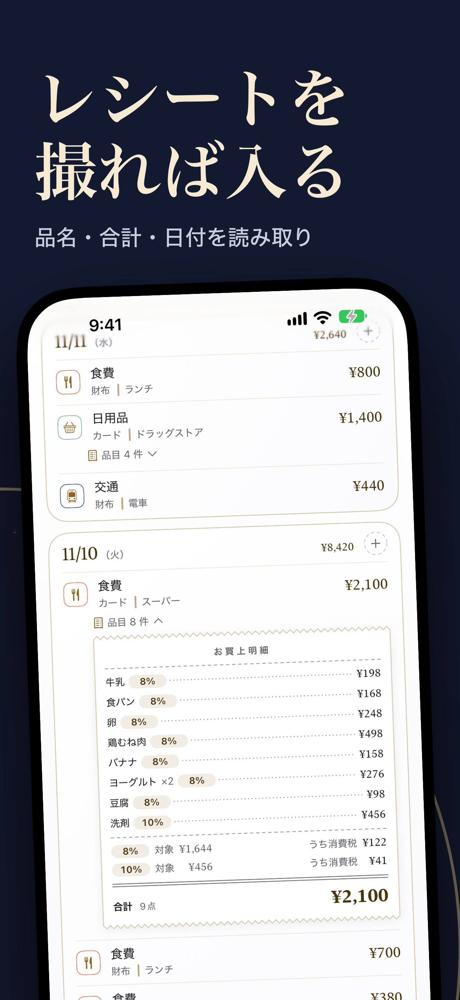
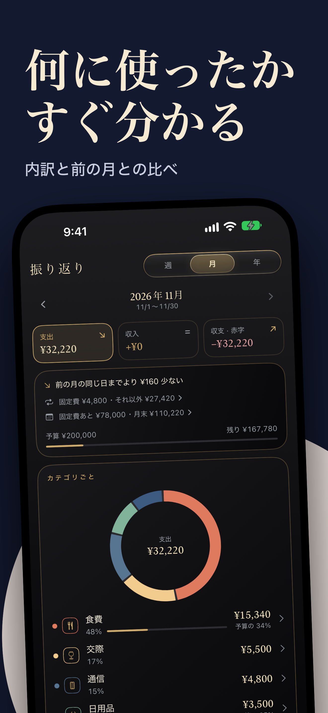
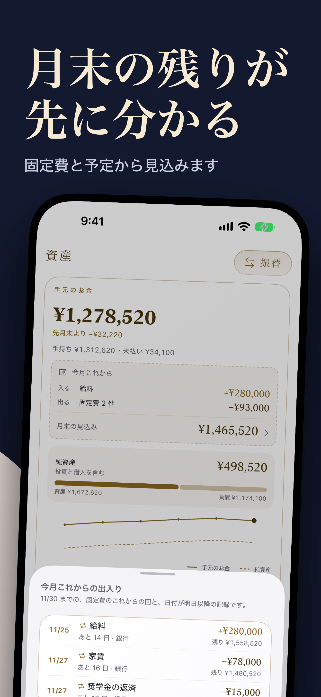
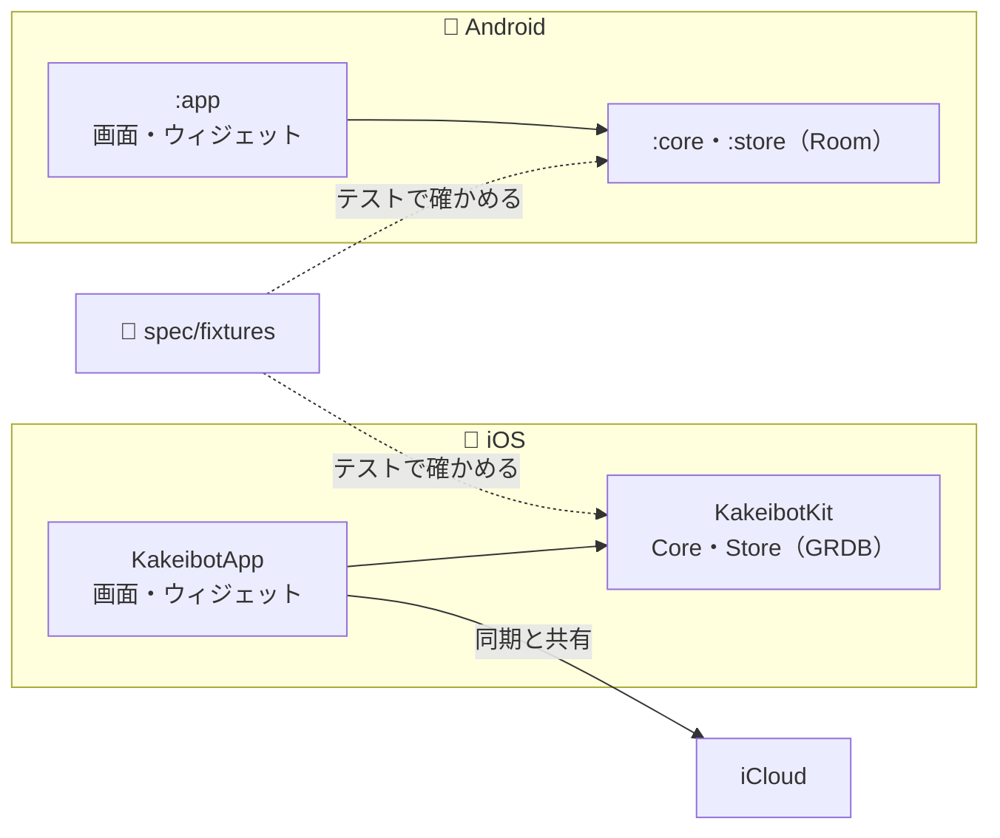

# かけいぼっと（Kakeibot）

見返すのが楽しい、iOS・Android の家計簿アプリ。

## ✨ 機能

| ホーム | 着せ替えのテーマ | 1 タップの記録 |
| :---: | :---: | :---: |
|  |  |  |

| レシートの読み取り | 振り返り | 月末の見込み |
| :---: | :---: | :---: |
|  |  |  |

## 🗺️ 全体像

| 部分 | 中身 |
| --- | --- |
| 計算 | 両 OS のテストが `spec/fixtures/` を読み、結果をそろえる |
| iOS のパッケージ | [architecture-packages](docs/architecture-packages.md) |
| Android のモジュール | [architecture-android](docs/architecture-android.md) |

## 💻 実行環境

| 対象 | 🍎 iOS | 🤖 Android |
| --- | --- | --- |
| 対応 OS | iOS 18 以上 | Android 8 以上（minSdk 26） |
| 言語 | Swift 6 | Kotlin 2.4 |
| 開発の道具 | Xcode、Homebrew | Android Studio、JDK 17 |

[道具とコマンド](docs/development.md)

## 📚 文書

| 知りたいこと | 文書 |
| --- | --- |
| 何を作るか | [docs/overview.md](docs/overview.md) |
| どう作るか | [docs/architecture.md](docs/architecture.md) |
| 道具とコマンド | [docs/development.md](docs/development.md) |
| パッケージの依存とフォルダ | [docs/architecture-packages.md](docs/architecture-packages.md) |
| 名前とファイルの置き場所 | [docs/architecture-naming.md](docs/architecture-naming.md) |
| Android の構成 | [docs/architecture-android.md](docs/architecture-android.md) |
| 画面の組み立て・見張り・通知とウィジェット | [docs/architecture-screens.md](docs/architecture-screens.md) |
| データの形 | [docs/data.md](docs/data.md) |
| 設定とテーマの表 | [docs/data-settings.md](docs/data-settings.md) |
| 同期のための表 | [docs/data-sync.md](docs/data-sync.md) |
| なぜそう決めたか | [docs/decisions/](docs/decisions/) |
| 何をどの順で作るか | [docs/roadmap.md](docs/roadmap.md) |
| 画面の言葉とコードの名前 | [docs/glossary.md](docs/glossary.md) |
| 書き出しの形式 | [spec/export-format.md](spec/export-format.md) |
| fixtures の形式 | [spec/fixtures.md](spec/fixtures.md) |
| 作業と文書の決まり | [CLAUDE.md](CLAUDE.md) |
| 文書の役割 | [.claude/rules/doc-roles.md](.claude/rules/doc-roles.md) |
| 全リポジトリ共通の決まり | [claude-config](https://github.com/yossibank/claude-config) |

## 🔤 フォント

| 字体 | フォント | 見本 | 著作権者 | ライセンス |
| --- | --- | --- | --- | --- |
| 手書き | [Klee One](https://github.com/fontworks-fonts/Klee) |  | The Klee Project Authors | [OFL 1.1](https://openfontlicense.org/) |
| ドット | [DotGothic16](https://github.com/fontworks-fonts/DotGothic16) |  | The DotGothic16 Project Authors | [OFL 1.1](https://openfontlicense.org/) |
| ポップ | [Hachi Maru Pop](https://github.com/noriokanisawa/HachiMaruPop) |  | The Hachi Maru Pop Project Authors | [OFL 1.1](https://openfontlicense.org/) |
