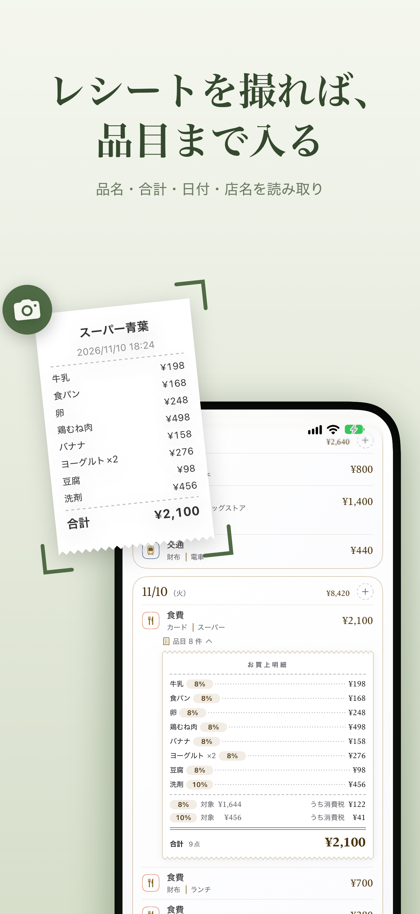
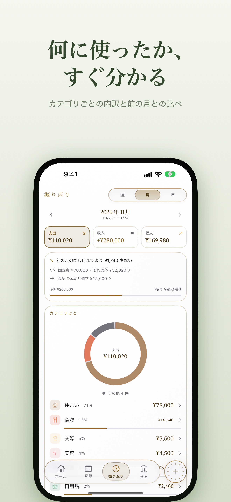
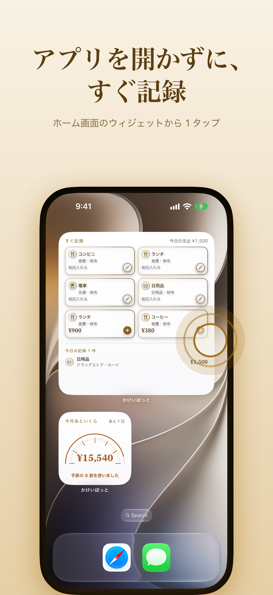
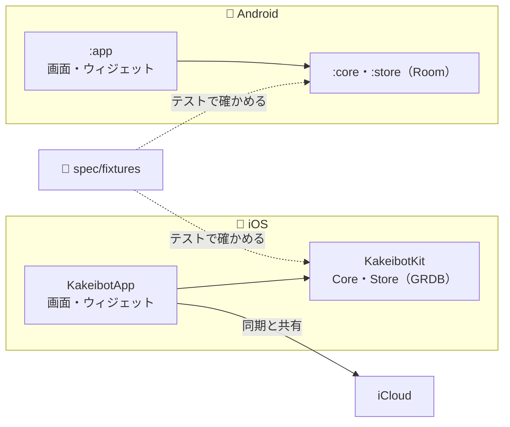

# かけいぼっと（Kakeibot）

見返すのが楽しい、iOS・Android の家計簿アプリ。

[](https://apps.apple.com/jp/app/id6829072935)


<table>
  <tr>
    <th>ホーム</th>
    <th>レシート</th>
    <th>振り返り</th>
    <th>ウィジェット</th>
  </tr>
  <tr>
    <td></td>
    <td></td>
    <td></td>
    <td></td>
  </tr>
</table>

1 タップの記録 ・ レシートの読み取り ・ 着せ替えのテーマ ・ 振り返り ・ ウィジェット ・ 家族と共有

## 🗺️ 全体像

iOS と Android は、同じ表の形と同じ計算の決まりを持つ。計算の結果は、両 OS のテストが `spec/fixtures/` を読んでそろえる。



iOS のパッケージは [architecture-packages](docs/architecture-packages.md) にある。Android のモジュールは [architecture-android](docs/architecture-android.md) にある。

## 🚀 動かし方

Xcode と [Homebrew](https://brew.sh/) が要る。Android は [Android Studio](https://developer.android.com/studio) と、その SDK が要る。ほかの道具は `make setup` で入る。

| 道具 | 使い道 |
| --- | --- |
| [jq](https://jqlang.org/) | テストに使うシミュレーターを選ぶ（`scripts/find-simulator.sh`）。JSON を整形する（`scripts/json-format.sh`） |
| [Mint](https://github.com/yonaskolb/Mint) | SwiftFormat と LicensePlist の版をそろえる（`Mintfile`） |
| [pre-commit](https://pre-commit.com/) | commit の前の確認を動かす |
| [xcbeautify](https://github.com/cpisciotta/xcbeautify) | ビルドとテストの出力を読みやすくする |

> [!NOTE]
> commit の前に pre-commit が、ステージした Swift と JSON を整形する。直したファイルがあると commit は止まるので、`git add` して commit し直す。

よく使うコマンドを、次の表に挙げる。

| 対象 | コマンド |
| --- | --- |
| 道具を入れ、hook を入れる | `make setup` |
| Xcode でワークスペースを開く | `make open` |
| ブランチのワークツリーを Xcode で開く | `make open BRANCH=feat/...` |
| 変更の確認（文書・JSON の整形・Swift の書き方・余白の値・両 OS のテストとビルド。出力は成否と失敗の箇所だけ） | `make verify` |
| 文書の一致と書き方、JSON の整形だけを確かめる（文書だけの変更） | `make verify-docs` |
| iOS のビルド（シミュレーター） | `make build` |
| テストのコンパイルだけ（走らせない） | `make test-build` |
| テスト（`ios/Kakeibot.xctestplan`、シミュレーター） | `make test` |
| 画面の部品を PNG に描く（下の注） | `make snapshot SNAPSHOT=widget` |
| Android のビルド（デバッグの APK） | `make android-build` |
| Android の Core と Store のテスト | `make android-test` |
| Swift と JSON の整形 | `make format` |
| ライセンスの一覧を作り直す（部品やフォントを足したとき） | `make licenses` |

`make snapshot` は claude-config の `ui-snapshot` を使う。セットは `.claude/snapshots/` の下の名前で、出力は `.build/snapshots/<セット>/` に出る。

DEBUG のビルドは、起動の引数 `-open` で設定の画面を直接開く。`settings` なら設定のシートを、`SetupItem` の名前（`homeSections` など）ならその画面を開く。

```sh
xcrun simctl launch booted com.yossibank.kakeibot -open homeSections
```

## 📚 文書

知りたいことごとに、読む文書が分かれている。

| 知りたいこと | 文書 |
| --- | --- |
| 何を作るか | [docs/overview.md](docs/overview.md) |
| どう作るか | [docs/architecture.md](docs/architecture.md) |
| パッケージの依存とフォルダ | [docs/architecture-packages.md](docs/architecture-packages.md) |
| 名前とファイルの置き場所 | [docs/architecture-naming.md](docs/architecture-naming.md) |
| Android の構成 | [docs/architecture-android.md](docs/architecture-android.md) |
| 画面の組み立て・見張り・通知とウィジェット | [docs/architecture-screens.md](docs/architecture-screens.md) |
| データの形 | [docs/data.md](docs/data.md) |
| 設定とテーマの表 | [docs/data-settings.md](docs/data-settings.md) |
| 同期のための表 | [docs/data-sync.md](docs/data-sync.md) |
| なぜそう決めたか | [docs/decisions/](docs/decisions/) |
| 何をどの順で作るか | [docs/roadmap.md](docs/roadmap.md) |
| 画面の言葉とコードの名前 | [docs/glossary.md](docs/glossary.md) |
| 書き出しの形式 | [spec/export-format.md](spec/export-format.md) |
| fixtures の形式 | [spec/fixtures.md](spec/fixtures.md) |
| 作業と文書の決まり | [CLAUDE.md](CLAUDE.md) |
| 文書の役割 | [.claude/rules/doc-roles.md](.claude/rules/doc-roles.md) |
| 全リポジトリ共通の決まり | [claude-config](https://github.com/yossibank/claude-config) |

## 🛠️ 出典

アプリに同梱するフォントは、どれも [SIL Open Font License 1.1](https://openfontlicense.org/) で配られている。使う文字だけに絞って入れ、ライセンスの文を `ios/Kakeibot/Fonts` に置く。

| フォント | 著作権者 | 使い道 |
| --- | --- | --- |
| [Klee One](https://github.com/fontworks-fonts/Klee) | The Klee Project Authors | 字体の「手書き」 |
| [DotGothic16](https://github.com/fontworks-fonts/DotGothic16) | The DotGothic16 Project Authors | 字体の「ドット」 |
| [Hachi Maru Pop](https://github.com/noriokanisawa/HachiMaruPop) | The Hachi Maru Pop Project Authors | 字体の「ポップ」 |
