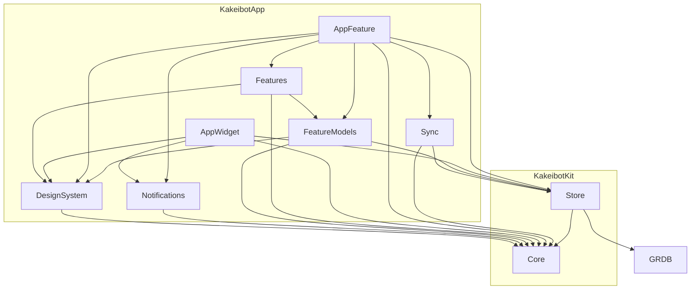

# パッケージの構成

> [!NOTE]
> 2 つのパッケージの依存の向きと、KakeibotKit のフォルダの木と中身が分かる。
> KakeibotApp のフォルダの木と中身は [architecture-packages-app](architecture-packages-app.md) にある。
> 全体の構成は [architecture](architecture.md)、名前の決まりは [architecture-naming](architecture-naming.md) にある。

## 📦 パッケージ

2 つのパッケージの中身は、次のとおりである。共通の形に無い `Store/Snapshot/`・`Store/Sync/`・`Sync`・`TestSupport` を足している。画面のモデルは、`Features` から `FeatureModels` に分けている。

Android も同じ分け方で、画面のモデルを `:featuremodels` に置く。中身は [architecture-android-app](architecture-android-app.md) にある。

依存の向きは、共通の形に次の 3 本を足したものである。

- `AppFeature --> Sync --> Store`
- `AppFeature・Features --> FeatureModels`
- `AppFeatureTests・FeaturesTests --> TestSupport`

`Features` は `Store` に依存しない。DB は `ScreenParts` に包んで受け取り、`FeatureModels` のモデルだけが開く。

`Features` と `AppFeature` には `MemberImportVisibility` を付ける。import していないモジュールの関数は呼べない。`import Store` が `AppModel` の 4 ファイルだけなのは、`make verify` が確かめる。

テストのターゲットを除いた依存は、次の図のとおりである。



### KakeibotKit

KakeibotKit のフォルダは、次の木のとおりである。

```text
KakeibotKit/
├── Sources/
│   ├── Core/
│   │   ├── Concepts/
│   │   │   ├── App/
│   │   │   ├── Budget/
│   │   │   ├── Category/
│   │   │   ├── Date/
│   │   │   ├── Entry/
│   │   │   ├── Export/V1/
│   │   │   ├── Icon/
│   │   │   ├── Notification/
│   │   │   ├── Receipt/
│   │   │   ├── Recurring/
│   │   │   ├── Review/
│   │   │   ├── Reward/
│   │   │   ├── Setting/
│   │   │   ├── Sync/
│   │   │   ├── Theme/
│   │   │   ├── Voice/
│   │   │   └── Wallet/
│   │   └── Shared/
│   └── Store/
│       ├── Database/
│       ├── Migrations/
│       ├── Queries/
│       │   ├── Methods/
│       │   └── Types/
│       ├── Records/
│       │   ├── Protocols/
│       │   ├── Rows/
│       │   ├── SettingKeys/
│       │   └── Values/
│       ├── Snapshot/
│       ├── Sync/
│       │   ├── Methods/
│       │   └── Types/
│       └── Writes/
│           ├── Methods/
│           └── Types/
└── Tests/
```

フォルダごとの中身は、次のとおり。

| フォルダ | 中身 |
| --- | --- |
| `Concepts/App/` | アプリの版 |
| `Concepts/Budget/` | 予算と消化 |
| `Concepts/Category/` | 記録のカテゴリとタグ |
| `Concepts/Date/` | LocalDate、期間の区切り、祝日、休日のずらし |
| `Concepts/Entry/` | 記録と品目、金額の電卓、日ごとのまとめ |
| `Concepts/Export/V1/` | 書き出しの形 |
| `Concepts/Icon/` | アイコンとスタンプ |
| `Concepts/Notification/` | 予約されているべき通知の計算と行き先 |
| `Concepts/Receipt/` | 文字の断片をレシートの行にまとめ、行かモデルが答えた行の役割から品目・合計・日付・店名を組み立てる決まり。人が直した品名 |
| `Concepts/Recurring/` | 固定費と記録漏れの後追い |
| `Concepts/Review/` | 振り返りの範囲と集計 |
| `Concepts/Reward/` | ごほうびと貯金箱 |
| `Concepts/Setting/` | 設定の値 |
| `Concepts/Sync/` | 同期の状態とまとめ、共有している口座と誘われた口座 |
| `Concepts/Theme/` | テーマの色・書体・形 |
| `Concepts/Voice/` | 話した文から金額・日付・カテゴリ・口座・メモを読む決まり |
| `Concepts/Wallet/` | 財布と残高 |
| `Core/Concepts/` の読み出しの型 | DB から読んだ値をまとめた型（`EntryList`・`MonthOverview` など）。DB を知らないので、画面も使う |
| `Core/Shared/` | 概念をまたいで使う型。型付きの ID・割合・金額の表記、下書きの決まりと問題、文字の前後の空白を除く拡張 |
| 同じフォルダの `Deletion` | 取り消しに使う削除の値。中の行は、Kit の中だけが読む |
| 同じフォルダの `NamedIconDraft` | 名前とアイコンを持つ下書き。カテゴリと口座の下書きが適合する |
| `Store/Queries/`・`Store/Sync/`・`Store/Writes/` | `Methods/` に `AppDatabase+*.swift` の拡張、`Types/` にそれ以外の型を置く |
| `Store/Queries/Methods/` | 返す型の名前で付ける。書き込みと同じ型なら `+<型>Query` |
| `Store/Records/` | 表の行・設定のキー・列の値の適合。`Protocols/` に並べ替え・非表示・アイコン付きの行の決まりを置く |
| `Store/Migrations/` | `MigrationV<3 桁の通し番号>.swift`。欠番は 14。同期のトリガーを作る固定の SQL は `MigrationSyncTriggers.swift` |
| `Store/Database/` | 最初の財布とカテゴリも作る。止める通知は AppFeature が送る |
| `Store/Snapshot/` | 書き出し用の全データの読み出し、読み込み用の全置き換え |
| `Store/Sync/` | 同期で送る行の記録と、受け取った行の書き込み |
| `Store/Writes/` | ウィジェットからの記録と取り消しも含む。並べ替え・非表示・アイコン付きの保存の共通の関数は `Methods/` に、その下書きの決まりは `Types/` に置く |

### KakeibotApp

KakeibotApp のフォルダの木と中身は、[architecture-packages-app](architecture-packages-app.md) にある。
