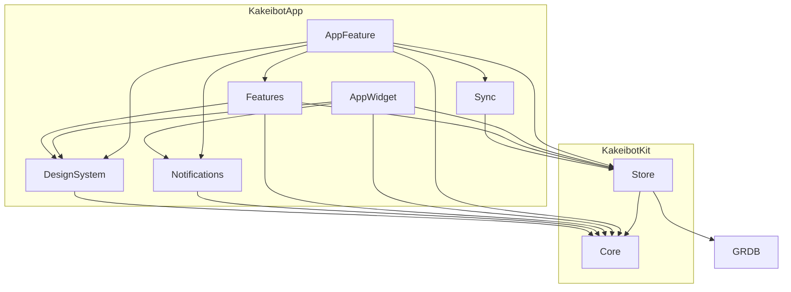

# パッケージの構成

> [!NOTE]
> 2 つのパッケージの依存の向きと、フォルダごとの中身が分かる。
> 全体の構成は [architecture](architecture.md) にある。

## 📦 パッケージ

2 つのパッケージの中身は、次のとおりである。共通の形に無い `Store/Snapshot/`・`Store/Sync/`・`Sync`・`TestSupport` を足している。

依存の向きは、共通の形に次の 2 本を足したものである。

- `AppFeature --> Sync --> Store`
- `AppFeatureTests・FeaturesTests --> TestSupport`

テストのターゲットを除いた依存は、次の図のとおりである。



### KakeibotKit

KakeibotKit のフォルダは、次の木のとおりである。

```text
KakeibotKit/
├── Sources/
│   ├── Core/
│   │   ├── Concepts/
│   │   │   ├── App/
│   │   │   ├── Budget/
│   │   │   ├── Category/
│   │   │   ├── Date/
│   │   │   ├── Entry/
│   │   │   ├── Export/V1/
│   │   │   ├── Icon/
│   │   │   ├── Notification/
│   │   │   ├── Receipt/
│   │   │   ├── Recurring/
│   │   │   ├── Review/
│   │   │   ├── Reward/
│   │   │   ├── Setting/
│   │   │   ├── Theme/
│   │   │   ├── Voice/
│   │   │   └── Wallet/
│   │   └── Shared/
│   └── Store/
│       ├── Database/
│       ├── Migrations/
│       ├── Queries/
│       │   ├── Methods/
│       │   └── Types/
│       ├── Records/
│       │   ├── Protocols/
│       │   ├── Rows/
│       │   ├── SettingKeys/
│       │   └── Values/
│       ├── Snapshot/
│       ├── Sync/
│       │   ├── Methods/
│       │   └── Types/
│       └── Writes/
│           ├── Methods/
│           └── Types/
└── Tests/
```

フォルダごとの中身は、次のとおり。

| フォルダ | 中身 |
| --- | --- |
| `Concepts/App/` | アプリの版 |
| `Concepts/Budget/` | 予算と消化 |
| `Concepts/Category/` | 記録のカテゴリとタグ |
| `Concepts/Date/` | LocalDate、期間の区切り、祝日、休日のずらし |
| `Concepts/Entry/` | 記録と品目、金額の電卓、日ごとのまとめ |
| `Concepts/Export/V1/` | 書き出しの形 |
| `Concepts/Icon/` | アイコンとスタンプ |
| `Concepts/Notification/` | 予約されているべき通知の計算と行き先 |
| `Concepts/Receipt/` | 文字の断片をレシートの行にまとめ、行かモデルが答えた行の役割から品目・合計・日付・店名を組み立てる決まり。人が直した品名 |
| `Concepts/Recurring/` | 固定費と記録漏れの後追い |
| `Concepts/Review/` | 振り返りの範囲と集計 |
| `Concepts/Reward/` | ごほうびと貯金箱 |
| `Concepts/Setting/` | 設定の値 |
| `Concepts/Theme/` | テーマの色・書体・形 |
| `Concepts/Voice/` | 話した文から金額・日付・カテゴリ・口座・メモを読む決まり |
| `Concepts/Wallet/` | 財布と残高 |
| `Core/Shared/` | 概念をまたいで使う型。型付きの ID、割合、下書きの問題 |
| `Store/Queries/`・`Store/Sync/`・`Store/Writes/` | `Methods/` に `AppDatabase+*.swift` の拡張、`Types/` にそれ以外の型を置く |
| `Store/Queries/Methods/` | 返す型の名前で付ける。書き込みと同じ型なら `+<型>Query` |
| `Store/Records/` | 表の行・設定のキー・列の値の適合 |
| `Store/Migrations/` | `MigrationV<3 桁の通し番号>.swift`。欠番は 14 |
| `Store/Database/` | 最初の財布とカテゴリも作る。止める通知は AppFeature が送る |
| `Store/Snapshot/` | 書き出し用の全データの読み出し、読み込み用の全置き換え |
| `Store/Sync/` | 同期で送る行の記録と、受け取った行の書き込み |
| `Store/Writes/` | ウィジェットからの記録と取り消しも含む |

### KakeibotApp

KakeibotApp のフォルダは、次の木のとおりである。

```text
KakeibotApp/
├── Sources/
│   ├── AppFeature/
│   │   ├── App/
│   │   ├── Bridge/
│   │   └── Main/
│   ├── AppWidget/
│   │   ├── Intents/
│   │   ├── Shared/
│   │   └── Widgets/
│   │       ├── Budget/
│   │       ├── EntryControl/
│   │       └── QuickRecord/
│   ├── DesignSystem/
│   │   ├── Components/
│   │   └── Theme/
│   ├── Features/
│   │   ├── Screens/
│   │   │   ├── Entry/
│   │   │   ├── Onboarding/
│   │   │   ├── Pro/
│   │   │   ├── Settings/
│   │   │   ├── Tabs/
│   │   │   └── WhatsNew/
│   │   └── Shared/
│   │       ├── Bill/
│   │       ├── DateChoice/
│   │       ├── EntryList/
│   │       ├── FeatureArt/
│   │       ├── Model/
│   │       ├── Notice/
│   │       ├── Notification/
│   │       ├── Period/
│   │       ├── Placeholder/
│   │       ├── Pro/
│   │       ├── SettingsParts/
│   │       ├── Setup/
│   │       ├── Stamp/
│   │       └── Wallet/
│   ├── Notifications/
│   └── Sync/
└── Tests/
```

フォルダごとの中身は、次のとおり。

| フォルダ | 中身 |
| --- | --- |
| `AppFeature/App/` | アプリの入口と起動、起動の印の動き、入力の準備、レビューのお願い。Pro が無くなったら同期を止める |
| `AppFeature/Bridge/` | Pro の購入を StoreKit で確かめる。同期の口座と参加者を CloudKit で読む |
| `AppFeature/Main/` | 4 つのタブと入力シートなどのシートを組む |
| `AppWidget/Intents/` | すぐ記録の記録と取り消し、コントロールの「記録する」 |
| `AppWidget/Shared/` | ウィジェットをまたいで使う読み出し・書体・テーマ・タイムライン |
| `AppWidget/Widgets/` | ウィジェットごとのフォルダ。コントロールの「記録する」は `EntryControl/` |
| `Features/Screens/Entry/` | 記録の入力シート |
| `Features/Screens/Entry/Receipt/` | レシートを VisionKit で撮り、Vision と Foundation Models で読む |
| `Features/Screens/Entry/Voice/` | 声を SpeechAnalyzer で聞き、Foundation Models でカテゴリと口座を選ぶ |
| `Features/Screens/Onboarding/` | 最初の設定のチュートリアル |
| `Features/Screens/Pro/` | Pro の画面と購入のモデル |
| `Features/Screens/Settings/` | 設定の項目ごとの画面。Menu は入口と、確かめ用のテストデータ（`#if DEBUG`） |
| `Features/Screens/Tabs/` | Assets・Home・Records・Review |
| `Features/Screens/WhatsNew/` | お知らせの版と機能の一覧と、それを並べるシート |
| `Features/Shared/Bill/` | これからの引き落としの行・月のページとタブ・見込みと確定の印と、その言葉 |
| `Features/Shared/DateChoice/` | 月の始まりの日・休日のずらし・曜日を選ぶ部品と、その表示の名前 |
| `Features/Shared/EntryList/` | 記録の一覧の検索と絞り込み、一覧の行に出す値 |
| `Features/Shared/FeatureArt/` | お知らせと Pro で機能を見せる絵（レシート・伝票・iPhone の枠・見本）と、縮める枠 |
| `Features/Shared/Model/` | 画面のモデルの見張りの形（失敗したら見張り直す） |
| `Features/Shared/Notice/` | 記録・削除の知らせと取り消し、保存の失敗が空き容量不足かの見分け。ファイルの頭は、元の型ごとに分かれる |
| `Features/Shared/Notification/` | 通知の許可の窓口と、許可が無いときの帯 |
| `Features/Shared/Period/` | 期間の範囲と月の始まり、期間を送る行と今に戻るボタン |
| `Features/Shared/Placeholder/` | タブで記録が無いときと読み込めないときの表示。設定の一覧が空なら `SettingsParts/Hint/` の `SettingsEmptyNote` を使う |
| `Features/Shared/Pro/` | Pro を買ったかと、止めた所の下に出すカード。StoreKit の中身は AppFeature が渡す |
| `Features/Shared/SettingsParts/` | 設定の画面で使う部品（Board・Header・Hint・Icon・Input・Layout・Tile） |
| `Features/Shared/Setup/` | 残りの設定とカスタマイズの項目と進み具合 |
| `Features/Shared/Stamp/` | 押したスタンプの数のカードと、押した日の一覧のシート |
| `Features/Shared/Wallet/` | 口座の役割ごとの、残高に添える言葉と額の色。資産のタブと設定の口座で使う |
| `Sync/` | CKSyncEngine で変更を送り受けする。財布の共有、共有シート、共有の受け入れも作る |
| `Tests/TestSupport/` | テストの補助。観測している値が変わるのを、上限の時間まで待つ |

画面ごとのフォルダは、[architecture-screens の「画面とフォルダ」](architecture-screens.md#-画面とフォルダ)にある。名前の決まりと、概念ごとの置き場所は、[architecture-naming](architecture-naming.md) にある。
