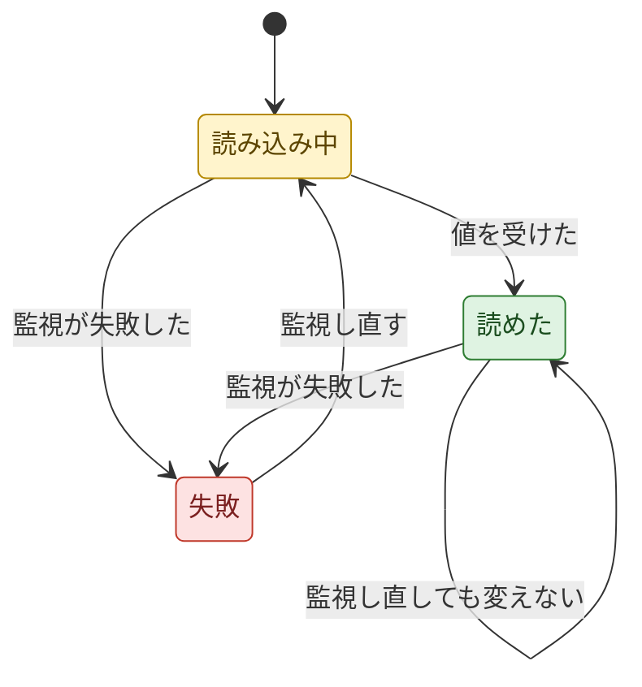

# 共通の部品の一覧

> [!NOTE]
> 複数の画面で使う仕組みの名前、使いどころ、置き場所が分かる。
> 設定の一覧の足し方は [architecture-parts-settings](architecture-parts-settings.md) にある。State の組み方は [architecture-parts-state](architecture-parts-state.md) にある。保存・並べ替え・非表示の共通の関数は [architecture-parts-writes](architecture-parts-writes.md) にある。
> 全体の構成は [architecture](architecture.md)、名前の付け方は [architecture-naming](architecture-naming.md) にある。

## 🪝 プロトコル

次の `Shared/` に置くプロトコルは、すべてここに載せる。置き場所は `FeatureModels`・`Features`・`Core` の 3 つである。

| 仕組み | 使いどころ | 置き場所 |
| --- | --- | --- |
| `ScreenModel` | 画面のモデル。DB を監視し、読めなかった時は `NoticeHolding` の知らせと `Loadable` の `failed` に出す | `FeatureModels/Shared/Model/` |
| `NoticeHolding` | エラーの知らせを持つ、モデルの状態。状態がそれだけの時は `NoticeState` を使う | `FeatureModels/Shared/Model/` |
| `NoticesHolding` | 知らせを `notices` の枠に持つ状態。`errorNotice` は `notices.error` を返す | `FeatureModels/Shared/Model/` |
| `ScreenNotices` | `notices` の枠の型。エラーの知らせを `error` で持つ | `FeatureModels/Shared/Model/` |
| `ScreenPerforming` | 画面がモデルの async の関数を呼ぶ口。`perform` が `Task` を始め、画面は `Task` を書かない | `FeatureModels/Shared/Model/` |
| `SettingSaving` | 設定の値を保存するモデル。失敗したら値を戻す | `FeatureModels/Shared/Model/` |
| `SettingsBoardModel` | 並べ替え・非表示・削除のできる、設定の一覧のモデル | `FeatureModels/Shared/SettingsParts/Board/Model/` |
| `SettingsBoardListModel` | 一覧を DB から読み、監視するモデル。`SettingsBoardPage` に載せる画面は、これに適合させる | `FeatureModels/Shared/SettingsParts/Board/Model/` |
| `SettingsBoardDatabaseModel` | `ScreenParts` だけで作れる一覧のモデル。`SettingsBoardSpec` の `makeModel()` の既定の実装を使える | `FeatureModels/Shared/SettingsParts/Board/Model/` |
| `SettingsBoardState` | 一覧のモデルの状態で、並べ替え中の並び（`SettingsBoardFields`）・知らせ・出している物を持つ。それだけの時は `SettingsBoardMovingState` を使う | `FeatureModels/Shared/SettingsParts/Board/Model/` |
| `SettingsBoardInput` | 一覧のモデルの入力で、DB から読んだ一覧と、説明カード・非表示の一覧を閉じたかを持つ。それだけの時は `SettingsBoardSnapshotInput` を使う | `FeatureModels/Shared/SettingsParts/Board/Model/` |
| `SettingsBoardOutput` | 一覧のモデルの出力。出す行・非表示の行・並べ替え中の行を出す | `FeatureModels/Shared/SettingsParts/Board/Model/` |
| `SettingsBoardSpec` | 一覧の画面ごとの設定（題・文言・並びの形・タイル・編集画面・確認）。画面ごとに 1 つ書く | `Features/Shared/SettingsParts/Board/` |
| `SettingsFoldModel` | 説明カードと非表示の一覧を閉じたかを、DB から読み書きするモデル。値は `input` の `SettingsFoldInput` に置き、モデルは `foldStore()` だけ書く | `FeatureModels/Shared/SettingsParts/Hint/` |
| `SettingsEditSheet` | 1 件を編集する画面。モデルと、削除・非表示の受け取りだけで作れる | `Features/Shared/SettingsParts/Input/` |
| `ScreenEditable` | 画面が書いてよい値の型の印。Swift の `public var` は `fields` と `presented` だけにする（[決まり](architecture-screens-flow.md#-画面がモデルに書く値)） | `FeatureModels/Shared/Model/`・`featuremodels/shared/model/` |
| `TabScreenModel` | タブ 4 つの監視と、失敗の画面を出すかを持つ。今日は iOS の `MainView` と Kotlin の `rememberTabModel` から受ける | `FeatureModels/Shared/Model/`・`featuremodels/shared/model/` |
| `EditFlowSource` | `EditFlow` に渡す元で、変わったか・問題の文・保存・非表示・削除を返す。モデルの入れ子の `Source` が state・input・依存を持ち、流れは作る時に受けて強く持つ | `FeatureModels/Shared/Model/`・`featuremodels/shared/model/` |
| `NamedIconDraft` | 名前とアイコンを持つ下書き（カテゴリ・口座）。アイコンの下書きと、名前とアイコンの問題を共通にする | `Core/Shared/` |
| `WidgetFallbackEntry` | ウィジェットの項目。読めなかった時の空と、見本を返す | `AppWidget/Shared/` |
| `WidgetTimelineProvider` | ウィジェットの提供元。`timeline(at:isPreview:)` だけ書けば、残りは既定の実装を使える | `AppWidget/Shared/` |
| `Draft` | 保存前の下書き。`problems` を返し、`validate()` が最初の問題を投げる | `Core/Shared/` |

## 📱 モデルから画面へ返す型

モデルの `state` に置き、画面が変化を受ける型である。受け方は、[architecture-screens-flow の「モデルから画面へ結果を返す」](architecture-screens-flow.md#️-モデルから画面へ結果を返す)にある。

| 仕組み | 使いどころ | 置き場所 |
| --- | --- | --- |
| `ScreenOutcome` | 保存できた・消した、の結果を 1 つ持つ。等しさは通し番号で比べる | `FeatureModels/Shared/Model/` |
| `EditFlow.Outcome` | 編集シートの結果。保存した値・非表示にしたか・消した物・閉じるかを持つ | `FeatureModels/Shared/Model/`・`featuremodels/shared/model/` |
| `SettingsBoardNotices` | 設定の一覧の `notices` の枠。エラー（`error`）と消した物（`removed`）を持つ | `FeatureModels/Shared/SettingsParts/Board/` |
| `SettingsBoardRemoved` | 設定の一覧で、非表示にした行と消した物の `UndoNotice`、まとめて消した結果を持つ。子の画面の結果は、モデルの `receive`・`receiveHidden` で受ける | `FeatureModels/Shared/SettingsParts/Board/` |
| `onOutcome` | 画面が `ScreenOutcome` の変化を受ける modifier | `Features/Shared/Model/` |
| `MainOutcomeSignal` | `MainView` が結果を受ける、見えない画面。`MainView` の `body` は、結果の値を読まずに済む | `AppFeature/Main/` |

## 🗺️ 画面の部品

| 仕組み | 使いどころ | 置き場所 |
| --- | --- | --- |
| `SettingsBoardPage` | 設定の一覧の画面の全体で、`SettingsBoardSpec` を受け取り、モデルと監視を持つ。行き先と確認は、モデルの `presented` から読む | `Features/Shared/SettingsParts/Board/` |
| `SettingsBoardLayout` | 一覧の並びの形。`tiles`（タイル）、`swipeCards`（幅を測って置く、横に払える行）、`swipeRows`（横に払える行） | `Features/Shared/SettingsParts/Board/` |
| `SettingsConfirmation` | 行を非表示・削除する前の確認の文言。`SettingsBoardSpec` が返す | `Features/Shared/SettingsParts/Board/` |
| `SettingsBoardDestination` | 新規と編集だけの行き先。`SettingsBoardMovingState` が使い、`SettingsBoardSpec` の既定の実装がある | `FeatureModels/Shared/SettingsParts/Board/` |
| `SettingsBoardShown` | 一覧の画面が出している物。行き先・開いている行・確認（`SettingsBoardPrompt`）を持つ | `FeatureModels/Shared/SettingsParts/Board/` |
| `Shown` | 出している物（シート・確認・メニュー・パネル）を 1 つの値で持つ。Swift は確認に `shown[.delete]` で `Binding` を渡す | `FeatureModels/Shared/Model/`・`featuremodels/shared/model/` |
| `ModelTask` | 保存などの実行中の印。`attempt` は実行中でも走らせ、二度押しは呼ぶ側が `isRunning` で止める | `FeatureModels/Shared/Model/`・`featuremodels/shared/model/` |
| `Loadable` | 読み込み中・読めた・失敗を 1 つの値で持ち、値と読んだ印を組にしない。監視し直す時は、失敗だけを読み込み中に戻す | `FeatureModels/Shared/Model/`・`featuremodels/shared/model/` |
| `UndoNotice` | 取り消しの知らせの値と、消すまでの時間（既定は 4 秒）を持ち、`ScreenWait` で数える。`show` に秒を渡せ、`EntryNoticeModel` が知らせごとの秒に使う | `FeatureModels/Shared/Model/`・`featuremodels/shared/model/` |
| `ErrorNotice` | エラーの知らせの文・色・出した数と、消すまでの 6 秒を持ち、`show`・`inform`・`clear` で変える。時間は `ScreenWait` で数え、Kotlin は `ModelTask` の失敗もここに出す | `FeatureModels/Shared/Model/`・`featuremodels/shared/model/` |
| `ScreenWait` | モデルの待ちで、`after` が時間の後に処理を動かし、`lasting` が部品の既定の長さを画面ごとに変える。テストは手で進める `ManualWait` を渡す | `FeatureModels/Shared/Model/`・`featuremodels/shared/model/` |
| `ObservationRound` | 監視をやり直す回で、`MainModel` が 1 つ持つ。`restart` で進め、`each` が回ごとに監視を始め直す | `FeatureModels/Shared/Model/`・`featuremodels/shared/model/` |
| `EditFlow` | 編集シートの流れの子のモデル。確認の `Shown`・`ModelTask`・保存の題・結果を持ち、モデルが `flow` で持つ | `FeatureModels/Shared/Model/`・`featuremodels/shared/model/` |
| `editSheet`・`EditSheet` | 編集シートの確認一式と結果の受け取り。Swift は `dismiss` を呼ぶ modifier、Kotlin は `onClose` と戻るを持つ | `Features/Shared/Model/`・`features/shared/model/` |
| `undoNotice`・`SettingsUndoNotice` | `UndoNotice` を出す画面の部品。削除の文は、Swift は `deletionNotice` が作る | `Features/Shared/Notice/`・`features/shared/settingsparts/board/` |
| `errorBanner`・`noticeBanner` | `ErrorNotice` を出す画面の部品。時間は数えず、押すと `clear` を呼ぶ | `Features/Shared/Notice/`・`designsystem/components/notice/` |
| `tabScreen`・`TabScreen` | タブの外枠で、失敗の画面を持つ。Kotlin は監視と、知らせの入れ替えで消す所も持つ | `Features/Shared/Model/`・`features/shared/tab/` |
| `SettingsBoardScreen` | `SettingsBoardPage` の中で使う、設定の一覧の外枠。説明カード・タイルの並び・追加ボタンを組む | `Features/Shared/SettingsParts/Board/` |
| `PageSlideReader` | 頁めくりの入れ物。動きの値を中に持って中身に `PageSlideProxy` を渡し、画面は値を持たない | `DesignSystem/Components/Navigation/` |
| `PageSlideProxy` | 頁めくりの口。`pageSlide` と `onPageSwipe` に渡し、ボタンからは `run(forward:)` で頁を送る | `DesignSystem/Components/Navigation/` |
| `ResizingPager` | 横に送る頁の入れ物。送っている途中も、隣の頁との間で高さをなめらかに変える | `DesignSystem/Components/Navigation/` |

`Loadable` の値は、監視の中で次のように移る。

