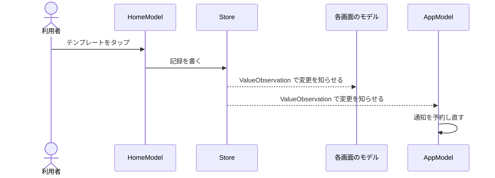

# 画面とモデルの流れ

> [!NOTE]
> 画面とモデルのあいだの呼び出しと結果の流れと、監視・起動・外から開く時の流れが分かる。
> 画面の組み立てと画面のフォルダは [architecture-screens](architecture-screens.md) にある。

## 📱 画面からモデルを呼ぶ

ボタンなどの同期の場所からモデルの async の関数を呼ぶ時は、モデルの `perform` を使う。画面に `Task` を書かない。

```diff
-Task {
-    await model.save()
-}
+model.perform {
+    await $0.save()
+}
```

| 項目 | 決まり |
| --- | --- |
| 口 | `ScreenPerforming` の `perform` |
| 適合 | `ScreenModel` と設定の共通のモデルは、初めから適合している。ほかのモデルは、型に適合を書く |
| 始まり | `perform` を呼んだ関数が戻ってから始まる。続けて呼ぶと、呼んだ順に始まる |
| 持ち主 | 始めた `Task` は誰も持たず、取り消さない。終わるまでモデルを持つ |
| 順に呼ぶ | 同じモデルの関数を順に呼ぶ時は、1 つの `perform` の中に並べる |
| テスト | `perform` が返す `Task` の `value` を待つ |
| `.task` | 画面が出た時と値が変わった時の読み込みは、`.task` と `task(id:)` に書く |

## 📏 画面がモデルに書く値

画面が書く入口は、モデルの `state` の `fields` と `presented` の枠だけにする。枠の一覧は [architecture-parts-state の「State の枠」](architecture-parts-state.md#️-state-の枠)にある。ほかの枠と値は画面から書けない型にし、変える時はモデルの関数を呼ぶ。

| 項目 | 決まり |
| --- | --- |
| `fields` | 入力と選んでいる物を、`ScreenEditable` の `Fields` に入れる。モデルが読む物に限る |
| `presented` | 表示中のものを、`Presented` に `Shown<値>` を名前で並べて持つ。例は `presented.sheet`・`presented.row` |
| `notices` | 時間で消える知らせは、モデルが `notices` に出し、時間もモデルが `ScreenWait` で数える。画面は `.task` で時間を数えない |
| 渡し方 | シートには `presented.x.item` を、確認には `presented.x[.y]` を渡す。入力は `Bindable(model.state).fields.x` で渡す |
| ほかの値 | `public internal(set)` か `public private(set)` にする。今日は `input` に置き、画面が `setToday` を呼ぶ |
| 画面が見た変化 | ホームの `customize` のように、モデルの関数で渡す。光らせる項目は、モデルが `presented.glow` に出す |
| 条件のある閉じ方 | 種類で閉じ方が違う時は、`Shown<値>` の制約付きの extension に `get`・`set` を書く。記録の `sheet`、資産の `goal` が当たる |
| Kotlin | どの枠も `private set` か `val` にし、画面が書く値は State の関数か `Shown` の関数を通す |
| 守らせ方 | `Features` と `AppFeature` は別のモジュールである。`internal(set)` の値への書き込みは、ビルドで止まる |

## 🖥️ モデルから画面へ結果を返す

保存できた・消した、の結果は、モデルの `state` の `outcome` に置く。画面は、関数の戻り値を見ない。

| 項目 | 決まり |
| --- | --- |
| 置く型 | `ScreenOutcome<値>`。同じ値を続けて置いても、変化として届く |
| 置く時 | モデルの関数が、できた時だけ置く。1 回の操作で 1 回だけ置き、戻り値でも同じ結果を返す |
| 受ける所 | 画面は、`onOutcome` を 1 か所に書く。閉じる・親に知らせるだけを書く |
| 閉じた後 | 閉じた画面には、結果が届かない |
| 編集シート | 結果は `EditFlow` の `Outcome` で持つ。`editSheet` が受ける |
| 知らせと確認 | 取り消し・エラーの知らせの値と、結果で出す確認は、モデルが `state` の値を書いて出す。知らせは `UndoNotice`・`ErrorNotice` が時間も数え、画面は見せるだけにする |
| 子の画面の結果 | 親の画面は親の `state` に直に書かず、親のモデルの `receive`・`receiveHidden` に渡す。設定の一覧・メインのタブ・テーマの一覧・入力シート（Android は `receiveTemplate` も）が当たる |
| 結果が何種類もある画面 | 結果を 1 つの `enum` にして、`ScreenOutcome` に入れる。入力シートの `EntryModel.Outcome` が当たる |
| 読み込みの後 | `.task` は、モデルの `start` だけを呼ぶ。読み込みの後に画面の値を組む時は、モデルが結果を置く |
| 待ってから出す | 画面の動きを待つ時間は、モデルが待ってから結果を置く。レシートの品目のシートが当たる |
| 残る `Task` | `Features` では、指の動きを追う `SettingsDrag` と `SettingsAutoScroll` だけが持つ |
| メインの画面 | シートとタブは `MainModel` が持ち、閉じる時間を待って切り替える。レビューの依頼は `AppReviewModel` が待つ |

## 🪝 監視のやり直し

DB の監視（`ValueObservation`）が止まった時は、次の決まりで監視し直す。

| 対象 | 動き |
| --- | --- |
| 各画面の監視 | 失敗したら、1 秒・2 秒・4 秒待って監視し直す。3 回を超えたら知らせを出して止める |
| AppModel の監視 | テーマ・ウィジェット・通知を監視する。同じ待ちで監視し直し、止まった時は知らせを出さない |
| Pro の監視 | AppModel が StoreKit の購入の状態を監視し、Pro が無くなったら同期を止める。監視のやり直しはしない |
| 回数 | 1 回の監視の中で数え、値を受けても戻さない |
| RootView | DB が使えるかどうかと今日が変わるたびに、AppModel の監視を始め直す |
| 前面に戻った時 | MainModel が `changeScene` で `ObservationRound` を進め、各画面の監視を始め直す。AppModel は `changeScene` で、止まった監視だけを始め直す |
| タブの監視 | MainView が `ObservationRound` の `each` で、タブ 4 つとはじめの案内をまとめて監視する。失敗の画面の「もう一度読み込む」も回を進める |
| 裏に回った印 | モデルの `ForegroundReturn` が覚え、inactive を挟んで戻っても検出する。Android は `ON_STOP` を裏とする |
| 止まった画面 | ホーム・記録・振り返り・資産は、「読めませんでした」と「もう一度読み込む」を出す |

## 🗄️ 保存から反映まで

テンプレートから記録した時に、各画面と通知へ反映されるまでの流れである。



AppModel は、今日からの記録と支出なしの印、通知の時刻、固定費を監視する。どれかが変わると、記録忘れの通知と固定費の更新前の通知を予約し直す。

## 🚀 起動と画面復帰

共通の表の処理に加えて、起動・前面に戻る・日付が変わる時に、固定費の記録漏れを作る。`0xdead10cc` で終了しないことは、実機で書き込みの最中に裏に回して確かめた。

## 🪟 外からの入口

外から開く入口と、その開く先は次のとおりである。

| 入口 | 開く先 |
| --- | --- |
| ウィジェット | ホーム |
| すぐ記録の金額を決めていないテンプレート | 入力シート（そのテンプレート） |
| すぐ記録の「＋ 記録する」 | 入力シート（今日） |
| テンプレートが無い時のすぐ記録 | テンプレートの追加 |
| すぐ記録の「レシート」 | 入力シート（今日）を開き、レシートの読み取りを始める |
| コントロールの「記録する」 | 入力シート（今日） |
| 記録忘れの通知 | 入力シート（今日） |
| 固定費の更新前の通知 | 設定 → 固定費 → その固定費 |

行き先は、通知と同じ `PlannedNotification.Route` で表す。ウィジェットからは、行き先の文字列を `kakeibot://home` のような URL にして渡す。起動した時は、起動画面が消えてから行き先を開き、起動時に開く画面は開かない。

コントロールの「記録する」は、AppIntent をアプリの中で動かす。行き先は `NotificationRouter` に渡す。このインテントのため、`Kakeibot` も AppWidget と AppIntents.framework をつなぐ。
