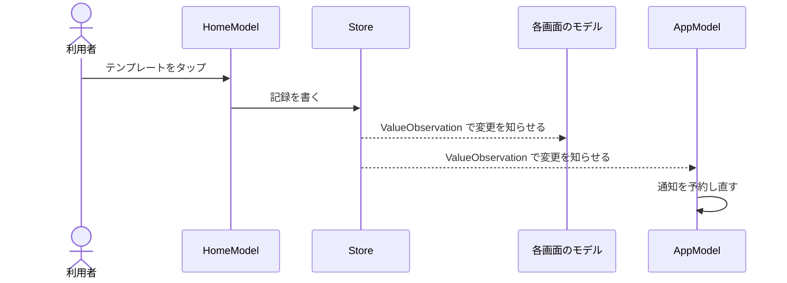

# 画面とモデルの流れ

> [!NOTE]
> 画面とモデルのあいだの呼び出しと結果の流れと、見張り・起動・外から開く時の流れが分かる。
> 画面の組み立てと画面のフォルダは [architecture-screens](architecture-screens.md) にある。

## 📱 画面からモデルを呼ぶ

ボタンなどの同期の場所からモデルの async の関数を呼ぶ時は、モデルの `perform` を使う。画面に `Task` を書かない。

```swift
model.perform {
    await $0.save()
}
```

| 項目 | 決まり |
| --- | --- |
| 口 | `ScreenPerforming` の `perform` |
| 適合 | `ScreenModel` と設定の共通のモデルは、初めから適合している。ほかのモデルは、型に適合を書く |
| 始まり | `perform` を呼んだ関数が戻ってから始まる。続けて呼ぶと、呼んだ順に始まる |
| 持ち主 | 始めた `Task` は誰も持たず、取り消さない。終わるまでモデルを持つ |
| 順に呼ぶ | 同じモデルの関数を順に呼ぶ時は、1 つの `perform` の中に並べる |
| テスト | `perform` が返す `Task` の `value` を待つ |
| `.task` | 画面が出た時と値が変わった時の読み込みは、`.task` と `task(id:)` に書く |

## 🖥️ モデルから画面へ結果を返す

保存できた・消した、の結果は、モデルの `state` の `outcome` に置く。画面は、関数の戻り値を見ない。

| 項目 | 決まり |
| --- | --- |
| 置く型 | `ScreenOutcome<値>`。同じ値を続けて置いても、変化として届く |
| 置く時 | モデルの関数が、できた時だけ置く。1 回の操作で 1 回だけ置き、戻り値でも同じ結果を返す |
| 受ける所 | 画面は、`onOutcome` を 1 か所に書く。閉じる・親に知らせるだけを書く |
| 閉じた後 | 閉じた画面には、結果が届かない |
| 編集シート | 結果は `SettingsEditOutcome` で持つ。`SettingsEditController` の `receive` が受ける |
| 知らせと確認 | 取り消しの知らせの値と、結果で出す確認は、モデルが `state` の値を書いて出す |
| 結果が何種類もある画面 | 結果を 1 つの `enum` にして、`ScreenOutcome` に入れる。入力シートの `EntryModel.Outcome` が当たる |
| 読み込みの後 | `.task` は、モデルの `start` だけを呼ぶ。読み込みの後に画面の値を組む時は、モデルが結果を置く |
| 待ってから出す | 画面の動きを待つ時間は、モデルが待ってから結果を置く。レシートの品目のシートが当たる |
| 残る `Task` | `Features` では、指の動きを追う `SettingsDrag` と `SettingsAutoScroll` だけが持つ |
| メインの画面 | シートとタブは `MainModel` が持ち、閉じる時間を待って切り替える。レビューの依頼は `AppReviewModel` が待つ |

## 🪝 見張り直し

見張りが止まったときの見張り直しは、次の決まりで動く。

| 対象 | 動き |
| --- | --- |
| 各画面の見張り | 失敗したら、1 秒・2 秒・4 秒待って見張り直す。3 回を超えたら知らせを出して止める |
| AppModel の見張り | テーマ・ウィジェット・通知を見張る。同じ待ちで見張り直し、止まったときは知らせを出さない |
| Pro の見張り | AppModel が StoreKit の購入の状態を見張り、Pro が無くなったら同期を止める。見張り直しはしない |
| 回数 | 1 回の見張りの中で数え、値を受けても戻さない |
| RootView | DB が使えるかどうかと今日が変わるたびに、AppModel の見張りを張り直す |
| 前面に戻った時 | MainModel が `changeScene` で各画面の見張りを始め直す。AppModel は `changeScene` で、止まった見張りだけを始め直す |
| 裏に回った印 | モデルの `ForegroundReturn` が覚え、inactive を挟んで戻っても検出する。Android は `ON_STOP` を裏とする |
| 止まった画面 | ホーム・記録・振り返り・資産は、「読めませんでした」と「もう一度読み込む」を出す |

## 🗄️ 保存から反映まで

テンプレートから記録した時に、各画面と通知へ反映されるまでの流れである。



AppModel は、今日からの記録と支出なしの印、通知の時刻、固定費を見張る。どれかが変わると、記録忘れの通知と固定費の更新前の通知を予約し直す。

## 🚀 起動と画面復帰

共通の表の処理に加えて、起動・前面に戻る・日付が変わる時に、固定費の記録漏れを作る。`0xdead10cc` で終了しないことは、実機で書き込みの最中に裏に回して確かめた。

## 🪟 外からの入口

外から開く入口と、その開く先は次のとおりである。

| 入口 | 開く先 |
| --- | --- |
| ウィジェット | ホーム |
| すぐ記録の金額を決めていないテンプレート | 入力シート（そのテンプレート） |
| すぐ記録の「＋ 記録する」 | 入力シート（今日） |
| テンプレートが無い時のすぐ記録 | テンプレートの追加 |
| すぐ記録の「レシート」 | 入力シート（今日）を開き、レシートの読み取りを始める |
| コントロールの「記録する」 | 入力シート（今日） |
| 記録忘れの通知 | 入力シート（今日） |
| 固定費の更新前の通知 | 設定 → 固定費 → その固定費 |

行き先は、通知と同じ `PlannedNotification.Route` で表す。ウィジェットからは、行き先の文字列を `kakeibot://home` のような URL にして渡す。起動したときは、起動画面が消えてから行き先を開き、起動時に開く画面は開かない。

コントロールの「記録する」は、AppIntent をアプリの中で動かす。行き先は `NotificationRouter` に渡す。このインテントのため、`Kakeibot` も AppWidget と AppIntents.framework をつなぐ。
