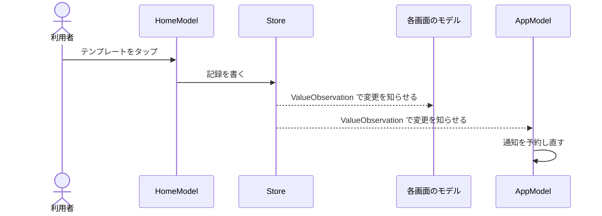

# 画面の組み立て

> [!NOTE]
> 画面をどう組み立て、保存した変更をどう画面へ届けるかが分かる。通知とウィジェットの方式と、画面のフォルダもここにある。
> 全体の構成は [architecture](architecture.md) にある。

## 📱 画面の組み立て

AppModel と MainView は、共通の形に加えて、次のものを持つ。

| 型 | 持つもの |
| --- | --- |
| AppModel | 最初の設定が済んでいなければ Onboarding を出す。今日は RootView が MainView と Onboarding に渡す |
| AppModel の持ち物 | DB を開く関数・時計・通知・Pro の窓口は、`dependencies` にまとめる。今の時刻は、その時計から受け取る |
| DB と時計の受け渡し | AppModel の `screenParts(for:)` が `ScreenParts` を作り、RootView が渡す。画面は、子の画面とモデルの init へそのまま渡す |
| 子の画面に渡す `ScreenParts` | モデルから開く画面には、モデルの `childParts()` が返す |
| MainView | タブは Home・Records・Review・Assets。起動したときに全部のタブが見張りを始め、全部を読み終えるまで起動画面を出す |
| MainView のタブの切り替え | 開いたことのあるタブを重ねて持ち、見えるかどうかだけを切り替える。`TabView` は切り替えのたびに中身の大きさを測り直して重いため使わない |
| MainView のタブの選択 | `MainModel` の `state` が持ち、`MainTabLayer` とタブの帯（`MainTabBar`）だけが読む。MainView の `body` が読むと、切り替えのたびに 4 つのタブを組み直して重いため読まない |
| MainView のシート | 新規・編集・設定・振替・お知らせなど。テンプレート（`EntryTemplate`）・口座（`Wallet`）・固定費（`Recurring`）も開く |
| MainView の知らせ | 記録・削除の取り消し・失敗の知らせを、タブの帯の上の 1 か所に出す。どれかが出たら他を消し、タブの画面の `errorBanner` は環境の `noticeRound` を進めて消す |
| ReviewView の一手の理由 | 締めた期間のシートを開くと、`task(id:)` で保存した文を読み、渡す事実が変わっていれば書き直す。同じ期間は、セッションの中で 1 度だけ頼み、書けなければ次に開いた時に頼む |
| ReviewView の途中経過 | 今の期間では、シートに `ReviewProgressView` を出し、AI を使わない。期間が変わると、`task(id:)` で一手（`ReviewGoal`）を読み直す |
| ReviewView の締めのレポート | 締めた期間では、シートの頭に `ReviewClosingView` を出す。中身は、開いた時の記録からコードで数える |
| ReviewView の一手 | 今の期間が変わると、`task(id:)` で直前の期間の一手を答え合わせし、次の一手を作る。開いた締めのレポートは、setting の `review_seen_reports` に残す |
| ReviewView のレビューの札 | 記録の数が変わると、`task(id:)` で出すかを決め直す |
| AssetsModel の集計 | MainActor の外で `AssetsSummary` を 1 つずつ組み立て、途中で届いた値は後でまとめて使う。記録の一覧・今日と集計は一緒に差し替える |

記録の一覧（`EntryList`）の見張りは、`AppDatabase` が 1 つだけ持つ。見張りの型は `ValueObservation` で、見張る画面と入力シートのあいだで共有する。中身が変わらない書き込みでは、値を渡さない。

月の集計（`MonthOverview`）と通知の入力（`NotificationInput`）も、この一覧から作る。ほかの表は、小さな問い合わせで足す。

### 画面からモデルを呼ぶ

ボタンなどの同期の場所からモデルの async の関数を呼ぶ時は、モデルの `perform` を使う。画面に `Task` を書かない。

```swift
model.perform {
    await $0.save()
}
```

| 項目 | 決まり |
| --- | --- |
| 口 | `ScreenPerforming` の `perform` |
| 適合 | `ScreenModel` と設定の共通のモデルは、初めから適合している。ほかのモデルは、型に適合を書く |
| 始まり | `perform` を呼んだ関数が戻ってから始まる。続けて呼ぶと、呼んだ順に始まる |
| 持ち主 | 始めた `Task` は誰も持たず、取り消さない。終わるまでモデルを持つ |
| 順に呼ぶ | 同じモデルの関数を順に呼ぶ時は、1 つの `perform` の中に並べる |
| テスト | `perform` が返す `Task` の `value` を待つ |
| `.task` | 画面が出た時と値が変わった時の読み込みは、`.task` と `task(id:)` に書く |

### モデルから画面へ結果を返す

保存できた・消した、の結果は、モデルの `state` の `outcome` に置く。画面は、関数の戻り値を見ない。

| 項目 | 決まり |
| --- | --- |
| 置く型 | `ScreenOutcome<値>`。同じ値を続けて置いても、変化として届く |
| 置く時 | モデルの関数が、できた時だけ置く。1 回の操作で 1 回だけ置き、戻り値でも同じ結果を返す |
| 受ける所 | 画面は、`onOutcome` を 1 か所に書く。閉じる・親に知らせるだけを書く |
| 閉じた後 | 閉じた画面には、結果が届かない |
| 編集シート | 結果は `SettingsEditOutcome` で持つ。`SettingsEditController` の `receive` が受ける |
| 知らせと確認 | 取り消しの知らせの値と、結果で出す確認は、モデルが `state` の値を書いて出す |
| 結果が何種類もある画面 | 結果を 1 つの `enum` にして、`ScreenOutcome` に入れる。入力シートの `EntryModel.Outcome` が当たる |
| 読み込みの後 | `.task` は、モデルの `start` だけを呼ぶ。読み込みの後に画面の値を組む時は、モデルが結果を置く |
| 待ってから出す | 画面の動きを待つ時間は、モデルが待ってから結果を置く。レシートの品目のシートが当たる |
| 残る `Task` | `Features` では、指の動きを追う `SettingsDrag` と `SettingsAutoScroll` だけが持つ |
| `AppFeature` | シートとタブは `MainModel` が持ち、閉じる時間を待って切り替える。レビューの依頼は `AppReviewModel` が待つ |

### 見張り直し

見張りが止まったときの見張り直しは、次の決まりで動く。

| 対象 | 動き |
| --- | --- |
| 各画面の見張り | 失敗したら、1 秒・2 秒・4 秒待って見張り直す。3 回を超えたら知らせを出して止める |
| AppModel の見張り | テーマ・ウィジェット・通知を見張る。同じ待ちで見張り直し、止まったときは知らせを出さない |
| Pro の見張り | AppModel が StoreKit の購入の状態を見張り、Pro が無くなったら同期を止める。見張り直しはしない |
| 回数 | 1 回の見張りの中で数え、値を受けても戻さない |
| RootView | DB が使えるかどうかと今日が変わるたびに、AppModel の見張りを張り直す |
| 前面に戻った時 | MainModel が `changeScene` で各画面の見張りを始め直す。AppModel は `changeScene` で、止まった見張りだけを始め直す |
| 裏に回った印 | モデルの `ForegroundReturn` が覚え、inactive を挟んで戻っても検出する。Android は `ON_STOP` を裏とする |
| 止まった画面 | ホーム・記録・振り返り・資産は、「読めませんでした」と「もう一度読み込む」を出す |

### 保存から反映まで

テンプレートから記録した時に、各画面と通知へ反映されるまでの流れである。



AppModel は、今日からの記録と支出なしの印、通知の時刻、固定費を見張る。どれかが変わると、記録忘れの通知と固定費の更新前の通知を予約し直す。

### 起動と画面復帰

共通の表の処理に加えて、起動・前面に戻る・日付が変わる時に、固定費の記録漏れを作る。`0xdead10cc` で終了しないことは、実機で書き込みの最中に裏に回して確かめた。

### 外からの入口

外から開く入口と、その開く先は次のとおりである。

| 入口 | 開く先 |
| --- | --- |
| ウィジェット | ホーム |
| すぐ記録の金額を決めていないテンプレート | 入力シート（そのテンプレート） |
| すぐ記録の「＋ 記録する」 | 入力シート（今日） |
| テンプレートが無い時のすぐ記録 | テンプレートの追加 |
| すぐ記録の「レシート」 | 入力シート（今日）を開き、レシートの読み取りを始める |
| コントロールの「記録する」 | 入力シート（今日） |
| 記録忘れの通知 | 入力シート（今日） |
| 固定費の更新前の通知 | 設定 → 固定費 → その固定費 |

行き先は、通知と同じ `PlannedNotification.Route` で表す。ウィジェットからは、行き先の文字列を `kakeibot://home` のような URL にして渡す。起動したときは、起動画面が消えてから行き先を開き、起動時に開く画面は開かない。

コントロールの「記録する」は、AppIntent をアプリの中で動かす。行き先は `NotificationRouter` に渡す。このインテントのため、`Kakeibot` も AppWidget と AppIntents.framework をつなぐ。

## 🖥️ 設定画面の説明カード

| 対象 | 決まり |
| --- | --- |
| 中身 | 見出しと、短い説明（`SettingsIntroCard.Note`）を 2 つ以上付ける |
| 閉じる | すべての画面で閉じられる。閉じたかは、画面のモデルの `input` の `SettingsFoldInput` が持つ |
| 渡し方 | 画面が `SettingsFold(\.hint, in: model)` を作り、カードとヘッダーの `hint:` に渡す |
| モデルが DB を持たない画面 | 「アプリアイコン」「ウィジェットの置き方」は、`SettingsHintModel` を子のモデルとして持つ |
| 置き場所 | 見出しとスクロールの間に置き、並べ替えの座標に入れない |
| 見本を固定した画面 | 「文字」「形と動き」は、カードを見本の下のスクロールの先頭に置く |

## 🪟 通知とウィジェット

通知とウィジェットの方式は、次のとおりである。

| 対象 | 方式 |
| --- | --- |
| 記録忘れの通知 | 30 日先まで予約し、当日の記録か支出なしの印ができたら当日分を取り消す |
| 固定費の更新前の通知 | 更新日の N 日前で予約する |
| iOS のウィジェットの読み出し | AppWidget が `AppDatabase.appGroupForReading()` で DB を読むだけで開く。表の形が最新でなければ読まない |
| iOS のウィジェットの読み出しの範囲 | 記録は、今月の 4 か月前の月初か 90 日前の早いほうからと、そこからの固定費・請求月に当たるものだけを読む |
| iOS のウィジェットの描き方 | ホームと同じ `MonthOverview` を使う。背景は、テーマ（`ThemePalette`）の色の値から作った色で描く |
| iOS のウィジェットの更新 | AppModel が、記録・予算・固定費・テンプレートとその並べ順・テーマの変化を見張って更新する。日付が変わるときはタイムラインで切り替える |
| iOS のウィジェットの更新の間隔 | 最後の変化から 1 秒待ち、続けて変わった分を 1 回にまとめる。シートを閉じる動きと重ねないため |
| iOS のウィジェットが読めない時 | 最初のロックの解除の前や移行の前で DB を読めない時は「アプリを開くと出ます」と出し、5 分後に読み直す |
| すぐ記録の書き込み | 押したときだけ、AppIntent が `appGroupForWriting()` で開いて書く。通知を予約し直し、すべてのウィジェットを更新する |
| すぐ記録の反映 | アプリを前面に戻すと、書いた記録が画面に出る |
| DB のファイル保護 | `NSFileProtectionCompleteUntilFirstUserAuthentication` にそろえる。ロック中も、ロック画面のウィジェットが金額を出す |
| DB のバックアップ | App Group の DB は、端末の iCloud バックアップに含まれる |

## 📂 画面とフォルダ

画面のフォルダは、`Features/Screens/` の下にある。一覧の画面は複数形にしてよい。

画面のモデルは、`FeatureModels/Screens/` の下に、同じ形のフォルダで置く。

設定の画面のフォルダは、中のファイルの頭と同じ名前にする。入口の `Menu/` だけは、ファイルの頭を `SettingsMenu` にする。

子フォルダに分けた画面は、`rules/swift-core.md` の役割の子フォルダで分ける。流れの名前のフォルダは、入力シートの `Receipt/` と `Voice/` だけである。`Receipt/` はレシートを撮る・読む・直す流れ、`Voice/` は声を聞く・読む・入れる流れである。

子フォルダに分けている画面は、入力シートと、タブの記録・振り返り・資産である。開くシートが 1 本だけの画面は、`Sheet/` を作らずに `Parts/` へ入れる。振り返りの `ReviewShareSheet` が当たる。

| 画面 | フォルダ |
| --- | --- |
| ホーム | `Tabs/Home/` |
| 記録 | `Tabs/Records/` |
| 振り返り | `Tabs/Review/` |
| 資産 | `Tabs/Assets/` |
| 入力シート | `Entry/` |
| 設定（入口） | `Settings/Menu/` |
| 口座 | `Settings/Wallets/` |
| カテゴリ | `Settings/Categories/` |
| テンプレート | `Settings/Templates/` |
| 予算 | `Settings/Budgets/` |
| 固定費 | `Settings/Recurring/` |
| 月の始まり | `Settings/MonthStartDay/` |
| スタンプ | `Settings/Stamps/` |
| ごほうびの決まり | `Settings/RewardRules/` |
| ホームに出すもの | `Settings/HomeSections/` |
| 起動時に開く画面 | `Settings/LaunchScreen/` |
| 記録忘れの通知 | `Settings/Reminder/` |
| テーマ | `Settings/Themes/` |
| アプリアイコン | `Settings/AppIcons/` |
| 文字・形と動き | `Settings/ThemeStyle/` |
| 同期と共有 | `Settings/Sync/` |
| バックアップ | `Settings/Backup/` |
| ウィジェットの置き方 | `Settings/WidgetGuide/` |
| お知らせ | `WhatsNew/` |
| 最初の設定 | `Onboarding/` |
| Pro | `Pro/` |
