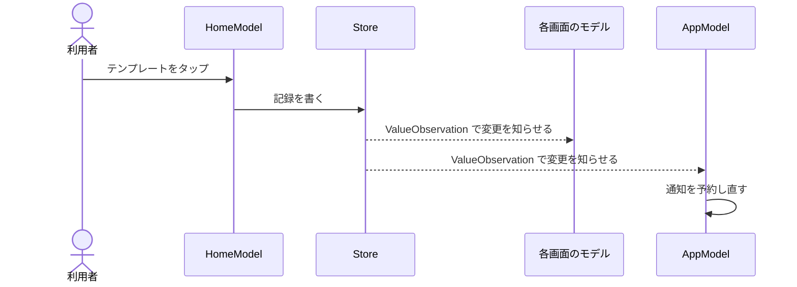

# 画面の組み立て

> [!NOTE]
> 画面をどう組み立て、保存した変更をどう画面へ届けるかが分かる。通知とウィジェットの方式と、画面のフォルダもここにある。
> 全体の構成は [architecture](architecture.md) にある。

## 📱 画面の組み立て

AppModel と MainView は、共通の形に加えて、次のものを持つ。

| 型 | 持つもの |
| --- | --- |
| AppModel | 最初の設定が済んでいなければ Onboarding を出す。今日は RootView が MainView と Onboarding に渡す |
| MainView | タブは Home・Records・Review・Assets。起動したときに全部のタブが見張りを始め、全部を読み終えるまで起動画面を出す |
| MainView のシート | 新規・編集・設定・振替・お知らせなど。テンプレート（`EntryTemplate`）・口座（`Wallet`）・固定費（`Recurring`）も開く |

記録の一覧（`EntryList`）の見張りは、`AppDatabase` が 1 つだけ持つ。見張りの型は `ValueObservation` で、見張る画面と入力シートのあいだで共有する。中身が変わらない書き込みでは、値を渡さない。

月の集計（`MonthOverview`）と通知の入力（`NotificationInput`）も、この一覧から作る。ほかの表は、小さな問い合わせで足す。

### 見張り直し

見張りが止まったときの見張り直しは、次の決まりで動く。

| 対象 | 動き |
| --- | --- |
| 各画面の見張り | 失敗したら、1 秒・2 秒・4 秒待って見張り直す。3 回を超えたら知らせを出して止める |
| AppModel の見張り | テーマ・ウィジェット・通知を見張る。同じ待ちで見張り直し、止まったときは知らせを出さない |
| Pro の見張り | AppModel が StoreKit の購入の状態を見張り、Pro が無くなったら同期を止める。見張り直しはしない |
| 回数 | 1 回の見張りの中で数え、値を受けても戻さない |
| RootView | DB が使えるかどうかと今日が変わるたびに、AppModel の見張りを張り直す |
| 前面に戻った時 | MainView が各画面の見張りを始め直す。AppModel の見張りは、止まったものがあるときだけ RootView が始め直す |
| 裏に回った印 | 裏に回ったことを覚えておき、inactive を挟んで戻っても検出する |
| 止まった画面 | ホーム・記録・振り返り・資産は、「読み込めませんでした」と「もう一度読み込む」を出す |

### 保存から反映まで

テンプレートから記録した時に、各画面と通知へ反映されるまでの流れである。

AppModel は、今日からの記録と支出なしの印、通知の時刻、固定費を見張る。どれかが変わると、記録忘れの通知と固定費の更新前の通知を予約し直す。

### 起動と画面復帰

共通の表の処理に加えて、起動・前面に戻る・日付が変わる時に、固定費の記録漏れを作る。`0xdead10cc` で終了しないことは、実機で書き込みの最中に裏に回して確かめた。

### 外からの入口

外から開く入口と、その開く先は次のとおりである。

| 入口 | 開く先 |
| --- | --- |
| ウィジェット | ホーム |
| すぐ記録の金額を決めていないテンプレート | 入力シート（そのテンプレート） |
| コントロールの「記録する」 | 入力シート（今日） |
| 記録忘れの通知 | 入力シート（今日） |
| 固定費の更新前の通知 | 設定 → 固定費 → その固定費 |

行き先は、通知と同じ `PlannedNotification.Route` で表す。ウィジェットからは、行き先の文字列を `kakeibot://home` のような URL にして渡す。起動したときは、起動画面が消えてから行き先を開き、起動時に開く画面は開かない。

コントロールの「記録する」は、AppIntent をアプリの中で動かす。行き先は `NotificationRouter` に渡す。このインテントのため、`Kakeibot` も AppWidget と AppIntents.framework をつなぐ。

## 🖥️ 設定画面の説明カード

| 対象 | 決まり |
| --- | --- |
| 中身 | 見出しと、短い説明（`SettingsIntroCard.Note`）を 2 つ以上付ける |
| 閉じられるカード | 一覧を編集する画面と、「文字」「形と動き」。`flag` に `hintFlag` を渡し、ヘッダーにも `hint:` を渡す |
| 閉じられないカード | 1 つの設定を選ぶ画面 |
| 見本を固定した画面 | 「文字」「形と動き」は、カードを見本の下のスクロールの先頭に置く |

## 🪟 通知とウィジェット

通知とウィジェットの方式は、次のとおりである。

| 対象 | 方式 |
| --- | --- |
| 記録忘れの通知 | 30 日先まで予約し、当日の記録か支出なしの印ができたら当日分を取り消す |
| 固定費の更新前の通知 | 更新日の N 日前で予約する |
| iOS のウィジェットの読み出し | AppWidget が `AppDatabase.appGroupForReading()` で DB を読むだけで開く。表の形が最新でなければ読まない |
| iOS のウィジェットの読み出しの範囲 | 記録は、今月の 4 か月前の月初か 90 日前の早いほうからと、そこからの固定費・請求月に当たるものだけを読む |
| iOS のウィジェットの描き方 | ホームと同じ `MonthOverview` を使う。背景は、テーマ（`ThemePalette`）の色の値から作った色で描く |
| iOS のウィジェットの更新 | AppModel が、記録・予算・固定費・テンプレートとその並べ順・テーマの変化を見張って更新する。日付が変わるときはタイムラインで切り替える |
| すぐ記録の書き込み | 押したときだけ、AppIntent が `appGroupForWriting()` で開いて書く。通知を予約し直し、すべてのウィジェットを更新する |
| すぐ記録の反映 | アプリを前面に戻すと、書いた記録が画面に出る |
| DB のファイル保護 | `NSFileProtectionCompleteUntilFirstUserAuthentication` にそろえる。ロック中も、ロック画面のウィジェットが金額を出す |
| DB のバックアップ | App Group の DB は、端末の iCloud バックアップに含まれる |

## 📂 画面とフォルダ

画面のフォルダは、`Features/Screens/` の下にある。設定の画面のフォルダは、中のファイルの頭と同じ名前にする。

| 画面 | フォルダ |
| --- | --- |
| ホーム | `Tabs/Home/` |
| 記録 | `Tabs/Records/` |
| 振り返り | `Tabs/Review/` |
| 資産 | `Tabs/Assets/` |
| 入力シート | `Entry/` |
| 設定（入口） | `Settings/Menu/` |
| 口座 | `Settings/Wallets/` |
| カテゴリ | `Settings/Categories/` |
| テンプレート | `Settings/Templates/` |
| 予算 | `Settings/Budgets/` |
| 固定費 | `Settings/Recurring/` |
| 月の始まり | `Settings/MonthStartDay/` |
| スタンプ | `Settings/Stamps/` |
| ごほうびの決まり | `Settings/RewardRules/` |
| ホームに出すもの | `Settings/HomeSections/` |
| 起動時に開く画面 | `Settings/LaunchScreen/` |
| 記録忘れの通知 | `Settings/Reminder/` |
| テーマ | `Settings/Themes/` |
| アプリアイコン | `Settings/AppIcons/` |
| 文字・形と動き | `Settings/ThemeStyle/` |
| 同期と共有 | `Settings/Sync/` |
| バックアップ | `Settings/Backup/` |
| ウィジェットの置き方 | `Settings/WidgetGuide/` |
| お知らせ | `WhatsNew/` |
| 最初の設定 | `Onboarding/` |
| Pro | `Pro/` |
