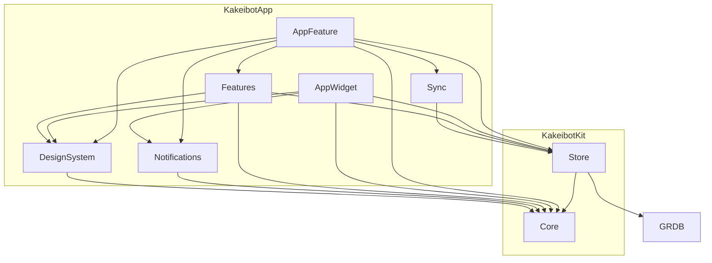

# 構成

> [!NOTE]
> kakeibot の今の形のうち、共通の iOS の構成から外れた点と、kakeibot だけの事実が分かる。
> 共通の形は [claude-config の architecture-ios](https://github.com/yossibank/claude-config/blob/main/docs/architecture-ios.md) にある。
> 手元の置き場所は、claude-config の `docs/architecture-ios.md` である。

## 🛠️ 使う技術

iOS の言語は Swift 6 で、ほかの技術は共通の形と同じである。画面と保存を選んだ理由は、decisions の[画面の作り](decisions/ios.md#画面の作り)と [DB](decisions/ios.md#db) にある。Android は、次の技術を使う。

| 項目 | Android |
| --- | --- |
| 言語 | Kotlin |
| 画面 | Jetpack Compose |
| 保存 | Room（SQLite）。表の形は iOS と同じ |
| ウィジェット | Glance |
| 通信 | なし |

両 OS の分け方とそろえ方は、[decisions/build.md の「共通化」](decisions/build.md#共通化)にある。

## 📂 リポジトリ

共通の木に、次のものを足している。

| パス | 中身 |
| --- | --- |
| `android/` | 未着手 |
| `scripts/docs-check.py` | 文書と実物の一致を確かめ、`make verify-docs` で走る。リンク先とその見出し、Makefile の入口、この文書のパッケージの木を見る |
| `scripts/docs-check.py` の fixtures | fixtures の `description` と `summary` も見る |
| `scripts/docs-check.py` のテストプラン | `Package.swift` のテストのターゲットと、テストプランの中身が一致するかも見る |
| claude-config の `hooks/docs-check.py` | 文書の書き方の決まりを確かめ、`make verify-docs` で追跡している全部の `.md` にかける |
| `spec/` | `export-format.md`、`fixtures.md`、`fixtures/` |
| `spec/fixtures/` | フォルダ名は、Core のフォルダ名の小文字にそろえる |
| `.claude/rules/` | spec の文書の役割 |
| `.claude/snapshots/` | `ui-snapshot` で描くセット。名前は描く場所（`tabs-`・`entry-`・`settings-`・`components`・`widget`・`store`）で始める |
| `.claude/snapshots/store/` | `store/screenshots/raw/` の画面に文言を重ね、ストアのスクリーンショットを描く |
| `store/ja/` | App Store の掲載情報の文と URL |
| `store/screenshots/` | ストアに出すスクリーンショット。6.9 インチは `6.9/`、6.3 インチは `6.3/`、元の画面は `raw/` |

## 📱 ios

ターゲットと ID は、共通の形の `<App>` を `Kakeibot` にしたものである。ほかに、次のものを持つ。

| 項目 | アプリ | ウィジェット |
| --- | --- | --- |
| アプリアイコン | Icon Composer の `AppIcon.icon`（ホワイト） | |
| アイコンの色違い | 設定で選べる色違いは、同じフォルダの `AppIcon-<色>.icon` | |
| アイコンの見本 | `Assets.xcassets` の `AppIconYen`・`AppIconDial`。設定の見本に描く、アイコンと同じ絵の写し | |
| 同梱のフォント | `Kakeibot/Fonts` の TTF と、そのライセンスの文。Info.plist の `UIAppFonts` で読む | アプリのものを `WidgetFonts` で読む |
| Pro の商品 | ID は `com.yossibank.kakeibot.pro`（買い切り、ファミリー共有あり）。手元で試す設定は `ios/Kakeibot.storekit` | |
| カメラ | 撮る許可の文は、ビルド設定の `INFOPLIST_KEY_NSCameraUsageDescription` に置く | |
| 共有の受け入れ | Info.plist の `CKSharingSupported`。AppFeature の `AppDelegate` が、シーンの delegate を差し替えて共有のリンクを受け取る | |

`license_plist.yml` には、同梱のフォントと配布元のライセンスを手で足す。

### 署名

| 項目 | 状態 |
| --- | --- |
| チーム | `6WHPY5MQSB`（Apple Developer Program に加入済み） |
| 登録済みの端末 | 自分の iPhone 1 台 |
| 開発用の証明書 | 2027-01-25 まで |
| プロファイル | 2027-10-10 まで |
| 配布用の証明書 | Archive のときに Xcode がクラウドで管理するものを使う |

## 📦 パッケージ

2 つのパッケージの中身は、次のとおりである。共通の形に無い `Store/Snapshot/`・`Store/Sync/`・`Sync`・`TestSupport` を足している。

依存の向きは、共通の形に次の 2 本を足したものである。

- `AppFeature --> Sync --> Store`
- `AppFeatureTests・FeaturesTests --> TestSupport`

テストのターゲットを除いた依存は、次の図のとおりである。



### KakeibotKit

KakeibotKit のフォルダは、次の木のとおりである。

```text
KakeibotKit/
├── Sources/
│   ├── Core/
│   │   ├── Concepts/
│   │   │   ├── Budget/
│   │   │   ├── Category/
│   │   │   ├── Date/
│   │   │   ├── Entry/
│   │   │   ├── Export/V1/
│   │   │   ├── Icon/
│   │   │   ├── Notification/
│   │   │   ├── Receipt/
│   │   │   ├── Recurring/
│   │   │   ├── Review/
│   │   │   ├── Reward/
│   │   │   ├── Setting/
│   │   │   ├── Theme/
│   │   │   └── Wallet/
│   │   └── Shared/
│   └── Store/
│       ├── Database/
│       ├── Migrations/
│       ├── Queries/
│       │   ├── Methods/
│       │   └── Types/
│       ├── Records/
│       │   ├── Rows/
│       │   ├── SettingKeys/
│       │   └── Values/
│       ├── Snapshot/
│       ├── Sync/
│       │   ├── Methods/
│       │   └── Types/
│       └── Writes/
│           ├── Methods/
│           └── Types/
└── Tests/
```

フォルダごとの中身は、次のとおり。

| フォルダ | 中身 |
| --- | --- |
| `Concepts/Budget/` | 予算と消化 |
| `Concepts/Category/` | 記録のカテゴリとタグ |
| `Concepts/Date/` | LocalDate、期間の区切り、祝日、休日のずらし |
| `Concepts/Entry/` | 記録と品目、金額の電卓、日ごとのまとめ |
| `Concepts/Export/V1/` | 書き出しの形 |
| `Concepts/Icon/` | アイコンとスタンプ |
| `Concepts/Notification/` | 予約されているべき通知の計算と行き先 |
| `Concepts/Receipt/` | 文字の断片をレシートの行にまとめ、行かモデルが答えた行の役割から品目・合計・日付・店名を組み立てる決まり。人が直した品名 |
| `Concepts/Recurring/` | 固定費と記録漏れの後追い |
| `Concepts/Review/` | 振り返りの範囲と集計 |
| `Concepts/Reward/` | ごほうびと貯金箱 |
| `Concepts/Setting/` | 設定の値 |
| `Concepts/Theme/` | テーマの色・書体・形 |
| `Concepts/Wallet/` | 財布と残高 |
| `Core/Shared/` | 概念をまたいで使う型。型付きの ID、割合、下書きの問題 |
| `Store/Queries/`・`Store/Sync/`・`Store/Writes/` | `Methods/` に `AppDatabase+*.swift` の拡張、`Types/` にそれ以外の型を置く |
| `Store/Queries/Methods/` | 返す型の名前で付ける。書き込みと同じ型なら `+<型>Query` |
| `Store/Records/` | 表の行・設定のキー・列の値の適合 |
| `Store/Migrations/` | `MigrationV<3 桁の通し番号>.swift`。欠番は 14 |
| `Store/Database/` | 最初の財布とカテゴリも作る。止める通知は AppFeature が送る |
| `Store/Snapshot/` | 書き出し用の全データの読み出し、読み込み用の全置き換え |
| `Store/Sync/` | 同期で送る行の記録と、受け取った行の書き込み |
| `Store/Writes/` | ウィジェットからの記録と取り消しも含む |

### KakeibotApp

KakeibotApp のフォルダは、次の木のとおりである。

```text
KakeibotApp/
├── Sources/
│   ├── AppFeature/
│   │   ├── App/
│   │   ├── Bridge/
│   │   └── Main/
│   ├── AppWidget/
│   │   ├── Intents/
│   │   ├── Shared/
│   │   └── Widgets/
│   │       ├── Budget/
│   │       └── QuickRecord/
│   ├── DesignSystem/
│   │   ├── Components/
│   │   └── Theme/
│   ├── Features/
│   │   ├── Screens/
│   │   │   ├── Entry/
│   │   │   ├── Onboarding/
│   │   │   ├── Pro/
│   │   │   ├── Settings/
│   │   │   ├── Tabs/
│   │   │   └── WhatsNew/
│   │   └── Shared/
│   │       ├── EntryList/
│   │       ├── FeatureArt/
│   │       ├── Model/
│   │       ├── Notice/
│   │       ├── Notification/
│   │       ├── Period/
│   │       ├── Placeholder/
│   │       ├── Pro/
│   │       ├── SettingsParts/
│   │       ├── Setup/
│   │       └── Stamp/
│   ├── Notifications/
│   └── Sync/
└── Tests/
```

フォルダごとの中身は、次のとおり。

| フォルダ | 中身 |
| --- | --- |
| `AppFeature/App/` | アプリの入口と起動、起動の印の動き、入力の準備、レビューのお願い。Pro が無くなったら同期を止める |
| `AppFeature/Bridge/` | Pro の購入を StoreKit で確かめる。同期の口座と参加者を CloudKit で読む |
| `AppFeature/Main/` | 4 つのタブと入力シートなどのシートを組む |
| `AppWidget/Intents/` | すぐ記録の記録と取り消し、コントロールの「記録する」 |
| `AppWidget/Shared/` | ウィジェットをまたいで使う読み出し・書体・テーマ・タイムライン |
| `AppWidget/Widgets/` | ウィジェットごとのフォルダ |
| `Features/Screens/Entry/` | 記録の入力シート。レシートは VisionKit で撮り、Vision と Foundation Models で読む |
| `Features/Screens/Onboarding/` | 最初の設定のチュートリアル |
| `Features/Screens/Pro/` | Pro の画面と購入のモデル |
| `Features/Screens/Settings/` | 設定の項目ごとの画面。Menu は入口と、確かめ用のテストデータ（`#if DEBUG`） |
| `Features/Screens/Tabs/` | Assets・Home・Records・Review |
| `Features/Screens/WhatsNew/` | お知らせの版と機能の一覧と、それを並べるシート |
| `Features/Shared/EntryList/` | 記録の一覧の検索と絞り込み、一覧の行に出す値 |
| `Features/Shared/FeatureArt/` | お知らせと Pro の画面で機能を見せる絵の部品（レシート・伝票・iPhone の枠・見本のデータ）。絵を幅に合わせて縮める枠も置く |
| `Features/Shared/Model/` | 画面のモデルの見張りの形（失敗したら見張り直す）、アプリの版 |
| `Features/Shared/Notice/` | 記録・削除の知らせと取り消し、保存の失敗が空き容量不足かの見分け |
| `Features/Shared/Notification/` | 通知の許可の窓口と、許可が無いときの帯 |
| `Features/Shared/Period/` | 期間の範囲と月の始まり、期間を送る行と今の期間に戻るボタン |
| `Features/Shared/Placeholder/` | 記録が無いときと読み込めないときの表示 |
| `Features/Shared/Pro/` | Pro を買ったかの状態と、止めた場所で下に出すカード。StoreKit の中身は AppFeature が渡す |
| `Features/Shared/SettingsParts/` | 設定の画面で使う部品（Board・Header・Hint・Icon・Input・Layout・Tile） |
| `Features/Shared/Setup/` | 残りの設定とカスタマイズの項目と進み具合 |
| `Features/Shared/Stamp/` | 押したスタンプの数のカードと、押した日の一覧のシート |
| `Sync/` | CKSyncEngine で変更を送り受けする。財布の共有、共有シート、共有の受け入れも作る |
| `Tests/TestSupport/` | テストの補助。観測している値が変わるのを、上限の時間まで待つ |

画面ごとのフォルダは、[architecture-screens の「画面とフォルダ」](architecture-screens.md#-画面とフォルダ)にある。

## 📏 名前の決まり

フォルダとファイルの名前は、共通の形の「名前の決まり」と `rules/swift-core.md` に従う。Migrations のファイルと型は、3 桁の通し番号で付ける。fixtures は `Core/Concepts/` のフォルダ名を小文字にして置く。

画面の組み立てと通知とウィジェットの方式は、[architecture-screens](architecture-screens.md) にある。

## 🧪 テスト

テストの形は、共通の形に `SyncTests` と `AppWidgetTests` を足したものである。Core のテストは、fixtures を全部通す。

テストの補助は、使う範囲で置き場所を分ける。

| 使う範囲 | 置き場所 |
| --- | --- |
| 1 つのテストターゲット | そのターゲットの直下の `Support/`。例は `StoreTests/Support/`・`FeaturesTests/Support/` |
| 複数のテストターゲット | `Tests/TestSupport/` のターゲット |
| 1 つのテストの型 | その型の `+Setup.swift` か、同じファイル |
