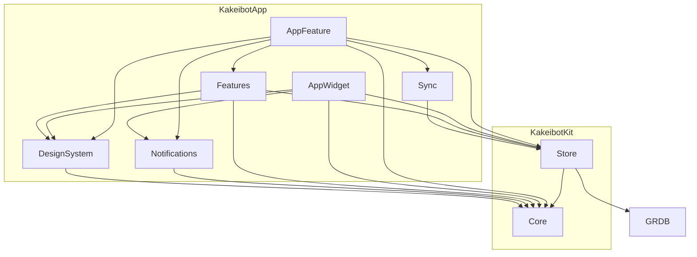

# 構成

> [!NOTE]
> kakeibot の今の形のうち、共通の iOS の構成から外れた点と、kakeibot だけの事実が分かる。
> 共通の形は [claude-config の architecture-ios](https://github.com/yossibank/claude-config/blob/main/docs/architecture-ios.md) にある。
> 手元の置き場所は、claude-config の `docs/architecture-ios.md` である。

## 🛠️ 使う技術

iOS の言語は Swift 6 で、ほかの技術は共通の形と同じである。画面と保存を選んだ理由は、decisions の[画面の作り](decisions/ios.md#画面の作り)と [DB](decisions/ios.md#db) にある。Android は、次の技術を使う。

| 項目 | Android |
| --- | --- |
| 言語 | Kotlin |
| 画面 | Jetpack Compose |
| 保存 | Room（SQLite）。表の形は iOS と同じ |
| ウィジェット | Glance |
| 通信 | なし |

両 OS の分け方とそろえ方は、[decisions/build.md の「共通化」](decisions/build.md#共通化)にある。

## 📂 リポジトリ

共通の木に、次のものを足している。

| パス | 中身 |
| --- | --- |
| `android/` | 未着手 |
| `scripts/docs-check.py` | 文書と実物の一致を確かめ、`make verify-docs` で走る。リンク先とその見出し、Makefile の入口、この文書のパッケージの木を見る |
| `scripts/docs-check.py` の fixtures | fixtures の `description` と `summary` も見る |
| `scripts/docs-check.py` のテストプラン | `Package.swift` のテストのターゲットと、テストプランの中身が一致するかも見る |
| claude-config の `hooks/docs-check.py` | 文書の書き方の決まりを確かめ、`make verify-docs` で追跡している全部の `.md` にかける |
| `spec/` | `export-format.md`、`fixtures.md`、`fixtures/` |
| `spec/fixtures/` | フォルダ名は、Core のフォルダ名の小文字にそろえる |
| `.claude/rules/` | spec の文書の役割 |
| `.claude/snapshots/widget/` | `ui-snapshot` で描くウィジェットの場合。あといくらの小・中、ロック画面の丸・横長・1 行 |
| `.claude/snapshots/recent-transfers/` | `ui-snapshot` で描く、入力シートの最近の振替の行。長い口座名、手数料の有無 |
| `.claude/snapshots/entry-sheet/` | `ui-snapshot` で描く入力シートの全体（支出・振替）。カテゴリの格子は描かれない |
| `.claude/snapshots/records/` | `ui-snapshot` で描く記録のタブ。カレンダーと一覧 |
| `.claude/snapshots/review/` | `ui-snapshot` で描く振り返りのタブ |
| `.claude/snapshots/assets/` | `ui-snapshot` で描く資産のタブ |
| `.claude/snapshots/home/` | `ui-snapshot` で描くホームのタブ |
| `.claude/snapshots/settings/` | `ui-snapshot` で描く設定。メニュー・口座・ごほうび・記録忘れの通知 |
| `.claude/snapshots/theme-style/` | `ui-snapshot` で描く、「文字」と「形と動き」の画面の見本 |
| `.claude/snapshots/home-sections/` | `ui-snapshot` で描く、ホームの並べ替え |
| `.claude/snapshots/parts/` | `ui-snapshot` で描く、カレンダー・タグ・テンプレートのカード |
| `.claude/snapshots/entry-wallet/` | `ui-snapshot` で描く、入力シートの口座を選ぶシート |
| `.claude/snapshots/entry-wallet-edit/` | `ui-snapshot` で描く、口座を選ぶシートの編集中 |
| `.claude/snapshots/store/` | `store/screenshots/raw/` の画面に文言を重ね、ストアのスクリーンショットを描く |
| `store/ja/` | App Store の掲載情報の文と URL |
| `store/screenshots/` | ストアに出す 6.9 インチのスクリーンショット。元の画面は `raw/` |

## 📱 ios

ターゲットと ID は、共通の形の `<App>` を `Kakeibot` にしたものである。ほかに、次のものを持つ。

| 項目 | アプリ | ウィジェット |
| --- | --- | --- |
| アプリアイコン | Icon Composer の `AppIcon.icon`（ホワイト） | |
| アイコンの色違い | 設定で選べる色違いは、同じフォルダの `AppIcon-<色>.icon` | |
| アイコンの見本 | `Assets.xcassets` の `AppIconYen`・`AppIconDial`。設定の見本に描く、アイコンと同じ絵の写し | |
| 同梱のフォント | `Kakeibot/Fonts` の TTF と、そのライセンスの文。Info.plist の `UIAppFonts` で読む | アプリのものを `WidgetFonts` で読む |
| 共有の受け入れ | Info.plist の `CKSharingSupported`。AppFeature の `AppDelegate` が、シーンの delegate を差し替えて共有のリンクを受け取る | |

`license_plist.yml` には、同梱のフォントと配布元のライセンスを手で足す。

### 署名

| 項目 | 状態 |
| --- | --- |
| チーム | `6WHPY5MQSB`（Apple Developer Program に加入済み） |
| 登録済みの端末 | 自分の iPhone 1 台 |
| 開発用の証明書 | 2027-01-25 まで |
| プロファイル | 2027-10-10 まで |
| 配布用の証明書 | なし。Archive のときに Xcode がクラウドで管理するものを使う |

## 📦 パッケージ

2 つのパッケージの中身は、次のとおりである。共通の形に無い `Store/Snapshot/`・`Store/Sync/`・`Sync`・`TestSupport` を足している。

依存の向きは、共通の形に次の 2 本を足したものである。

- `AppFeature --> Sync --> Store`
- `AppFeatureTests・FeaturesTests --> TestSupport`

テストのターゲットを除いた依存は、次の図のとおりである。



### KakeibotKit

KakeibotKit のフォルダは、次の木のとおりである。

```text
KakeibotKit/
├── Sources/
│   ├── Core/
│   │   ├── Budget/
│   │   ├── Category/
│   │   ├── Date/
│   │   ├── Entry/
│   │   ├── Export/V1/
│   │   ├── Icon/
│   │   ├── Identifier/
│   │   ├── Notification/
│   │   ├── Recurring/
│   │   ├── Review/
│   │   ├── Reward/
│   │   ├── Setting/
│   │   └── Wallet/
│   └── Store/
│       ├── Database/
│       ├── Migrations/
│       ├── Queries/
│       ├── Records/
│       ├── Snapshot/
│       ├── Sync/
│       └── Writes/
└── Tests/
```

フォルダごとの中身は、次のとおり。

| フォルダ | 中身 |
| --- | --- |
| `Core/Budget/` | 予算と消化 |
| `Core/Category/` | 記録のカテゴリとタグ |
| `Core/Date/` | LocalDate、期間の区切り、祝日 |
| `Core/Entry/` | 記録、金額の電卓、日ごとのまとめ |
| `Core/Export/V1/` | 書き出しの形 |
| `Core/Icon/` | アイコンとスタンプ |
| `Core/Identifier/` | 型付きの ID |
| `Core/Notification/` | 予約されているべき通知の計算と行き先 |
| `Core/Recurring/` | 固定費と記録漏れの後追い |
| `Core/Review/` | 振り返りの範囲と集計 |
| `Core/Reward/` | ごほうびと貯金箱 |
| `Core/Setting/` | 設定の値とテーマ |
| `Core/Wallet/` | 財布と残高 |
| `Store/Database/` | 最初の財布とカテゴリも作る。止める通知は AppFeature が送る |
| `Store/Snapshot/` | 書き出し用の全データの読み出し、読み込み用の全置き換え |
| `Store/Sync/` | 同期で送る行の記録と、受け取った行の書き込み |
| `Store/Writes/` | ウィジェットからの記録と取り消しも含む |

### KakeibotApp

KakeibotApp のフォルダは、次の木のとおりである。

```text
KakeibotApp/
├── Sources/
│   ├── AppFeature/
│   ├── AppWidget/
│   ├── DesignSystem/
│   │   ├── Components/
│   │   └── Theme/
│   ├── Features/
│   │   ├── Screens/
│   │   │   ├── Entry/
│   │   │   ├── Onboarding/
│   │   │   ├── Settings/
│   │   │   └── Tabs/
│   │   └── Shared/
│   │       ├── Model/
│   │       ├── Notice/
│   │       ├── Period/
│   │       ├── Settings/
│   │       ├── Setup/
│   │       └── Stamp/
│   ├── Notifications/
│   └── Sync/
└── Tests/
```

フォルダごとの中身は、次のとおり。

| フォルダ | 中身 |
| --- | --- |
| `AppFeature/` | 起動の印の動き、通知の許可、入力の準備も持つ |
| `AppWidget/` | すぐ記録の記録と取り消し、コントロールの「記録する」 |
| `DesignSystem/Components/` | Amount・Banner・Button・Calendar・Chart・Dial・Gesture・Icon・Input・Menu・Navigation・Row・Sheet・Surface・Tag・Template |
| `Features/Screens/Entry/` | 記録の入力シート |
| `Features/Screens/Onboarding/` | 最初の設定のチュートリアル |
| `Features/Screens/Settings/` | 設定の項目ごとの画面。Menu は入口と、確かめ用のテストデータ（`#if DEBUG`） |
| `Features/Screens/Tabs/` | Assets・Home・Records・Review |
| `Features/Shared/Model/` | 画面のモデルの見張りの形（失敗したら見張り直す）、記録の検索と絞り込み |
| `Features/Shared/Notice/` | 記録・削除の知らせと取り消し、記録が無いときと読み込めないときの表示、保存の失敗が空き容量不足かの見分け |
| `Features/Shared/Period/` | 期間の範囲と月の始まり、期間を送る行と今の期間に戻るボタン |
| `Features/Shared/Settings/` | 設定の画面で使う部品（Board・Header・Hint・Icon・Input・Layout・Tile） |
| `Features/Shared/Setup/` | 残りの設定とカスタマイズの項目と進み具合 |
| `Features/Shared/Stamp/` | 押したスタンプの数のカードと、押した日の一覧のシート |
| `Sync/` | CKSyncEngine で変更を送り受けする。財布の共有、共有シート、共有の受け入れも作る |
| `Tests/TestSupport/` | テストの補助。観測している値が変わるのを、上限の時間まで待つ |

## 📏 名前の決まり

フォルダとファイルの名前は、共通の形の「名前の決まり」と `rules/swift-core.md` に従う。kakeibot では、入れる先のない `Core/Identifier` だけ、ファイルが 1 つのフォルダを認める。fixtures は `spec/fixtures/` の下の、Core のフォルダ名を小文字にしたフォルダに置く。

画面の組み立てと通知とウィジェットの方式は、[architecture-screens](architecture-screens.md) にある。

## 🧪 テスト

テストの形は、共通の形に `SyncTests` と `AppWidgetTests` を足したものである。Core のテストは、fixtures を全部通す。

## ⚠️ 未検証

> [!WARNING]
> - 配布用の証明書を Xcode がクラウドで管理するか（12 番で確かめる）
> - すぐ記録を押したとき、ウィジェットの拡張から DB に書け、アプリを前面に戻すと画面に出るか。ホーム画面で押して確かめる
> - ロック中に、ロック画面のウィジェットが金額を出すか（実機）。ファイル保護は、アプリと拡張でそろえた。値は `NSFileProtectionCompleteUntilFirstUserAuthentication` である
