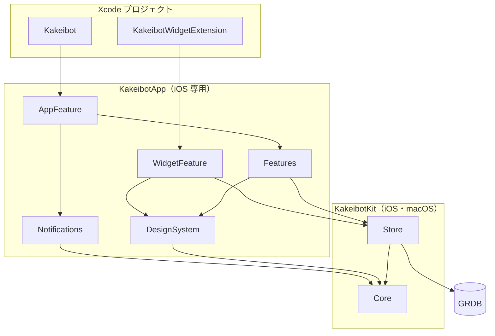
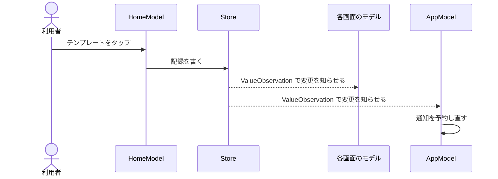

# 構成

kakeibot の今の形を書く。

## 使う技術

OS ごとに、次の技術を使う。

| 項目 | iOS | Android |
| --- | --- | --- |
| 言語 | Swift 6 | Kotlin |
| 画面 | SwiftUI ＋ `@Observable`。[理由](decisions.md#画面の作り) | Jetpack Compose |
| 保存 | GRDB（SQLite）。[理由](decisions.md#db) | Room（SQLite）。表の形は iOS と同じ |
| ウィジェット | WidgetKit | Glance |
| 通信 | なし。通知も端末の中で予約する | 同じ |

両 OS の分け方とそろえ方は、[decisions.md の「共通化」](decisions.md#共通化)にある。

## リポジトリ

```
kakeibot/
├── android/                 未着手
├── docs/
├── ios/
├── spec/
│   ├── export-format.md
│   ├── fixtures.md
│   └── fixtures/            Core のフォルダ名の小文字にそろえる
├── .github/                 CI（ビルドとテスト）
├── .pre-commit-config.yaml  commit の前の確認（SwiftFormat）
├── .swiftformat
├── Brewfile                 Mint と pre-commit
├── Makefile                 準備・開く・整形・ビルド・テストのコマンド
└── Mintfile                 SwiftFormat の版
```

## ios

`ios/` の中は、次の形である。

```
ios/
├── Kakeibot/                アプリ（@main で AppFeature を呼ぶだけ）、アプリアイコン、起動画面
├── Kakeibot.xcodeproj       アプリとウィジェットのターゲット
├── Kakeibot.xctestplan      テストターゲットをまとめたテストプラン
├── Kakeibot.xcworkspace     プロジェクトと 2 つのパッケージを並べる。Xcode ではこれを開く
├── KakeibotWidget/          ウィジェット（@main で WidgetFeature を呼ぶだけ）
└── Packages/
    ├── KakeibotApp/         iOS 専用。Xcode でテスト
    └── KakeibotKit/         iOS と macOS。Mac の上で swift test
```

| 項目 | アプリ | ウィジェット |
| --- | --- | --- |
| ターゲット | `Kakeibot` | `KakeibotWidgetExtension` |
| Bundle ID | `com.yossibank.kakeibot` | `com.yossibank.kakeibot.widget` |
| App Group | `group.com.yossibank.kakeibot` | 同じ |
| アプリアイコン | Icon Composer の `AppIcon.icon`。設定で選べる色違いは `AppIcon-Black`・`AppIcon-Forest`・`AppIcon-Silver`・`AppIcon-Ivory`・`AppIcon-White`・`AppIcon-Gold` | |

### 署名

| 項目 | 状態 |
| --- | --- |
| チーム | `6WHPY5MQSB` |
| 登録済みの端末 | 自分の iPhone 1 台 |
| 開発用の証明書 | 2027-01-25 まで |
| プロファイル | 2027-10-10 まで |
| 配布用の証明書 | なし。Archive のときに Xcode がクラウドで管理するものを使う |

## パッケージ

2 つのパッケージは、次の形である。ターゲットはすべてあり、中のフォルダはそのコードを作るときに足す。

### KakeibotKit

```
KakeibotKit/
├── Sources/
│   ├── Core/
│   │   ├── Budget/          予算の型、「この月から」、残り、消化
│   │   ├── Category/        記録のカテゴリ（EntryCategory）とタグ、その入力の判定
│   │   ├── Date/            LocalDate、期間の区切りと呼び方、週の始まり、月と期間のマス目、祝日
│   │   ├── Entry/           記録の型、入力の判定、金額の電卓、日ごとのまとめ、支出なしの日
│   │   ├── Export/
│   │   │   └── V1/
│   │   ├── Icon/            アイコンと、その入力の判定、アイコンの棚、カレンダーのスタンプ
│   │   ├── Identifier/      型付きの ID
│   │   ├── Notification/    予約されているべき通知の計算、通知の行き先、通知の許可の状態
│   │   ├── Recurring/       固定費の日付、入力の判定、記録漏れの後追い
│   │   ├── Review/          振り返りの週・月・年の範囲、合計と内訳
│   │   ├── Reward/          決まり・記録・目標、貯金箱の残高
│   │   ├── Setting/         設定の行と選べる値、テーマの型
│   │   └── Wallet/          財布の型と、その入力の判定、残高
│   └── Store/
│       ├── Database/        App Group、DatabasePool、止められる前の対策、最初の財布とカテゴリ。止める通知は AppFeature が送る
│       ├── Migrations/      版ごとに 1 ファイル
│       ├── Queries/         記録とカテゴリ・タグの一覧、入力の選択肢、月の要約・日ごとの合計、テンプレート、月の始まり、予算、アイコンの棚
│       ├── Records/         Core の型を GRDB で読み書きできるようにする
│       ├── Snapshot/        書き出し用の全データの読み出し、読み込み用の全置き換え
│       └── Writes/          記録の保存・更新・削除、カテゴリ（タグを含む）とテンプレートの保存・並べ替え・非表示・削除、棚のアイコンの保存・並べ替え・削除、月の始まりと予算の保存
└── Tests/
    ├── CoreTests/           Core と同じフォルダ分け
    └── StoreTests/          メモリ上の DB
```

### KakeibotApp

```
KakeibotApp/
├── Sources/
│   ├── AppFeature/          AppModel、RootView、MainView（タブとシート）、起動の印の動き、通知の許可、入力の準備
│   ├── DesignSystem/
│   │   ├── Components/      部品の種類ごとのフォルダ
│   │   │   ├── Amount/      金額、予算の使い具合の色と棒、残りの文字
│   │   │   ├── Banner/      画面の下に出す知らせ、3 秒で消えるエラーの知らせとその状態
│   │   │   ├── Button/      輪・大きな・見出しの横・点線の追加のボタン
│   │   │   ├── Calendar/    月のカレンダー、曜日の名前と色
│   │   │   ├── Chart/       円グラフ、割合の棒
│   │   │   ├── Dial/        ダイヤルの面と目盛り、半円のダイヤル
│   │   │   ├── Gesture/     持ち上げて動かす、横に払う、左右に払って送る、バーを隠してもスワイプで戻る
│   │   │   ├── Icon/        アイコン、絵柄から SF Symbols への置き換え
│   │   │   ├── Input/       カプセルの切り替え、チップ、テンキー
│   │   │   ├── Menu/        長押しなどで開くメニューの面、見出し、行、区切り
│   │   │   ├── Navigation/  浮かせたタブの帯と ＋ ボタン、ページの点とすべり
│   │   │   ├── Row/         記録の 1 行、払うと削除か非表示のボタンを出す行、行の説明の文
│   │   │   ├── Sheet/       確かめのカード、中身の高さに合わせたシート、閉じる前の確かめ
│   │   │   ├── Surface/     カードとガラスの見た目、見出し、区切り線、端をぼかす
│   │   │   ├── Tag/         タグの札と、紐に下げて並べる列
│   │   │   └── Template/    テンプレートのカードと、その大きさ
│   │   └── Theme/           色（Palette）と濃さの段階、文字の大きさの段階、色の文字列の読み取り、点線
│   ├── Features/
│   │   ├── Common/          画面のモデルの見張りの形、複数の画面で使う記録の行とテンプレートの説明
│   │   ├── Entry/
│   │   ├── EntryNotice/     記録・削除の知らせと取り消し
│   │   ├── Onboarding/      最初の設定のチュートリアル
│   │   ├── Period/          期間の範囲と月の始まりの書き方、いまの期間のカード、日を選ぶマス
│   │   ├── Settings/
│   │   │   ├── Budgets/     予算の一覧と額の入力
│   │   │   ├── Categories/
│   │   │   ├── Icons/
│   │   │   ├── Menu/        設定の入口、起動画面の名前、確かめ用のテストデータ（#if DEBUG）
│   │   │   ├── Parts/       設定の画面で共有する入力欄、見出し、行の一覧、カテゴリと口座のタイル、非表示にする枠（棚から消す枠も兼ねる）とボタン、保存のボタンの文字、選ぶボタン
│   │   │   ├── Period/      月の始まりの設定
│   │   │   ├── Recurring/   固定費の一覧と編集
│   │   │   ├── Reminder/    記録忘れの通知の設定と、通知の許可を確かめる関数
│   │   │   ├── ShelfIcons/  アイコンの棚の一覧と編集
│   │   │   ├── Templates/
│   │   │   └── Wallets/
│   │   └── Tabs/
│   │       ├── Assets/
│   │       ├── Home/
│   │       ├── Records/
│   │       └── Review/
│   ├── Notifications/       予約されているべき通知と今の予約の差を OS に反映、押された通知の行き先を受ける
│   └── WidgetFeature/
└── Tests/
    ├── AppFeatureTests/
    └── FeaturesTests/
```

### 依存の向き



## 名前の決まり

フォルダとファイルの名前は、次の決まりで付ける。

- 同じ役割のものは 1 つの親フォルダにまとめる
- Core は概念ごとのフォルダに、型と計算を一緒に入れる
- Store は役割ごとのフォルダ（Queries・Writes・Records など）に分ける
- DesignSystem の部品は、Components の下の種類ごとのフォルダに入れる。名前の順に並べたとき、フォルダの中が 1 つの種類の部品だけになるように分ける
- Features は画面の名前。一覧の画面は複数形
- 1 つのフォルダには、ファイルかサブフォルダのどちらかだけを入れる
- ファイルが 1 つだけのフォルダは作らず、近いフォルダに入れる。ターゲットの直下と、入れる先のない `Core/Identifier` だけ例外にする
- ファイル名は、中の型の名前にする。拡張は `型名+役割` にする（`TemplateOrder+Title`）
- Features のフォルダでは、ファイル名の頭を、その画面か、その画面が扱う型の名前にそろえる（`WalletListView`、`WalletKind+Title`）
- `View+役割` の名前は、DesignSystem の画面をまたいで使うモディファイアだけに付ける。画面ごとのモディファイアは、画面の名前で始める（`WalletHideConfirmation`）
- fixtures のファイル名の頭に、試す型の名前を kebab-case で付ける（`local-date-week.json`）

## Features と AppFeature

画面の処理は、各画面と、画面どうしをつなぐ部分に分ける。

| ターゲット | 受け持つこと | 知らないこと |
| --- | --- | --- |
| Features | 1 つ 1 つの画面の表示と操作 | ほかの画面、タブ、通知、ウィジェット |
| AppFeature | タブ、入力シート、移動、起動時の処理、通知とウィジェットへの反映 | 各画面の中身 |

### 画面のモデル

画面のモデルは、次の決まりで作る。

- 処理のある画面だけ `@Observable` のモデルを置く。表示だけの画面には置かない
- 作るときに `AppDatabase`・`LocalDate`・ほかの画面を開く関数を引数で受け取る
- ほかの画面を開く関数は Core の型だけを使う（`openNewEntry(LocalDate)`、`openEntry(Entry.ID)`）
- DB は `ValueObservation` で見張る。保存すると、見張っている画面が自動で変わる
- 見張りは `ScreenModel` の `observe(_:failure:receive:)` で書く。読めなかったときは、エラーのバナーに出す
- 見張りと最初の読み込みは `run()` にまとめる。1 回だけ読む値を先に読み、見張りは並べて動かす
- 記録の一覧（`EntryList`）の見張りは `AppDatabase` が 1 つだけ持ち、見張る画面のあいだで共有する
- 計算は Core に任せる。書き込みは DB に書くだけ
- 設定の一覧は項目の enum を持ち、移る先は AppFeature が決める

### AppModel

| 持つもの | 中身 |
| --- | --- |
| 起動の状態 | DB を開いている途中、最初の設定、準備済み、失敗。最初の設定が済んでいなければ Onboarding を出す |
| 今日 | アプリで 1 つだけ持つ。RootView が MainView と Onboarding に渡す |
| 通知の行き先 | 押された通知の行き先。MainView が開いたら消す |

### MainView

| 持つもの | 中身 |
| --- | --- |
| タブのモデル | Home・Records・Review・Assets。アプリが動いている間ずっと持ち、今日が変わったら渡し直す |
| シート | 新規・編集・設定・テンプレート・振替・口座・固定費など。空なら閉じる |

### 保存から反映まで



AppModel は、今日からの記録と支出なしの印、通知の時刻、固定費を見張る。どれかが変わると、記録忘れの通知と固定費の更新前の通知を予約し直す。

### 起動と画面復帰

起動・前面に戻る・日付が変わるときに行う処理を、上から順に並べる。

| 処理 | 起動 | 前面に戻る | 日付が変わる |
| --- | --- | --- | --- |
| DB を開き、表の形を最新にする | する | | |
| 今日を決める | する | する | する |
| 固定費の記録漏れを作る | する | する | する |
| 通知を予約し直す | する | する | する |

裏に回ると `AppDatabase.suspend()` で DB を止め、裏から戻ると `AppDatabase.resume()` で再開する。実機で、書き込みの最中に裏に回しても `0xdead10cc` で終了しないことを確かめた。

### 外からの入口

| 入口 | 開く先 |
| --- | --- |
| ウィジェット | ホーム |
| 記録忘れの通知 | 入力シート（今日） |
| 固定費の更新前の通知 | 設定 → 固定費 → その固定費 |

## 通知とウィジェット

| 対象 | 方式 |
| --- | --- |
| 記録忘れの通知 | 数日先まで予約し、当日の記録か支出なしの印ができたら当日分を取り消す |
| 固定費の更新前の通知 | 更新日の N 日前で予約する |
| iOS のウィジェット | WidgetFeature が Store で DB を直接読む。ホームと同じ集計クエリを使う |

## テスト

テストターゲットは `ios/Kakeibot.xctestplan` にまとめ、`Kakeibot` スキームに付ける。パッケージは、プロジェクトのフォルダとしても登録する。こうしないと、スキームからパッケージのテストターゲットが見えない。

`make test` は、このテストプランを iOS シミュレーターで走らせる。CI（`.github/workflows/verify.yml`）は、`make test` だけを走らせる。

| 対象 | 方法 |
| --- | --- |
| Core | `make test`。Mac の上では `swift test` でも走る。fixtures を全部通し、`#filePath` からの相対パスで読む |
| Store | メモリ上の DB で、表の形の変更・集計・書き出しの往復 |
| Features | 処理のある画面のモデル |
| AppFeature | AppModel と通知の予約。通知の予約係だけテスト用に差し替える |
| 見た目 | プレビューで目で確かめる。UI テストは書かない |

## 未検証

> [!WARNING]
> - パッケージの中のフォントを、起動時の登録で使えるか（DesignSystem を作るとき）
> - Apple Developer Program に加入しているか。プロファイルの期限が 1 年なのは有料のチームの特徴だが、加入状態は確かめていない
> - 配布用の証明書を Xcode がクラウドで管理するか（10 番で確かめる）
