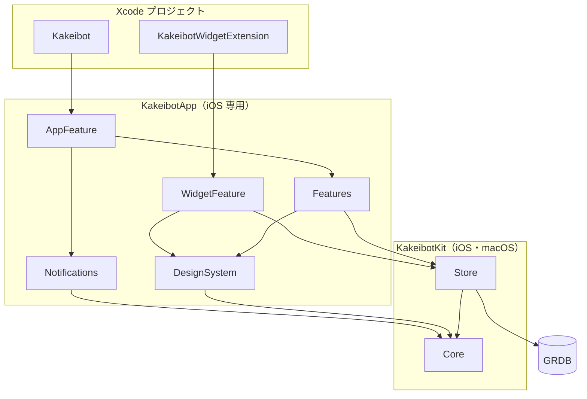
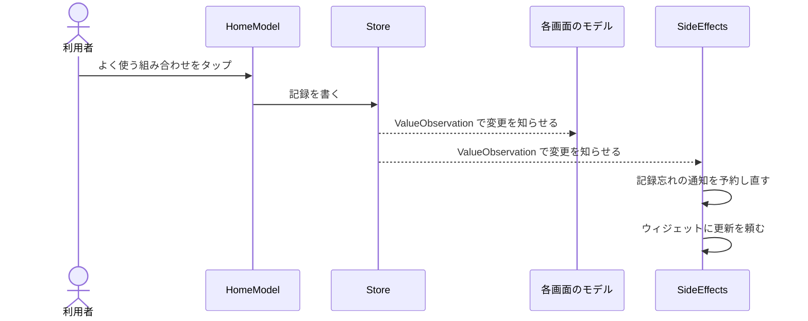

# 構成

## 方針

| 項目 | 決定 |
| --- | --- |
| 作り方 | iOS を Swift で先に作り、Android は計算部分を Kotlin に移す |
| ずれの防止 | `spec/fixtures` の JSON テストケースを、Swift と Kotlin の両方のテストで読む |
| 画面 | iOS は SwiftUI ＋ `@Observable`、Android は Jetpack Compose |
| 保存 | iOS は GRDB（SQLite）、Android は Room。表の形は同じ |
| 通信 | なし。通知はすべて端末の中で予約する |

理由と選ばなかった案は [decisions.md](decisions.md)。

## リポジトリ

```
kakeibot/
├── android/                 未着手
├── docs/
├── ios/
├── spec/
│   ├── export-format.md
│   └── fixtures/            未着手。Core のフォルダ名の小文字にそろえる
├── .pre-commit-config.yaml  commit の前の確認（SwiftFormat）
├── .swiftformat
├── Brewfile                 Mint と pre-commit
├── Makefile                 準備・整形・ビルドのコマンド
└── Mintfile                 SwiftFormat の版
```

## ios

```
ios/
├── Kakeibot/                アプリ（@main で AppFeature を呼ぶだけ）
├── Kakeibot.xcodeproj
├── KakeibotWidget/          ウィジェット（@main で WidgetFeature を呼ぶだけ）
└── Packages/                未着手
    ├── KakeibotApp/         iOS 専用。Xcode でテスト
    └── KakeibotKit/         iOS と macOS。Mac の上で swift test
```

| 項目 | アプリ | ウィジェット |
| --- | --- | --- |
| ターゲット | `Kakeibot` | `KakeibotWidgetExtension` |
| Bundle ID | `com.yossibank.kakeibot` | `com.yossibank.kakeibot.widget` |
| App Group | `group.com.yossibank.kakeibot` | 同じ |
| 端末 | iPhone のみ | 同じ |
| 署名 | 自動（チーム `6WHPY5MQSB`） | 同じ |

> [!NOTE]
> パッケージを 2 つに分けるのは、1 つのパッケージに iOS 専用のターゲットがあると、`swift test --filter` で絞っても全ターゲットがビルドされて失敗するため（Swift 6.4 で確認済み）。

### KakeibotKit

```
KakeibotKit/
├── Sources/
│   ├── Core/
│   │   ├── Budget/          予算の型、「この月から」、残り、消化
│   │   ├── Category/
│   │   ├── Character/       一言の文と選び方
│   │   ├── Date/            LocalDate、期間の区切りと呼び方、週の始まり
│   │   ├── Entry/           記録の型、よく使う組み合わせの並べ方
│   │   ├── Export/
│   │   │   ├── Upgrade/     古い版から新しい版への変換
│   │   │   └── V1/
│   │   ├── Icon/
│   │   ├── Notification/    予約されているべき通知の計算
│   │   ├── Recurring/       固定費の記録の作成、記録漏れの後追い
│   │   ├── Reward/          決まり・記録・目標、貯金箱の残高
│   │   ├── Theme/           テーマの型、読みやすさの判定
│   │   └── Wallet/          財布の型、残高
│   └── Store/
│       ├── Database/        App Group、DatabasePool、止められる前の対策
│       ├── Migrations/      版ごとに 1 ファイル
│       ├── Preview/         プレビュー用のサンプルデータ（#if DEBUG）
│       ├── Queries/         月の要約・日ごとの合計・よく使う組み合わせの元データ
│       ├── Records/         Core の型を GRDB で読み書きできるようにする
│       └── Snapshot/        書き出し用の全データの読み出し、読み込み用の全置き換え
└── Tests/
    ├── CoreTests/           Core と同じフォルダ分け
    └── StoreTests/          メモリ上の DB
```

### KakeibotApp

```
KakeibotApp/
├── Sources/
│   ├── AppFeature/          AppModel、DeepLink、RootView、Routes、SideEffects
│   ├── DesignSystem/
│   │   ├── Components/
│   │   │   ├── Common/      ボタン、カード、テンキー
│   │   │   └── Kakeibo/     アイコン、金額、記録の 1 行、期間の切り替え
│   │   ├── Resources/
│   │   │   ├── Assets.xcassets
│   │   │   └── Fonts/
│   │   └── Theme/           テーマを画面全体に渡す仕組み、フォントの登録
│   ├── Features/
│   │   ├── Entry/
│   │   ├── Onboarding/
│   │   ├── Settings/
│   │   │   ├── Backup/
│   │   │   ├── Budgets/
│   │   │   ├── Categories/
│   │   │   ├── Character/
│   │   │   ├── Icons/
│   │   │   ├── Menu/
│   │   │   ├── Recurring/
│   │   │   ├── Rewards/
│   │   │   └── Themes/
│   │   └── Tabs/
│   │       ├── Calendar/
│   │       ├── Home/
│   │       ├── Review/
│   │       └── Wallets/
│   ├── Notifications/       予約されているべき通知と今の予約の差を OS に反映
│   └── WidgetFeature/
└── Tests/
    ├── AppFeatureTests/
    └── FeaturesTests/
```

### 依存の向き



## 名前の決まり

| 決まり |
| --- |
| 同じ役割のものは 1 つの親フォルダにまとめる |
| Core は概念ごとのフォルダに、型と計算を一緒に入れる |
| Features は画面の名前。一覧の画面は複数形 |
| 1 つのフォルダには、ファイルかサブフォルダのどちらかだけを入れる |
| ファイル名の頭に画面の名前を付ける（`HomeView`、`HomeModel`） |

## Features と AppFeature

| | 受け持つこと | 知らないこと |
| --- | --- | --- |
| Features | 1 つ 1 つの画面の表示と操作 | ほかの画面、タブ、通知、ウィジェット |
| AppFeature | タブ、入力シート、移動、起動時の処理、通知とウィジェットへの反映 | 各画面の中身 |

### 画面のモデル

| 決まり |
| --- |
| 処理のある画面だけ `@Observable` のモデルを置く。表示だけの画面には置かない |
| 作るときに `AppDatabase`・`LocalDate`・ほかの画面を開く関数を引数で受け取る。Environment で渡すのはテーマだけ |
| ほかの画面を開く関数は Core の型だけを使う（`openNewEntry(LocalDate)`、`openEntry(Entry.ID)`） |
| DB は `ValueObservation` で見張る。保存すると、見張っている画面が自動で変わる |
| 計算は Core に任せる。書き込みは DB に書くだけ |
| 設定の一覧は項目の enum を持ち、移る先は AppFeature が決める |

### AppModel

| 持つもの | 中身 |
| --- | --- |
| 今日 | 日付が変わったらタブのモデルに知らせる |
| タブのモデル | Home・Calendar・Review・Wallets。アプリが動いている間ずっと持つ |
| 入力シート | 新規（日付つき）か編集（記録の ID）か。空なら閉じる |
| 移動先 | タブごとの `NavigationStack` の path |
| 最初の設定 | 済んでいなければ Onboarding を出す |

### 保存から反映まで



| SideEffects が見張るもの | すること |
| --- | --- |
| 今日の記録、今日の支出なしの印 | 記録忘れの通知を予約し直す |
| 固定費 | 更新前の通知を予約し直す |
| DB のどこか | ウィジェットに更新を頼む（まとめて 1 回） |

### 起動と画面復帰

1. DB を開き、表の形を最新にする
2. 固定費の記録漏れを作る
3. 通知を予約し直す
4. ウィジェットに更新を頼む

前面に戻ったときと日付が変わったときにも 2〜4 を行う。

### 外からの入口

| 入口 | 開く先 |
| --- | --- |
| ウィジェット | ホーム |
| 記録忘れの通知 | 入力シート（今日） |
| 固定費の更新前の通知 | 設定 → 固定費 → その固定費 |

## 通知とウィジェット

| 対象 | 方式 |
| --- | --- |
| 記録忘れの通知 | 数日先まで予約し、当日の記録か支出なしの印ができたら当日分を取り消す |
| 固定費の更新前の通知 | 更新日の N 日前で予約する |
| iOS のウィジェット | WidgetFeature が Store で DB を直接読む。ホームと同じ集計クエリを使う |
| Android のウィジェット | Glance |

## テスト

| 対象 | 方法 |
| --- | --- |
| Core | `swift test`。fixtures を全部通す |
| Store | メモリ上の DB で、表の形の変更・集計・書き出しの往復 |
| Features | 処理のある画面のモデル |
| AppFeature | SideEffects。通知の予約係だけテスト用に差し替える |
| 見た目 | プレビューで目で確かめる。UI テストは書かない |

> [!WARNING]
> **未検証**
> - App Group 上の SQLite で `0xdead10cc` が起きないか（0 番、実機）
> - パッケージの中のフォントを、起動時の登録で使えるか（DesignSystem を作るとき）
> - Swift の fixtures をパッケージの外から相対パスで読めるか（0 番）
