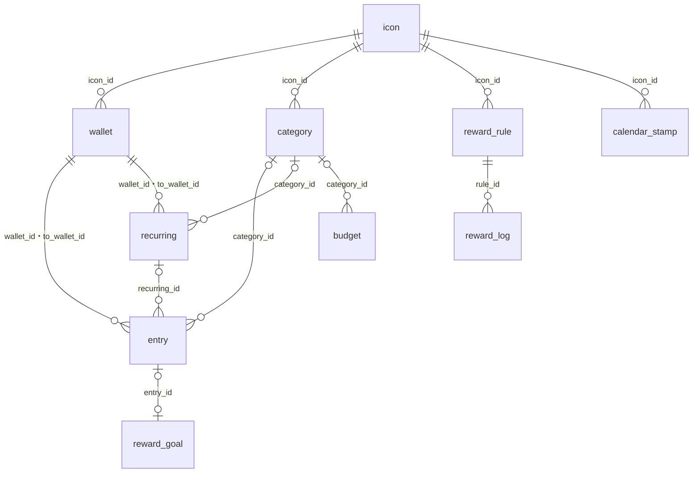

# データ

kakeibot が端末に保存する表の形と、その決まりを書く。

## 表の関係

表どうしの参照は、次の図のとおりである。

`no_spend_day`・`theme`・`setting` はほかの表を参照しない（`setting` の `theme_id` は値として持つ）。

## 共通の決まり

> [!IMPORTANT]
> - 金額は整数（円）。小数の型を使わない
> - 記録の日付は `YYYY-MM-DD` の文字列。時刻と時差を含めない

| 決まり | 理由 |
| --- | --- |
| ID は UUID（文字列） | 書き出したデータを別の端末で読み込んでも ID がぶつからない |
| 通貨の列は持たない | 円だけを扱う |
| 月は `YYYY-MM`。呼び方は [decisions.md](decisions.md) の「期間の呼び方」 | 給料日 25 日なら 1/25〜2/24 が `2026-02` |
| 日時は UTC の ISO 8601 | 書き出しと記録忘れの判定に使う |
| 財布・カテゴリは消さずに `archived_at` でしまう | 過去の記録が参照している |
| 残高・貯金箱の残高は保存せず、記録から計算する | 二重に持つとずれる |

## 表

表ごとに、列と型と補足を書く。型は SQLite の型で書く。

### icon

| 列 | 型 | 補足 |
| --- | --- | --- |
| id | TEXT | なし |
| emoji | TEXT | 空でもよい |
| text | TEXT | 3 文字まで。emoji と text のどちらかは必須 |
| color | TEXT | `#RRGGBB` |
| created_at / updated_at | TEXT | なし |

### wallet

| 列 | 型 | 補足 |
| --- | --- | --- |
| id | TEXT | なし |
| name | TEXT | なし |
| kind | TEXT | `cash` `bank` `card` `emoney` `point` |
| icon_id | TEXT | なし |
| initial_balance | INTEGER | カードはマイナスでもよい |
| sort_order | INTEGER | なし |
| archived_at | TEXT | なし |
| created_at / updated_at | TEXT | なし |

### category

| 列 | 型 | 補足 |
| --- | --- | --- |
| id | TEXT | なし |
| kind | TEXT | `expense` `income` |
| name | TEXT | なし |
| icon_id | TEXT | なし |
| sort_order | INTEGER | なし |
| archived_at | TEXT | なし |
| created_at / updated_at | TEXT | なし |

### entry

| 列 | 型 | 補足 |
| --- | --- | --- |
| id | TEXT | なし |
| type | TEXT | `expense` `income` `transfer` |
| amount | INTEGER | 1 以上 |
| date | TEXT | なし |
| category_id | TEXT | 振替は空、それ以外は必須 |
| wallet_id | TEXT | 振替では出す側 |
| to_wallet_id | TEXT | 振替だけ。wallet_id と別 |
| memo | TEXT | なし |
| recurring_id | TEXT | 固定費から作った記録 |
| recurring_date | TEXT | どの回の分か |
| created_at / updated_at | TEXT | なし |

`(recurring_id, recurring_date)` は重複禁止。支出を記録した日の `no_spend_day` は消す。

### budget

| 列 | 型 | 補足 |
| --- | --- | --- |
| id | TEXT | なし |
| category_id | TEXT | 空なら月全体 |
| from_month | TEXT | この月から有効 |
| amount | INTEGER | 空ならこの月から予算なし |

ある月の予算は、`from_month` がその月以前でいちばん新しい行。`(category_id, from_month)` は重複禁止（月全体は部分インデックスで防ぐ）。

### recurring

| 列 | 型 | 補足 |
| --- | --- | --- |
| id | TEXT | なし |
| type / amount / category_id / wallet_id / to_wallet_id / memo | entry と同じ | 決まりも entry と同じ |
| frequency | TEXT | `monthly` `yearly` |
| month | INTEGER | yearly だけ |
| day | INTEGER | 1〜31。月末を超えたらその月の最終日 |
| start_date / end_date | TEXT | end_date は空でもよい |
| remind_days_before | INTEGER | 空なら知らせない |
| generated_until | TEXT | どの日まで記録を作ったか |
| created_at / updated_at | TEXT | なし |

### reward_rule

| 列 | 型 | 補足 |
| --- | --- | --- |
| id | TEXT | なし |
| name | TEXT | 「自炊した日」 |
| amount | INTEGER | なし |
| icon_id | TEXT | なし |
| is_active | INTEGER | なし |
| sort_order | INTEGER | なし |
| created_at / updated_at | TEXT | なし |

### reward_log

| 列 | 型 | 補足 |
| --- | --- | --- |
| id | TEXT | なし |
| rule_id | TEXT | なし |
| date | TEXT | なし |
| amount | INTEGER | その時点の額を写す |
| created_at | TEXT | なし |

`(rule_id, date)` は重複禁止。

### reward_goal

| 列 | 型 | 補足 |
| --- | --- | --- |
| id | TEXT | なし |
| name | TEXT | なし |
| target_amount | INTEGER | なし |
| purchased_at | TEXT | なし |
| entry_id | TEXT | 買ったときの記録 |
| created_at / updated_at | TEXT | なし |

貯金箱の残高 ＝ reward_log の合計 − 買った目標の target_amount の合計。

### calendar_stamp

| 列 | 型 | 補足 |
| --- | --- | --- |
| id | TEXT | なし |
| date | TEXT | なし |
| icon_id | TEXT | なし |
| created_at | TEXT | なし |

1 日に置ける数は未決。

### no_spend_day

| 列 | 型 | 補足 |
| --- | --- | --- |
| date | TEXT | 主キー |
| created_at | TEXT | なし |

### theme

| 列 | 型 | 補足 |
| --- | --- | --- |
| id | TEXT | なし |
| name | TEXT | なし |
| background / surface / text_primary / text_secondary / accent / expense / income | TEXT | `#RRGGBB`。色の数は未決 |
| corner_radius | INTEGER | なし |
| font_id | TEXT | 同梱フォントから選ぶ |
| is_builtin | INTEGER | なし |
| created_at / updated_at | TEXT | なし |

### setting

| key | 値 |
| --- | --- |
| month_start_day | 1〜31 |
| week_start | `monday` など |
| reminder_time | `HH:mm`。空なら知らせない |
| character_id | 同梱キャラクターの ID |
| character_name | なし |
| theme_id | なし |
| onboarding_completed | `true` `false` |

列は `key`（TEXT、主キー）と `value`（TEXT）の 2 つ。

## よく使う組み合わせ

表は持たない。直近 60 日の記録を「種類・カテゴリ・財布・金額」でまとめ、回数の多い順に 6 つ出す。日数と件数は未決。

## 表の形の変更

| 対象 | 方式 |
| --- | --- |
| iOS | GRDB の `DatabaseMigrator` |
| Android | Room の移行（iOS の最新の形から始める） |
| テスト | 古い版の DB から最新の形まで移せることを確かめる |
