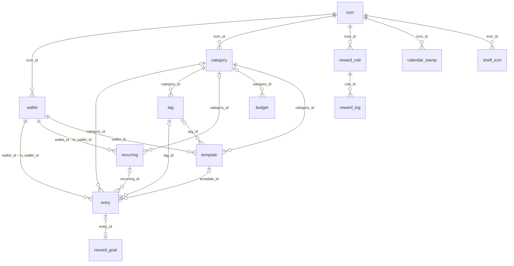

# データ

kakeibot が端末に保存する表の形と、その決まりを書く。

## 表の関係

表どうしの参照は、次の図のとおりである。

`no_spend_day`・`theme`・`setting` はほかの表を参照しない（`setting` の `theme_id` は値として持つ）。

## 共通の決まり

> [!IMPORTANT]
> - 金額は整数（円）。小数の型を使わない
> - 記録の日付は `YYYY-MM-DD` の文字列。時刻と時差を含めない

ほかに、すべての表で次の決まりを守る。

- ID は UUID の小文字の文字列
- 通貨の列は持たない。円だけを扱う
- 月は `YYYY-MM`。期間との対応は下の表
- 日時は UTC の ISO 8601
- 財布・カテゴリ・タグ・スタンプの一覧のアイコンは消さずに `archived_at` でしまう
- 残高・貯金箱の残高は保存せず、記録から計算する

月の始まりごとに、期間と月の呼び方を次の表に並べる。理由は [decisions.md の「期間の呼び方」](decisions.md#期間の呼び方)にある。

| 月の始まり | 期間 | 呼び方 |
| --- | --- | --- |
| 1 日 | 2/1〜2/28 | `2026-02` |
| 25 日（給料日） | 1/25〜2/24 | `2026-02` |
| 31 日 | 1/31〜2/27 | `2026-02` |

## 最初に入るデータ

App Group の DB を開いたときに財布もカテゴリも無ければ、次を入れる。理由は [decisions.md の「最初の財布とカテゴリ」](decisions.md#最初の財布とカテゴリ)にある。

| 表 | 中身 |
| --- | --- |
| wallet | 財布（`cash`）、銀行（`bank`） |
| category（`expense`） | 食費、日用品、交通、交際、趣味、衣服、美容、医療、住まい、通信、光熱費、その他 |
| category（`income`） | 給料、臨時収入、その他 |

どれにも、絵柄（`glyph`）と色の icon を 1 つずつ付ける。

スタンプの一覧が 1 つも無ければ（しまったものも数える）、`star`・`party`・`trophy`・`cake`・`fitness`・`travel`・`sun`・`moon` の絵柄の shelf_icon を、この順で入れる。

## 表

表ごとに、列と型と補足を書く。型は SQLite の型で書く。

### icon

| 列 | 型 | 補足 |
| --- | --- | --- |
| id | TEXT | |
| emoji | TEXT | 空でもよい |
| text | TEXT | 3 文字まで |
| glyph | TEXT | 決まった絵柄の名前（`food`・`transit` など）。OS ごとに絵に置き換える |
| color | TEXT | `#RRGGBB` |
| created_at / updated_at | TEXT | |

emoji・text・glyph のどれかは必須。

### shelf_icon

| 列 | 型 | 補足 |
| --- | --- | --- |
| id | TEXT | |
| icon_id | TEXT | |
| sort_order | INTEGER | |
| archived_at | TEXT | |
| created_at / updated_at | TEXT | |

スタンプの一覧に並ぶアイコン。カレンダーのスタンプは、ここにある icon を指す。

### wallet

| 列 | 型 | 補足 |
| --- | --- | --- |
| id | TEXT | |
| name | TEXT | |
| kind | TEXT | `cash` `bank` `card` `emoney` `point` `other` |
| icon_id | TEXT | |
| initial_balance | INTEGER | カードはマイナスでもよい |
| sort_order | INTEGER | |
| archived_at | TEXT | |
| created_at / updated_at | TEXT | |

### category

| 列 | 型 | 補足 |
| --- | --- | --- |
| id | TEXT | |
| kind | TEXT | `expense` `income` |
| name | TEXT | |
| icon_id | TEXT | |
| sort_order | INTEGER | |
| archived_at | TEXT | |
| created_at / updated_at | TEXT | |

### tag

| 列 | 型 | 補足 |
| --- | --- | --- |
| id | TEXT | |
| category_id | TEXT | どのカテゴリのタグか |
| name | TEXT | 8 文字まで |
| sort_order | INTEGER | カテゴリの中での並び |
| archived_at | TEXT | |
| created_at / updated_at | TEXT | |

### entry

| 列 | 型 | 補足 |
| --- | --- | --- |
| id | TEXT | |
| type | TEXT | `expense` `income` `transfer` |
| amount | INTEGER | 1 以上 |
| date | TEXT | |
| category_id | TEXT | 振替は空、それ以外は必須 |
| tag_id | TEXT | 空でもよい。入れるなら category_id のタグ |
| template_id | TEXT | テンプレートから作った記録だけ |
| wallet_id | TEXT | 振替では出す側 |
| to_wallet_id | TEXT | 振替だけ。wallet_id と別 |
| memo | TEXT | |
| recurring_id | TEXT | 固定費から作った記録 |
| recurring_date | TEXT | どの回の分か |
| created_at / updated_at | TEXT | |

`recurring_id` と `recurring_date` は、そろって入るか、どちらも空にする。`(recurring_id, recurring_date)` は重複禁止。支出を記録した日の `no_spend_day` は消す。

### template

| 列 | 型 | 補足 |
| --- | --- | --- |
| id | TEXT | |
| name | TEXT | |
| type | TEXT | `expense` `income` |
| amount | INTEGER | 空なら使うときに入れる。入れるなら 1 以上 |
| category_id | TEXT | |
| tag_id | TEXT | 空でもよい。入れるなら category_id のタグ |
| wallet_id | TEXT | |
| memo | TEXT | |
| sort_order | INTEGER | |
| archived_at | TEXT | |
| created_at / updated_at | TEXT | |

テンプレートは `archived_at` でしまうか、消す。消すと、記録の `template_id` を空にする。

### budget

| 列 | 型 | 補足 |
| --- | --- | --- |
| id | TEXT | |
| category_id | TEXT | 空なら月全体 |
| from_month | TEXT | この月から有効 |
| amount | INTEGER | 空ならこの月から予算なし |

ある月の予算は、`from_month` がその月以前でいちばん新しい行である。`(category_id, from_month)` は重複禁止（月全体は部分インデックスで防ぐ）。額を前の月と同じに戻したら、その月の行を消す。

月全体の予算に、次の行があるとする。

| from_month | amount |
| --- | --- |
| `2026-01` | 100000 |
| `2026-04` | 120000 |
| `2026-07` | 空 |

このとき、月ごとに使う行と予算は、次の表になる。

| 月 | 使う行 | 予算 |
| --- | --- | --- |
| `2026-03` | `2026-01` | 100,000 円 |
| `2026-04` | `2026-04` | 120,000 円 |
| `2026-08` | `2026-07` | なし |

### recurring

| 列 | 型 | 補足 |
| --- | --- | --- |
| id | TEXT | |
| type / amount / category_id / wallet_id / to_wallet_id / memo | entry と同じ | 決まりも entry と同じ |
| frequency | TEXT | `monthly` `yearly` |
| month | INTEGER | yearly だけ |
| day | INTEGER | 1〜31。月末を超えたらその月の最終日 |
| start_date / end_date | TEXT | end_date は空でもよい |
| remind_days_before | INTEGER | 空なら知らせない |
| generated_until | TEXT | どの日まで記録を作ったか |
| sort_order | INTEGER | 設定の一覧の並び |
| archived_at | TEXT | しまっている間は記録を作らない |
| created_at / updated_at | TEXT | |

### reward_rule

| 列 | 型 | 補足 |
| --- | --- | --- |
| id | TEXT | |
| name | TEXT | 「自炊した日」 |
| amount | INTEGER | |
| icon_id | TEXT | |
| is_active | INTEGER | |
| sort_order | INTEGER | |
| created_at / updated_at | TEXT | |

### reward_log

| 列 | 型 | 補足 |
| --- | --- | --- |
| id | TEXT | |
| rule_id | TEXT | |
| date | TEXT | |
| amount | INTEGER | その時点の額を写す |
| created_at | TEXT | |

`(rule_id, date)` は重複禁止。

### reward_goal

| 列 | 型 | 補足 |
| --- | --- | --- |
| id | TEXT | |
| name | TEXT | |
| target_amount | INTEGER | |
| purchased_at | TEXT | |
| entry_id | TEXT | 買ったときの記録 |
| created_at / updated_at | TEXT | |

貯金箱の残高 ＝ reward_log の合計 − 買った目標の target_amount の合計。

### calendar_stamp

| 列 | 型 | 補足 |
| --- | --- | --- |
| id | TEXT | |
| date | TEXT | |
| icon_id | TEXT | |
| created_at | TEXT | |

date ごとに 1 つまで。押し直すと置き換える。

### no_spend_day

| 列 | 型 | 補足 |
| --- | --- | --- |
| date | TEXT | 主キー |
| created_at | TEXT | |

### theme

| 列 | 型 | 補足 |
| --- | --- | --- |
| id | TEXT | |
| name | TEXT | |
| background / surface / text_primary / text_secondary / accent / expense / income | TEXT | `#RRGGBB`。色の数は未決 |
| corner_radius | INTEGER | |
| font_id | TEXT | 同梱フォントから選ぶ |
| is_builtin | INTEGER | |
| created_at / updated_at | TEXT | |

### setting

| key | 値 |
| --- | --- |
| month_start_day | 1〜31。月末を超えたらその月の最終日 |
| week_start | `monday`〜`sunday`。空なら日曜 |
| reminder_time | `HH:mm`。空なら知らせない |
| character_id | 同梱キャラクターの ID |
| character_name | |
| theme_id | |
| onboarding_completed | `true` `false` |
| launch_screen | `home` `entry`。空ならホーム |
| template_order | `manual` `frequent` `category` `amount` `name`。空なら並べた順 |
| category_menu_opened | `true` `false`。`true` なら入力シートの長押しのヒントを出さない |
| records_layout | `list` `calendar`。空なら一覧 |
| review_scale | `week` `month` `year`。空なら月 |
| review_kind | `expense` `income` `balance`。空なら支出 |

列は `key`（TEXT、主キー）と `value`（TEXT）の 2 つ。`key` は表では縛らず、上の表の名前だけをアプリで使う。

## 表の形の変更

| 対象 | 方式 |
| --- | --- |
| iOS | GRDB の `DatabaseMigrator` |
| Android | Room の移行（iOS の最新の形から始める） |
| テスト | 古い版の DB から最新の形まで移せることを確かめる |
