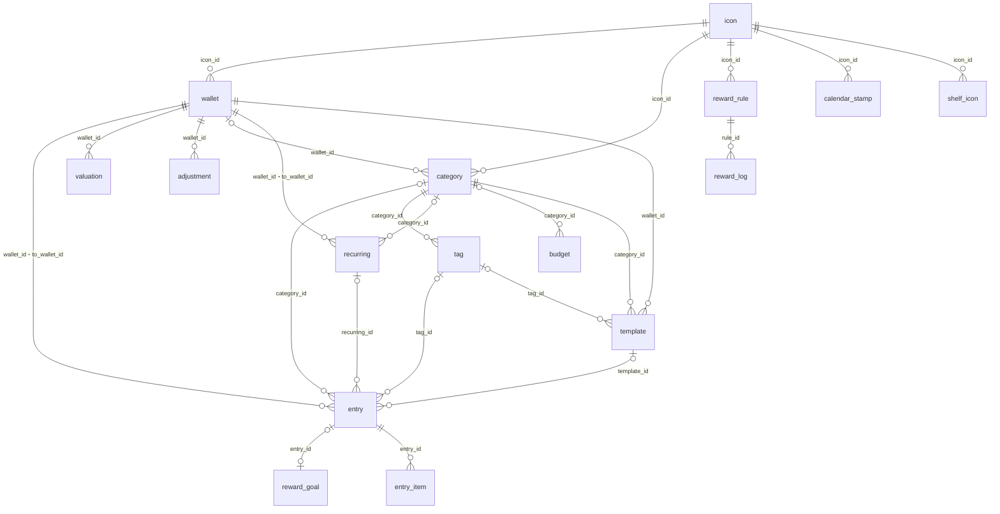

# データ

> [!NOTE]
> kakeibot が端末に保存する表の関係・形・決まりと、最初に入るデータが分かる。
> 言葉の対応は [glossary](glossary.md) にある。

## 🗺️ 表の関係

表どうしの参照は、次の図のとおりである。

`no_spend_day`・`item_name`・`theme`・`setting` はほかの表を参照しない。`setting` の `theme_id` は、値として持つ。

## 📏 共通の決まり

> [!IMPORTANT]
> - 金額は整数（円）。小数の型を使わない
> - 記録の日付は `YYYY-MM-DD` の文字列。時刻と時差を含めない

ほかに、すべての表で次の決まりを守る。

- ID は UUID の小文字の文字列にする。
- 通貨の列は持たない。円だけを扱う。
- 月は `YYYY-MM` にする。期間との対応は下の表にある。
- 日時は UTC の ISO 8601 にする。
- 財布（`Wallet`）・カテゴリ・タグ・スタンプの一覧のアイコンは、ふだんは `archived_at` でしまう。
- 財布とカテゴリは、記録が無いときだけ消せる。使っている固定費（`Recurring`）・テンプレート（`EntryTemplate`）・評価額・予算・タグも一緒に消す。
- 残高・貯金箱の残高は保存せず、記録と評価額から計算する。

月の始まりごとに、期間と月の呼び方を次の表に並べる。理由は [decisions/periods.md の「期間の呼び方」](decisions/periods.md#期間の呼び方)にある。

| 月の始まり | 期間 | 呼び方 |
| --- | --- | --- |
| 1 日 | 2/1〜2/28 | `2026-02` |
| 25 日（給料日） | 1/25〜2/24 | `2026-02` |
| 31 日 | 1/31〜2/27 | `2026-02` |

## 🚀 最初に入るデータ

App Group の DB を開いたときに財布もカテゴリも無ければ、次を入れる。理由は [decisions/setup.md の「最初の財布とカテゴリ」](decisions/setup.md#最初の財布とカテゴリ)にある。

| 表 | 中身 |
| --- | --- |
| wallet | 財布（`cash`）、銀行（`bank`） |
| category（`expense`） | 食費、日用品、交通、交際、趣味、衣服、美容、医療、住まい、通信、光熱費、その他 |
| category（`income`） | 給料、臨時収入、その他 |

どれにも、絵柄（`glyph`）と色の icon を 1 つずつ付ける。

最初の設定を開いたときにテンプレートが 1 つも無ければ、支出のテンプレートを入れる。金額は空にし、口座は最初の現金の口座にする。

| 名前 | カテゴリ |
| --- | --- |
| コンビニ | 食費 |
| ランチ | 食費 |
| 電車 | 交通 |
| 日用品 | 日用品 |

スタンプの一覧が 1 つも無ければ（しまったものも数える）、shelf_icon を入れる。絵柄は `star`・`party`・`trophy`・`cake`・`fitness`・`travel`・`sun`・`moon` の順にする。

同期を入れて最初の取得を終えるまでは、財布・カテゴリ・shelf_icon を入れない。`sync_state.engine_state` が空の間がそれに当たる。

## 🗄️ 表

表ごとに、列と型と補足を書く。型は SQLite の型で書く。

`theme` と `setting` は [data-settings](data-settings.md)、同期のための表は [data-sync](data-sync.md) にある。

### icon

| 列 | 型 | 補足 |
| --- | --- | --- |
| id | TEXT | |
| emoji | TEXT | 空でもよい |
| text | TEXT | 3 文字まで |
| glyph | TEXT | 決まった絵柄の名前（`food`・`transit` など）。OS ごとに絵に置き換える |
| color | TEXT | `#RRGGBB` |
| created_at / updated_at | TEXT | |

emoji・text・glyph のどれかは必須。新しい版で足した glyph を古い版が受け取ったら、`other` として読む。

### shelf_icon

| 列 | 型 | 補足 |
| --- | --- | --- |
| id | TEXT | |
| icon_id | TEXT | |
| sort_order | INTEGER | |
| archived_at | TEXT | |
| created_at / updated_at | TEXT | |

スタンプの一覧に並ぶアイコン。カレンダーのスタンプは、ここにある icon を指す。

### wallet

| 列 | 型 | 補足 |
| --- | --- | --- |
| id | TEXT | |
| name | TEXT | |
| kind | TEXT | `cash` `bank` `card` `emoney` `point` `other` `investment` `loan` |
| icon_id | TEXT | |
| initial_balance | INTEGER | カードはマイナスでもよい |
| loan_amount | INTEGER | 借入の口座で最初に借りた額。ほかは NULL |
| sort_order | INTEGER | |
| archived_at | TEXT | |
| created_at / updated_at | TEXT | |

### valuation

投資の口座の、ある日の評価額。

| 列 | 型 | 補足 |
| --- | --- | --- |
| id | TEXT | |
| wallet_id | TEXT | |
| date | TEXT | |
| amount | INTEGER | その日の終わりの残高 |
| created_at / updated_at | TEXT | |

`(wallet_id, date)` は重複禁止。同じ日に入れ直したら置き換える。

財布の残高は、いちばん新しい評価額から次のように数える。

| 場合 | 数え方 |
| --- | --- |
| 評価額がある | その額に、評価額の日より後の記録を足し引きする |
| 評価額と同じ日の記録 | 評価額より後に作ったものだけを足し引きする |
| 評価額が無い | 最初の残高に、すべての記録を足し引きする |
| ある日の時点の残高 | その日までの評価額だけを使う |

### adjustment

口座の残高の調整。記録とは別に持ち、残高にだけ足す。

| 列 | 型 | 補足 |
| --- | --- | --- |
| id | TEXT | |
| wallet_id | TEXT | |
| date | TEXT | |
| amount | INTEGER | 残高に足す額。符号付きで、0 は入れない |
| created_at / updated_at | TEXT | |

残高は、記録と同じく日までの調整を足す。評価額のある投資は、評価額より前の調整を足さない。

### category

| 列 | 型 | 補足 |
| --- | --- | --- |
| id | TEXT | |
| kind | TEXT | `expense` `income` |
| name | TEXT | |
| icon_id | TEXT | |
| sort_order | INTEGER | |
| archived_at | TEXT | |
| wallet_id | TEXT | 共有の財布の共有用のカテゴリだけ。自分のカテゴリは NULL |
| created_at / updated_at | TEXT | |

### tag

| 列 | 型 | 補足 |
| --- | --- | --- |
| id | TEXT | |
| category_id | TEXT | どのカテゴリのタグか |
| name | TEXT | 8 文字まで |
| sort_order | INTEGER | カテゴリの中での並び |
| archived_at | TEXT | |
| created_at / updated_at | TEXT | |

### entry

| 列 | 型 | 補足 |
| --- | --- | --- |
| id | TEXT | |
| type | TEXT | `expense` `income` `transfer` |
| amount | INTEGER | 1 以上 |
| date | TEXT | |
| category_id | TEXT | 振替は空、それ以外は必須 |
| tag_id | TEXT | 空でもよい。入れるなら category_id のタグ |
| template_id | TEXT | テンプレートから作った記録だけ |
| wallet_id | TEXT | 振替では出す側 |
| to_wallet_id | TEXT | 振替だけ。wallet_id と別 |
| memo | TEXT | |
| recurring_id | TEXT | 固定費から作った記録 |
| recurring_date | TEXT | 休日でずらす前の予定日で、どの回の分かを表す。`date` は実際の日（ずらした後） |
| bill_month | TEXT | カードの引き落としの回の月（`2026-11`）で、休日でずらす前の予定日の月で書く。空なら締め日で決める |
| transfer_id | TEXT | 振替の手数料だけが持つ、元の振替の entry。重複禁止で、振替を消すと一緒に消える |
| tax_included | INTEGER | 0 は外税、1 は内税で、品目の税の計算を表す。品目の無い記録は 0 |
| created_at / updated_at | TEXT | |

`recurring_id` と `recurring_date` は、そろって入るか、どちらも空にする。`(recurring_id, recurring_date)` は重複禁止。支出を記録した日の `no_spend_day` は消す。

索引は、`date`・`(wallet_id, date)`・`to_wallet_id`・`category_id` に付ける。

振替の手数料は、振替と別の支出の記録にする。決まりは次のとおり。

- 日付と財布は振替に合わせ、財布は振替元にする。
- カテゴリは `fee_category_id` の設定のカテゴリにし、無ければ「手数料」を作る。
- 手数料を 0 にすると記録を消す。

### entry_item

| 列 | 型 | 補足 |
| --- | --- | --- |
| id | TEXT | |
| entry_id | TEXT | 支出か収入の entry。記録を消すと一緒に消える |
| name | TEXT | 空にしない |
| quantity | INTEGER | 1 以上 |
| amount | INTEGER | 数量を掛けた後の金額。値引は負の数 |
| tax_rate | INTEGER | 空・8・10。空は税込で、8 と 10 は記録が外税なら税抜、内税なら税込の金額 |
| sort_order | INTEGER | |
| created_at / updated_at | TEXT | |

索引は、`entry_id` に付ける。品目の合計と記録の `amount` の差は保存しない。決まりは [decisions/receipts.md の「記録の品目」](decisions/receipts.md#記録の品目)にある。

### item_name

レシートで人が直した品名を覚える表である。

| 列 | 型 | 補足 |
| --- | --- | --- |
| id | TEXT | |
| store | TEXT | 読んだ店名 |
| raw | TEXT | 読んだ品名の文字 |
| name | TEXT | 人が直した品名 |
| created_at / updated_at | TEXT | |

`(store, raw)` は重複禁止。同じ組を直し直すと、`name` を書き換える。読んだままの文字に戻すと、行を消す。

### template

| 列 | 型 | 補足 |
| --- | --- | --- |
| id | TEXT | |
| name | TEXT | |
| type | TEXT | `expense` `income` |
| amount | INTEGER | 空なら使うときに入れる。入れるなら 1 以上 |
| category_id | TEXT | |
| tag_id | TEXT | 空でもよい。入れるなら category_id のタグ |
| wallet_id | TEXT | |
| memo | TEXT | |
| bill_shift | INTEGER | 0〜2。wallet_id がカードのとき、使った日の何回あとの引き落としに入れるか。カードでなければ 0 |
| sort_order | INTEGER | |
| archived_at | TEXT | |
| created_at / updated_at | TEXT | |

テンプレートは `archived_at` でしまうか、消す。消すと、記録の `template_id` を空にする。

### budget

| 列 | 型 | 補足 |
| --- | --- | --- |
| id | TEXT | |
| category_id | TEXT | 空なら月全体 |
| from_month | TEXT | この月から有効 |
| amount | INTEGER | 空ならこの月から予算なし |

ある月の予算は、`from_month` がその月以前でいちばん新しい行である。`(category_id, from_month)` は重複禁止（月全体は部分インデックスで防ぐ）。額を前の月と同じに戻したら、その月の行を消す。

月全体の予算に、次の行があるとする。

| from_month | amount |
| --- | --- |
| `2026-01` | 100000 |
| `2026-04` | 120000 |
| `2026-07` | 空 |

このとき、月ごとに使う行と予算は、次の表になる。

| 月 | 使う行 | 予算 |
| --- | --- | --- |
| `2026-03` | `2026-01` | 100,000 円 |
| `2026-04` | `2026-04` | 120,000 円 |
| `2026-08` | `2026-07` | なし |

### recurring

| 列 | 型 | 補足 |
| --- | --- | --- |
| id | TEXT | |
| type / amount / category_id / wallet_id / to_wallet_id / memo | entry と同じ | 決まりも entry と同じ |
| frequency | TEXT | `monthly` `yearly` |
| month | INTEGER | yearly だけ |
| day | INTEGER | 1〜31。月末を超えたらその月の最終日 |
| holiday_shift | TEXT | `none` `previous` `next`。休日に当たったら、そのまま・前の平日・次の平日にする |
| closing_day | INTEGER | 振替だけで、1〜31（31 は末日）。あれば、記録の額を振替先のカードの利用分にし、amount は 0 にする |
| fee | INTEGER | 振替だけで、1 以上。あれば、記録するときに手数料も記録する |
| bill_shift | INTEGER | 0〜2。テンプレートと同じ。振替では 0 |
| final_amount | INTEGER | 最後の回の額で、end_date があり決まった額のときだけ入る。空なら最後の回も amount |
| start_date / end_date | TEXT | end_date は空でもよい |
| remind_days_before | INTEGER | 空なら知らせない |
| generated_until | TEXT | どの日まで記録を作ったか |
| sort_order | INTEGER | 設定の一覧の並び |
| archived_at | TEXT | しまっている間は記録を作らない |
| created_at / updated_at | TEXT | |

### reward_rule

| 列 | 型 | 補足 |
| --- | --- | --- |
| id | TEXT | |
| name | TEXT | 「自炊した日」 |
| amount | INTEGER | |
| icon_id | TEXT | |
| is_active | INTEGER | |
| sort_order | INTEGER | |
| created_at / updated_at | TEXT | |

### reward_log

| 列 | 型 | 補足 |
| --- | --- | --- |
| id | TEXT | |
| rule_id | TEXT | |
| date | TEXT | |
| amount | INTEGER | その時点の額を写す |
| created_at | TEXT | |

`(rule_id, date)` は重複禁止。

### reward_goal

| 列 | 型 | 補足 |
| --- | --- | --- |
| id | TEXT | |
| name | TEXT | |
| target_amount | INTEGER | |
| purchased_at | TEXT | |
| entry_id | TEXT | 買ったときの記録。その記録を消すと空にする |
| created_at / updated_at | TEXT | |

貯金箱の残高 ＝ reward_log の合計 − 買った目標の target_amount の合計。

### calendar_stamp

| 列 | 型 | 補足 |
| --- | --- | --- |
| id | TEXT | |
| date | TEXT | |
| icon_id | TEXT | |
| created_at | TEXT | |

date ごとに 1 つまで（date に一意の索引を付ける）。押し直すと置き換える。

### no_spend_day

| 列 | 型 | 補足 |
| --- | --- | --- |
| date | TEXT | 主キー |
| created_at | TEXT | |

## 📝 表の形の変更

| 対象 | 方式 |
| --- | --- |
| iOS | GRDB の `DatabaseMigrator` |
| Android | Room の移行（iOS の最新の形から始める） |
| テスト | 古い版の DB から最新の形まで移せることを確かめる |
