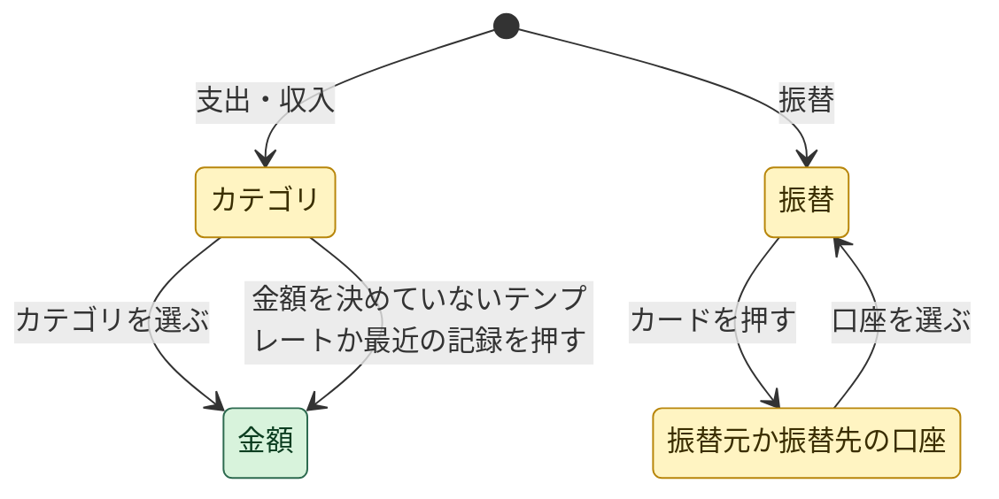

# 入力シートの入力盤

> [!NOTE]
> 入力シートの下の入力盤と、金額を入れるテンキーを、どう決めたかと、その理由が分かる。寸法の数は pt で書く。
> シートの形は [entry-sheet](entry-sheet.md)、紙のカードは [entry-sheet-card](entry-sheet-card.md) にある。

## 入力盤

**決定：下半分は開け閉めしない入力盤にし、押した行やカテゴリの印に合わせて中身だけを替える。**

| 項目 | 内容 |
| :---: | --- |
| 💡 理由 | テンキーを開く・閉じる操作が要らない。開いた時に見える物が、今入れる項目の分だけになる |
| 💡 理由 | カテゴリから選ぶと、押す回数を増やさずに金額へ進める |
| ❌ 却下 | ~~口座を選ぶと金額の中身へ進む~~ 選び直すたびに戻る手間がかかる |
| ❌ 却下 | ~~開くと電卓を出す形~~ テンキーを開く・閉じる操作が要る |
| ❌ 却下 | ~~電卓を閉じて始めるだけの形~~ テンキーを開く・閉じる操作が要る |

> [!IMPORTANT]
> - 新しい記録も編集も、支出と収入はカテゴリ、振替は振替の中身で始める。
> - カテゴリを選ぶと金額へ進む。支払い元と入金先は、選んでも中身を替えない。
> - 紙のカードと入力盤の高さは、中身や場面によらず同じにする。

### 中身の移り変わり

紙のカードの行を押すと、その行の中身に替える。項目の順番は、紙のカードの行と同じにする。金額がいちばん後になる。

後ろの項目へ移るなら右から、前の項目へ移るなら左から中身を入れ替える。

種類を切り替えた時と「続けて記録」の後も、始めの中身に戻す。日付は、選んでも中身を替えない。

### 入力盤の置き方

- 入力盤の下に保存のボタンを置く。保存のボタンは [entry-save](entry-save.md) にある。
- ホームの線がある端末では、入力盤を画面の下から 20 の所まで下げる。
- 小さい端末で入りきらない中身は、入力盤の中で送る。テンキーは送らず、キーを低くして収める。
- 日付の中身は、入る端末では 6 段の月もカレンダーを全部出す。入らない小さい端末では送る。

### 入力盤の面

- 入力盤は、4 つの角を丸めた金の淡い線で囲み、面を背景よりわずかに沈めて内側の上に薄い影を落とす。
- 濃い灰色や濃い金の面にはしない。ライトのテーマで、白いカードと背景から浮いて見える。
- 金の枠で浮かせる紙のカードと、見た目を分ける。

### 中身

入力盤の中身は、次のとおり。

| 中身 | 見た目 |
| --- | --- |
| カテゴリ | 5 列 3 段のカテゴリ・タグ・2 行のテンプレートを並べる |
| 振替 | 縦に並べた振替元と振替先のカードと、よく使う組み合わせ。決まりは [entry-transfer](entry-transfer.md) にある |
| 金額 | 上の端に「金額を入力」と、品目を使う時は金のピル「品目に分ける」を置く。下にテンキーを置き、声を聞く間は声のカードに替える |
| 手数料 | 上の端に手数料の候補。下にテンキーを置く |
| 口座 | 口座を 2 列のタイルで並べ、右上に「追加」と「編集」を置く |
| 日付 | 上の端に「今日」・「昨日」・「おととい」。下に詰めたカレンダーを置く |

- カードで請求を選べる時は、口座の中身に請求の行を出す。
- 金額を入れた後は、カテゴリの中身のタグの下に「＋ 今の入力を保存」を点線で出す。
- 「金額を入力」の見出しは振替でも出し、テンキーの位置を種類でそろえる。

### 口座の追加と編集

| 状態 | 見た目 | 操作 |
| --- | --- | --- |
| 選ぶ形 | 口座を 2 列のタイルで並べる | 「追加」は、口座を足すシートを開く。足した口座は、そのまま選ぶ |
| 編集 | タイルの右上の角に鉛筆の丸い印を重ねる | タイルを押すと、その口座を直すシートを開く。「完了」で選ぶ形に戻る |

鉛筆をタイルの右に並べない。名前と残高の幅が減り、字が縮む。

口座の一覧を別のシートで開いてから編集に切り替える形にはしない。直すまでの手数が増える。

## テンキー

**決定：金額を入れる欄は、入力シートのほかでも同じ電卓のテンキーを下から出す。**

| 段 | キー |
| :---: | --- |
| 上 | <kbd>⌫</kbd> <kbd>税込 8%</kbd> <kbd>税込 10%</kbd> <kbd>÷</kbd> |
| 下 | <kbd>00</kbd> <kbd>0</kbd> <kbd>000</kbd> <kbd>＝</kbd> |

> [!IMPORTANT]
> - <kbd>⌫</kbd> を長押しすると、震わせて全部を消す。
> - 入力シートの入力盤のテンキーは閉じないので、<kbd>＝</kbd> は計算の途中でなくても <kbd>＝</kbd> のまま出す。

### 引き出しで出すテンキー

見出しに `✓` を出さない。

| 状態 | <kbd>＝</kbd> の所のキー |
| --- | --- |
| 計算の途中 | <kbd>＝</kbd> |
| 計算の途中でない | 塗りのない閉じるキー（キーボードと下向きの矢印） |
