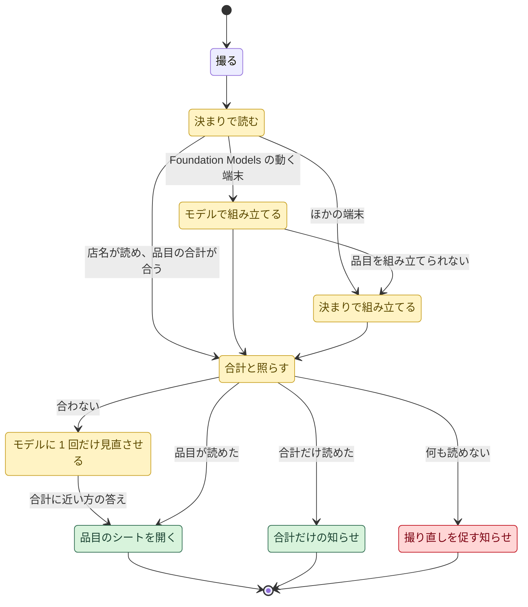

# レシートの読み取り

> [!NOTE]
> レシートの読み取りと、読む回数をどう決めたかと、その理由が分かる。
> 記録の品目と税率は [receipts](receipts.md)、記録のほかの操作は [records](records.md) にある。

## レシートを読む

**決定：入力シートの紙のカードに「レシートを撮る」を置き、撮ったレシートから品目・合計・日付・店名を読む。**

| 項目 | 内容 |
| :---: | --- |
| 💡 理由 | 今の入力の流れのまま使え、「続けて記録」と合わせて何枚も入れられる |
| 💡 理由 | 書類のカメラ（VisionKit）で撮り、Vision と端末の中のモデルで読む。端末の外には送らない |
| 💡 理由 | 品目の合計とレシートの合計を照らし、合わない所だけを見せれば、手直しが減る |
| 💡 理由 | モデルには行の役割だけを答えさせ、金額は行の文字から読むので、モデルが行に無い数字を作っても品目に入らない |
| ❌ 却下 | ~~外のサービスで読む~~ 端末の外には送らない |
| ❌ 却下 | ~~モデルに品名と金額を書き写させる~~ モデルが行に無い数字を作ると、品目に入ってしまう |

> [!IMPORTANT]
> - 金額が読めても自動では保存せず、人が確かめてから保存する。品目が読めたら品目のシートを開き、合計だけ読めたら知らせを出す。
> - 品名・金額・数量・日付は、モデルが指した行の文字から決まりで読む。組み立て方は [fixtures](../../spec/fixtures/receipt/receipt-labels.json) にそろえる。
> - 画像は保存せず、読んだら捨てる。

### 読む流れ

### 撮る

- レシートを撮る入口は、紙のカードの右上の丸いボタンにする。置き方は [entry-sheet の「紙のカード」](entry-sheet-card.md#紙のカード)にある。
- 書類のカメラが使えない端末では出さない。
- 撮る前に、毎回撮り方（平らな所・明るい所・1 枚ずつ端まで）を絵で出す。
- 撮り方の絵は、「次から表示しない」に印を付けて閉じると、次から出さない。
- 長いレシートは、縦に何枚かに分けて撮れる。
- 読んでいる間は、紙片の上を光の帯が動くカードを出す。

### モデルで読む

- 決まりだけで店名が読め、品目の合計がレシートの合計と合う時は、モデルに聞かずにその結果を使う。
- Foundation Models の動く端末では、番号を付けた行をモデルに渡す。
- モデルには、まずレシートの並び方を一文で書かせ、それに沿って行の番号と税率の印を答えさせる。
- モデルが答える行は、次のとおりである。店名・日付・合計・品目・品名・数量の行と、品目の値引・レシート全体の値引の行。
- モデルの答えでも決まりでも品目の合計がレシートの合計と合わない時は、モデルに 1 回だけ見直させる。
- 見直しでは、同じ会話でずれた金額を伝え、合計に近い方の答えを使う。
- モデルには毎回同じ答えを出させ、カメラを開いた時に準備しておく。
- 行が多すぎて 1 度に読めない時は、撮った 1 枚ずつ読んでつなげる。

### 品目の組み立て

- 傾けて撮った写真は、幅の広い文字の傾きで行を水平に直してから、文字の断片を行にまとめる。
- ほかの端末と、モデルが品目を組み立てられなかった時は、行の並び・「合計」の語・金額の形の決まりで組み立てる。
- 日付は決まりで読めた方を、店名はモデルが読めた方を先に使う。
- 両方で組み立てた時は、品目の合計がそれぞれの合計に近い方の品目を使い、同じならモデルの方を使う。選び方は [fixtures](../../spec/fixtures/receipt/receipt-merging.json) にそろえる。
- モデルが指しても、合計・お預り・残高より後の行と、決まりで品目の形と読めない行は品目にしない。
- 文字が 1 つしか無い品名と、0 円の行も品目にしない。
- 数量の行は前の品目につなげ、`@` で始まる単価の行だけは次の品目につなげる。
- 小計より前の値引の行は、直前の品目より小さければその品目から引く。
- ほかの値引は別の品目にし、税率は金額の一番大きい品目に合わせる。

### 税率を決める

- 税率は、印のとおりの形と、印の無い品目を 10% にした形を、外税・内税の順に合計と照らして合う形にする。どれも合わなければ税込にする。
- 印の無いレシートは、すべてを 10% か 8% の外税にして合計と合えば、その税率にする。
- 8%対象・10%対象の額が品目の小計と同じなら、その税率の内税にする。

### 読んだ後

| 状態 | 見た目 | 操作 |
| :---: | --- | --- |
| 読めた | 店名はメモに入れる。カテゴリは、シートで選んでいるものを変えない | |
| 一部が読めない | 読めなかった項目は、今の値のまま残す。合計が読めず品目が読めた時は、記録の金額を品目の合計にする | |
| 何も読めない | 撮り直しを促す知らせを出す | |
| 合計と合わない | 読み違えらしい品目の行に琥珀色を付ける。選び方は [fixtures](../../spec/fixtures/receipt/receipt-suspects.json) にそろえる | |

読み違えらしい行には、差と同じ金額の行と、読み違えやすい数字を 1 つ直せば差が消える行を選ぶ。

人が直した品名は、レシートから読んだ店名と読んだ文字の組で覚え、次から同じ店で使う。後でメモの店名を直しても、覚える鍵は変えない。覚えた品名を読んだままの文字に戻したら、その組を忘れる。

## レシートを読む回数

**決定：無料ではレシートから 3 回まで保存でき、Pro は回数の制限なく使える。**

| 項目 | 内容 |
| :---: | --- |
| 💡 理由 | 無料のうちに精度を試せ、使い続ける人に Pro を勧められる |
| 💡 理由 | 読んでも保存しなければ数えないので、読み直しで回数が減らない |
| ❌ 却下 | ~~すべて無料にする~~ 使い続ける人に Pro を勧められない |
| ❌ 却下 | ~~初めから Pro だけにする~~ 無料のうちに精度を試せない |
| ❌ 却下 | ~~読んだ回で数える~~ 読み直しで回数が減る |

> [!IMPORTANT]
> - 回数は setting 表の `receipt_saved_count` に置き、同期中の端末どうしで共有する。
> - 3 回を使い切った後に「レシート」を押すと、Pro の案内を出す。
> - 品目を手で足すのは、無料のまま使える。
> - アプリを消して入れ直すと回数は 0 に戻る。それは許す。
