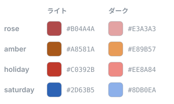

# テーマ

> [!NOTE]
> テーマの色、保存、読みやすさの決定が分かる。
> 言葉の対応は [glossary](../glossary.md) にある。

## テーマの色

**決定：画面の色は `Palette` の役割の名前（`accent`・`text` など）で書く。色の組（`ThemePalette`）は、シーンの UIKit のトレイトで渡す。**

| 項目 | 内容 |
| :---: | --- |
| 💡 理由 | 色を使う箇所が `Color` の型のまま、テーマで変わる。シートの中も同じテーマになり、一部だけ別のテーマでも描ける |
| ❌ 却下 | ~~色を `ShapeStyle` にする~~ 色を使う箇所が `Color` の型のままにならない |

> [!IMPORTANT]
> - 選んだテーマの色の組は、`.palette(_:)` でウィンドウのシーンの UIKit のトレイトに入れる。
> - シーンの明るさ（`userInterfaceStyle`）は、テーマの地が明るいかで決める。画面ごとに明るさを決めない。
> - 予算の超過や曜日のように意味を持つ色は、テーマでは変えず、地の明るさで変える。

役割の色は、描く時にそのトレイトから決まる。

### 影と光のにじみ

影・光のにじみ・後ろを暗くする幕は、`Palette` の `shadow`・`glow`・`scrim` で描く。明るい地では、影・光のにじみ・幕を、どれも暗い地より薄くする。

## テーマの保存

**決定：用意したテーマは描く 12 色をすべてコードに持ち、手で作るテーマは 5 色だけを選んで保存する。金額は、支出を強調の濃い色、収入を強調の色で描く。**

| 項目 | 内容 |
| :---: | --- |
| 💡 理由 | 手で選ぶ色を少なくし、用意したテーマは色を細かく合わせられる |
| ❌ 却下 | ~~12 色をすべて保存する~~ 手で選ぶ色が多くなる |
| ❌ 却下 | ~~用意したテーマも 5 色から作る~~ 用意したテーマの色を細かく合わせられない |

> [!IMPORTANT]
> - 選んだテーマは、設定の `theme_id` に名前で保存する。
> - 手で作るテーマは、`theme` 表に地・カード・文字・控えめな文字・強調の 5 色を保存する。`expense`・`income` の列は描画に使わない。
> - 描くほかの色は、この 5 色から作る。作り方は [theme-palette-base.json](../../spec/fixtures/theme/theme-palette-base.json) の `description` にある。

### 設定の並び

設定では、ライト・ダーク・作ったテーマ・「iPhone に合わせる」の順に並べる。

| 節 | 決まり |
| :---: | --- |
| ライト | ホワイトを先頭にする |
| ダーク | ブラックを先頭にする |
| 作ったテーマ | 1 つ以上ある時だけ出す |
| 「iPhone に合わせる」 | 既定にする。iPhone がライトならホワイト、ダークならブラックで描き、明るさが変わると切り替える |

### 作る・直す・消す

| 状態 | 見た目 | 操作 |
| --- | --- | --- |
| 一覧 | 下に「テーマを追加」 | 押すと、選んでいるテーマの色をもとに作る |
| 見本を長押し | 入力シートのカテゴリと同じ形のメニューを、見本の下に出す。入りきらない時は上に出す | その色をもとに作れる。作ったテーマは、このメニューから編集も開ける |
| 選んでいる作ったテーマの見本 | | 押すと編集を開く |
| 編集 | 色ごとに用意した色の並びから選ぶ。並びの最後の色の選択で、細かく調整もできる | 保存するとそのまま選ぶ。「…」から消す |
| 消した直後 | 「取り消す」を出す | 押すとテーマと、消す前に選んでいたテーマに戻す |

選んでいるテーマを消した時は、ホワイトに戻す。

### 押せなくする色

- 文字・補足の文字・アクセントは、今の背景とカードで読めない色を押せなくする。
- カードは、背景と明るさが違う色を押せなくする。
- 背景を変えて読めなくなった色は、読める色に差し替える。

## テーマの読みやすさ

**決定：文字の色と地の色のコントラスト比を WCAG の式で測り、満たさない色があるテーマは保存させない。**

| 項目 | 内容 |
| :---: | --- |
| 💡 理由 | 本文は WCAG の AA に、見出しや印は大きな文字と部品の基準に合わせる |
| ❌ 却下 | ~~すべて 4.5 以上~~ 見出しや印は、大きな文字と部品の基準に合わせる |

地は、背景の上下・パネル（`Palette.panel`）・カードの上下の 5 色にする。各色は、地のどれとも次の比を満たす。

| 色 | 地のどれとも満たす比 |
| --- | ---: |
| `text`・`accentStrong` | 4.5 以上 |
| `accent`・`subtext`・`hint` | 3 以上 |

用意したテーマは、`hint` も地のどれとも 4.5 以上にする。日付や補足の小さな文字を `hint` で描くためである。手で作るテーマの検査は、上の表のまま 3 以上で止める。

## 意味の色の読みやすさ

**決定：意味の色は、地のどれとも比が 3 以上になるように、地に合わせて作る。保存は止めない。**

| 項目 | 内容 |
| :---: | --- |
| 💡 理由 | 地は自由に選べるが、意味の色は選べない。地によっては予算の超過・残高のマイナス・エラーの文言が読めなくなる |
| ❌ 却下 | ~~意味の色も検査に入れて保存させない~~ 意味の色は選べない |

> [!IMPORTANT]
> - 意味を持つ色は、`rose`・`amber`・`holiday`・`saturday` である。
> - 元の色は、テーマの明暗で選ぶ。地のどれとも比が 3 以上なら、そのまま使う。
> - 足りなければ、色相と彩度を保ったまま明度をずらし、最初に 3 以上になった色を使う。
> - 明るいテーマは暗く、暗いテーマは明るくを先に試し、届かなければ逆向きを試す。
> - どちらも届かなければ、比が最も高かった色を使う。

元の色は、次のとおり。

