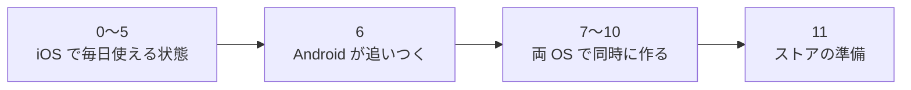

# 画面と作る順番

kakeibot を作る順番と、その状態、作る画面を書く。

## 作る順番

作る順番は、大きく次の段階に分かれる。

| 順 | 中身 | OS | 状態 |
| --- | --- | --- | --- |
| 0 | 土台（下の表） | iOS | ✅ 完了 |
| 1 | 入力シート、記録の一覧 → 毎日使い始める（下の表） | iOS | ✅ 完了 |
| 2 | 財布の残高、振替（下の表） | iOS | ✅ 完了 |
| 3 | 期間の設定、予算、ホームの「あといくら」（下の表） | iOS | ✅ 完了 |
| 4 | 振り返り、カレンダー（下の表） | iOS | ✅ 完了 |
| 5 | 固定費・繰り返し、通知 | iOS | ⬜ 未着手 |
| 6 | Core を Kotlin に移して fixtures を通し、1〜5 の画面を作る | Android | ⬜ 未着手 |
| 7 | 自作のアイコン、カレンダーのスタンプ | 両方 | ⬜ 未着手 |
| 8 | テーマ、入力シートのスタイル（カード・円形のカテゴリ） | 両方 | ⬜ 未着手 |
| 9 | キャラクター、ごほうび貯金 | 両方 | ⬜ 未着手 |
| 10 | ウィジェット | 両方 | ⬜ 未着手 |
| 11 | ストアの準備 | 両方 | ⬜ 未着手 |

### 0 番の中身

| 順 | 作業 | 担当 | 状態 |
| --- | --- | --- | --- |
| 1 | Xcode プロジェクト（アプリ、ウィジェット、App Group、Swift 6、iOS 18、iPhone のみ） | 自分 | ✅ 完了 |
| 2 | KakeibotKit・KakeibotApp の骨組みと、Xcode プロジェクトへのつなぎ | Claude | ✅ 完了 |
| 3 | `spec/fixtures/date` → Core の Date → CoreTests | Claude | ✅ 完了 |
| 4 | DB の最初の形（[data.md](data.md) の表すべて）と Records | Claude | ✅ 完了 |
| 5 | 書き出し V1（Core の Export、Store の Snapshot、往復の fixtures） | Claude | ✅ 完了 |
| 6 | 実機で `0xdead10cc` が起きないか確かめる | 自分 | ✅ 完了 |

0 番が終わったと言える条件と、その確かめ方を次の表に挙げる。

| 確認すること | 方法 |
| --- | --- |
| fixtures が全部通る | `swift test` |
| 古い DB から最新の形に移せる | 移行のテスト |
| 書き出し → 読み込み → 書き出しで同じ結果になる | `spec/fixtures/export` |
| 裏に回ってもアプリが止められない | 実機 |

### 1 番の中身

支出と収入を記録して一覧で見返して直せ、カテゴリを自分に合わせて変えられるところまで作る。振替は 2 番で作る。

| 順 | 作業 | 担当 | 状態 |
| --- | --- | --- | --- |
| 1 | Core の入力の判定と日ごとのまとめ、Store の記録の読み書き、最初の財布とカテゴリ | Claude | ✅ 完了 |
| 2 | DesignSystem のアイコン・金額・記録の 1 行・テンキー | Claude | ✅ 完了 |
| 3 | 入力シート（支出・収入、新規と編集。1 画面の夜のダイヤルと、下から出す電卓） | Claude | ✅ 完了 |
| 4 | タブの骨組み、ホームの最近の記録、記録の一覧、＋ ボタン | Claude | ✅ 完了 |
| 5 | カテゴリの編集（名前、絵柄・絵文字・文字と色、追加、並べ替え、非表示） | Claude | ✅ 完了 |
| 6 | テンプレート（名前・金額・カテゴリ・財布・メモ。入力シートから 1 回で入れる） | Claude | ✅ 完了 |
| 7 | カテゴリのタグ（朝ごはん・昼ごはんなど。1 つの記録に 1 つまで） | Claude | ✅ 完了 |

### 2 番の中身

財布ごとの残高を見られ、財布の間のお金の動きを振替で記録できるところまで作る。

| 順 | 作業 | 担当 | 状態 |
| --- | --- | --- | --- |
| 1 | Core の残高の計算、資産タブ（残高の合計と 6 か月の動き、財布ごとの残高） | Claude | ✅ 完了 |
| 2 | 入力シートの振替（振替元と振替先、資産タブの振替ボタン） | Claude | ✅ 完了 |
| 3 | 財布の編集（名前・種類・アイコン・最初の残高、追加、並べ替え、非表示） | Claude | ✅ 完了 |

### 3 番の中身

給料日などに合わせた期間で、予算に対してあといくら使えるかを、ホームで見られるところまで作る。

| 順 | 作業 | 担当 | 状態 |
| --- | --- | --- | --- |
| 1 | 月の始まりの設定。ホーム・記録・資産を、その期間で数える | Claude | ✅ 完了 |
| 2 | 予算の編集（月全体とカテゴリごと、この月からの履歴） | Claude | ✅ 完了 |
| 2a | 最初の設定のチュートリアル（月の始まり、月の予算、起動時に開く画面） | Claude | ✅ 完了 |
| 3 | ホームの「あといくら」（予算から今の期間の支出を引く） | Claude | ✅ 完了 |

### 4 番の中身

使ったお金をカレンダーで日ごとに見て、期間ごとの内訳と前の期間との差を振り返れるところまで作る。

| 順 | 作業 | 担当 | 状態 |
| --- | --- | --- | --- |
| 1 | 週の始まりの設定。カレンダーの並びに使う | Claude | ✅ 完了 |
| 2 | 記録のカレンダー（一覧との切り替え、日ごとの金額、支出なしの印） | Claude | ✅ 完了 |
| 3 | Core の振り返りの集計（月・週・年の合計、カテゴリと口座の内訳、前の期間との差） | Claude | ✅ 完了 |
| 4 | 振り返りのタブ（円グラフ、前の期間との比較、予算の消化） | Claude | ✅ 完了 |

## 画面

画面は、タブと、そこから開くシート・設定に分かれる。

### タブと ＋ ボタン

| タブ | 中身 |
| --- | --- |
| ホーム | 今月あといくら、今日の支出、キャラクターの一言、テンプレート（2 段で横に送る。よく使う順などの並べ替えを選べる。すべてのシートで探す）、最近の記録。最近の記録の行は横に払って削除する |
| 記録 | カレンダーと月の一覧の切り替え。カレンダーは日ごとの金額、スタンプ、支出なしの印。一覧の行は横に払って削除する |
| 振り返り | 支出・収入・収支と、月・週・年の切り替え。円グラフ、前の期間との比較、予算の消化。記録と同じく、左右に払って期間を送る |
| 資産 | 残高の合計と動き、これからの引き落とし、財布ごとの残高、ごほうび貯金箱 |

＋ ボタンはタブの右に置き、入力シートを開く。

### シートと設定

| 画面 | 中身 |
| --- | --- |
| 入力シート | 支出・収入・振替、テンキー、カテゴリ、財布、日付、メモ。新規と編集を兼ねる |
| 設定の一覧 | ホームの右上の歯車から開く。下の画面と、通知・期間・バックアップ |
| アイコン | 絵文字・色・短い文字。その場で見た目を確認 |
| アプリアイコン | 色違いから選ぶ |
| テーマ | その場で見た目を確認 |
| キャラクター | 選んで名前を付ける |
| 予算 / 固定費 / ごほうび / カテゴリ / 財布 | 一覧と編集 |
| 最初の設定 | ようこそ、月の始まり、月の予算、起動時に開く画面。テーマ・キャラクター・財布は作るときに足す |
