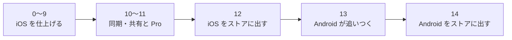

# 画面と作る順番

> [!NOTE]
> kakeibot を作る順番と、その状態、作る画面が分かる。
> 最初のリリースの機能は [overview](overview.md) にある。

## 🗓️ 作る順番

作る順番は、大きく次の段階に分かれる。

| 順 | 中身 | OS | 状態 |
| --- | --- | --- | --- |
| 0 | 土台 | iOS | ✅ 完了 |
| 1 | 入力シート、記録の一覧 → 毎日使い始める | iOS | ✅ 完了 |
| 2 | 財布（`Wallet`）の残高、振替 | iOS | ✅ 完了 |
| 3 | 期間の設定、予算、ホームの「あといくら」 | iOS | ✅ 完了 |
| 4 | 振り返り、カレンダー | iOS | ✅ 完了 |
| 5 | 固定費（`Recurring`）・繰り返し、通知 | iOS | ✅ 完了 |
| 6 | スタンプの一覧、カレンダーのスタンプ（`CalendarStamp`）、アプリアイコンの色違い | iOS | ✅ 完了 |
| 7 | テーマ（`ThemePalette`） | iOS | ✅ 完了 |
| 8 | ごほうび貯金（`RewardRule`・`RewardGoal`・`RewardLog`） | iOS | ✅ 完了 |
| 9 | ウィジェット | iOS | ✅ 完了 |
| 10 | 端末間の同期と家族との共有（iCloud） | iOS | ✅ 完了 |
| 11 | Pro の課金（買い切り） | iOS | ✅ 完了 |
| 12 | ストアの準備と公開 | iOS | ✅ 完了 |
| 13 | Core を Kotlin に移して fixtures を通し、1〜9 の画面を作る | Android | 🚧 進行中 |
| 14 | ストアの準備と公開 | Android | ⬜ 未着手 |
| 15 | 振り返りの作り直し。途中経過・締めのレポート・一手と答え合わせ・一手の理由（`ReviewComment`） | iOS | ✅ 完了 |

13 番は、次の段に分けて進める。

| 段 | 中身 | 状態 |
| --- | --- | --- |
| 13-1 | Core と Store を Kotlin に移す | ✅ 完了 |
| 13-2 | アプリの土台。DB を開き、テーマと 4 つのタブ、＋ ボタンを出す | ✅ 完了 |
| 13-3 | iOS の 1〜9 に当たる画面を、同じ順に作る | 🚧 進行中 |

13-3 は、次の所まで進んでいる。

| 画面 | 状態 |
| --- | --- |
| 入力シート（支出・収入、テンキー、カテゴリ、口座、日付、メモ、続けて記録） | ✅ 完了 |
| 入力シートの編集と削除 | ✅ 完了 |
| 記録の一覧（月の送り、集計、日のカード、行から編集を開く） | ✅ 完了 |
| 入力シートの振替（振替元と振替先） | ✅ 完了 |
| 資産（手元のお金、純資産、口座ごとの残高） | ✅ 完了 |
| ホーム（今月あといくら、今日と今月の支出、今月の収入、最近の記録） | ✅ 完了 |
| 月の予算の入力 | ✅ 完了 |
| 記録のカレンダー（日ごとの金額、日を選んでその日のカードを出す、一覧との切り替え） | ✅ 完了 |
| 振り返り（週・月・年、支出・収入・収支、円グラフ、カテゴリごと、前の期間との差） | ✅ 完了 |
| 入力シートのタグ、よく使う（テンプレートと最近の記録）、振替の手数料 | ✅ 完了 |
| 入力シートの品目（品名・単価・数量・税率・値引、外税と内税、差額の調整） | ✅ 完了 |
| 入力シートの声の入力（端末の中だけで認識する Android 12 以上） | ✅ 完了 |
| 入力シートの今の入力からテンプレートを作る（テンプレートを追加する画面） | ✅ 完了 |
| 設定の一覧と、期間の設定（月の始まり・週の始まり） | ✅ 完了 |
| 固定費の一覧と編集（毎月・毎年、その日に自動で記録） | ✅ 完了 |
| カテゴリごとの予算、予算の繰り越し、月の始まりの休日の扱い | ✅ 完了 |
| 固定費のカードの引き落とし・終わりの日・並べ替え・非表示、通知 | ✅ 完了 |
| ホームのテンプレート・カスタマイズ・引き落とし・スタンプ | ⬜ 未着手 |
| 資産の月末の見込み・推移・引き落とし・貯金箱、残高の調整 | ⬜ 未着手 |
| 記録の検索・絞り込み・選択、スタンプ、支出なしの印 | ⬜ 未着手 |
| 振り返りの固定費と見込み・予算の消化・スタンプの数 | ⬜ 未着手 |

15 番は、次の段に分けて進める。

| 段 | 中身 | 状態 |
| --- | --- | --- |
| 15-1 | 途中経過と締めのレポートに分ける。一手の表（`ReviewGoal`）、いまのペース、答え合わせ、記録のつづき、いつもと比べる | ✅ 完了 |
| 15-2 | 一手の理由。締めのレポートの一手のチケットに、AI の 1〜2 文を出す | ✅ 完了 |

## 📱 画面

画面は、タブと、そこから開くシート・設定に分かれる。

### タブと ＋ ボタン

＋ ボタンはタブの右に置き、入力シートを開く。タブごとの見た目と操作は、次の小見出しにある。

#### ホーム

| 部分 | 見た目 | 操作 |
| --- | --- | --- |
| 全体 | 今月あといくら、今日の支出、まだ決めていない設定、テンプレート（`EntryTemplate`）、最近の記録 | 最近の記録の行は、横に払って削除する |
| テンプレート | 2 段で横に送る | よく使う順などの並べ替えを選べる。すべてのシートで探す |

ホームの次のものは、設定で並べ替えたり非表示にしたりできる。

- 予算
- 自分好みにカスタマイズ
- テンプレート
- 最近の記録
- これからの引き落とし
- 押したスタンプ

#### 記録

| 部分 | 見た目 | 操作 |
| --- | --- | --- |
| 全体 | カレンダーと月の一覧の切り替え。カレンダーは日ごとの金額、スタンプ、支出なしの印 | 画面を左右に払って月を送る。消すときは行を選んでまとめて消す |
| 予定の固定費 | カレンダーの日のカードと一覧に、明日以降の固定費を日付ごとに出す | 行を押すと固定費の編集を開く。絞り込み・検索・選択の間は出さない |
| 今日の印 | 今日の日付の横に「今日」を出す。一覧に明日以降の日がある時は、「これから」「これまで」の小見出しで分ける | なし |
| 検索 | 切り替えの右のボタン | 記録を探し、カテゴリ・口座・タグで絞る |
| 選択 | 一覧と検索の結果の「選択」 | 記録を選び、カテゴリ・口座をまとめて変えるか削除する |

#### 振り返り

| 部分 | 見た目 | 操作 |
| --- | --- | --- |
| 全体 | 支出・収入・収支と、月・週・年の切り替え。円グラフ、前の期間との比較、これからの固定費と期末の見込み、予算の消化、押したスタンプの数 | 記録と同じく、左右に払って期間を送る |
| 締めのレポート | 締めた期間のシート（題は「ふりかえり」）に出す。結果・答え合わせ・記録のつづき・いつもと比べる・次の一手と、その理由を並べる（[ai-review](decisions/ai-review.md)） | 開いた時に、事実が変わっていれば理由を書き直す |
| レビューの札 | 一番下に、App Store のレビューを頼む札。記録が 10 件以上ある時だけ出す | 「レビューを書く」で App Store を開く。押すか隣の「閉じる」で閉じた後と、OS の評価のダイアログを頼んだ後は、二度と出さない |

#### 資産

| 部分 | 見た目 | 操作 |
| --- | --- | --- |
| 全体 | 手元のお金、今月これからの出入りと月末の見込み、純資産と推移、これからの引き落とし、財布ごとの残高、ごほうび貯金箱 | 月末の見込みを押すと、固定費のこれからの回と予定の記録を日付の順に並べ、行から記録か固定費の編集を開く。貯金箱の、今日の達成を付けるボタンを押す |

資産の財布ごとの残高は、資産の手持ち・投資と、負債のカードの未払い・借入に分けて並べる。手持ちがマイナスの口座は、残高の調整で今の額に合わせられる。

#### 広い画面

画面の幅が 560 pt 以上ある時は、次の画面を 2 列に並べる。

| 画面 | 右の列 |
| --- | --- |
| 振り返り | カテゴリごと・スタンプ |
| 資産 | 資産と負債の口座 |
| 記録のカレンダー | 選んだ日のカード。日のマスには、その日の支出の大きさに合わせた濃さの色を敷く |

iPad のように幅がさらに広い時は、次のようにする。

| 画面 | 幅 | 並べ方 |
| --- | --- | --- |
| ホーム | 760 pt 以上 | 2 列。左に予算・カスタマイズ・テンプレート、右に最近の記録・引き落とし・スタンプ |
| 記録の一覧 | 720 pt より広い | 集計と日のカードを 720 pt までにし、中央に置く |

横幅が広い時は、タブを左のサイドバーに縦に並べ、右に画面を出す。iPhone Duo を開いた時が当たる。＋ ボタンは、サイドバーの下の「記録する」になる。

### シートと設定

| 画面 | 中身 |
| --- | --- |
| 入力シート | 支出・収入・振替、テンキー、カテゴリ、財布、振替の手数料、日付、メモ、品目、レシートの読み取り、声の入力 |
| 入力シートの新規と編集 | 新規と編集を兼ねる。新規では「続けて記録」で閉じずに次を入れる |
| 設定の一覧 | ホームの右上の歯車から開く。下の画面と、通知・期間・バックアップを並べる |
| 設定の一覧の分け方 | 記録に使うもの・予算と期間・楽しみ・ホームと通知・見た目・データ・このアプリについて・Pro。楽しみは使い始めてから出し、Pro は見出しの無いカードで、いちばん下にバージョン |
| スタンプ | カレンダーに押すスタンプの一覧と編集。絵柄・絵文字・短い文字と色で作り、その場で見た目を確認する |
| アプリアイコン | 色違いから選ぶ |
| テーマ | その場で見た目を確認 |
| 予算 / 固定費 / ごほうびの決まり / カテゴリ / 財布 / テンプレート | 一覧と編集 |
| 文字 / 形と動き | その場で見た目を確認して選ぶ |
| ホームに出すもの | ホームのカードを出し分け、並べ替える |
| 起動時に開く画面 | 起動したときに開くタブか、入力シートを選ぶ |
| 月の始まり / 週の始まり | 期間の区切りを選ぶ |
| 記録忘れの通知 | 知らせるかどうかと時刻を選ぶ |
| 同期と共有 | 同期の切り替えと、財布の共有 |
| バックアップ | 書き出しと読み込み |
| ウィジェットの置き方 | 置く場所を切り替え、壁紙に置いたウィジェットの見本と、できること・置き方を出す。ホーム画面は見本を左右になぞって種類と大きさを選ぶ |
| お知らせ | ホームの右上のベルから開く。版ごとに足した機能を、使い方の 3 コマのカードで並べ、その機能の画面を開ける |
| お問い合わせ / レビューを書く | Google フォームと App Store のレビューを、外で開く |
| 記録をすべて削除 | 件数を出す確認のカードを開き、押すと記録を消す |
| 最初の設定 | ようこそ（始め方を選ぶ）、月と週の始まり、月の予算、ほかに決めること |
| 最初の設定のほかに決めること | 口座・カテゴリ・固定費・テンプレート・通知・テーマ |
