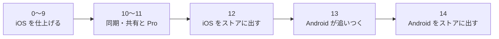

# 画面と作る順番

kakeibot を作る順番と、その状態、作る画面を書く。

## 作る順番

作る順番は、大きく次の段階に分かれる。

| 順 | 中身 | OS | 状態 |
| --- | --- | --- | --- |
| 0 | 土台（下の表） | iOS | ✅ 完了 |
| 1 | 入力シート、記録の一覧 → 毎日使い始める（下の表） | iOS | ✅ 完了 |
| 2 | 財布の残高、振替（下の表） | iOS | ✅ 完了 |
| 3 | 期間の設定、予算、ホームの「あといくら」（下の表） | iOS | ✅ 完了 |
| 4 | 振り返り、カレンダー（下の表） | iOS | ✅ 完了 |
| 5 | 固定費・繰り返し、通知（下の表） | iOS | ✅ 完了 |
| 6 | スタンプの一覧、カレンダーのスタンプ、アプリアイコンの色違い（下の表） | iOS | ✅ 完了 |
| 7 | テーマ（下の表） | iOS | ✅ 完了 |
| 8 | ごほうび貯金（下の表） | iOS | ✅ 完了 |
| 9 | ウィジェット（下の表） | iOS | ✅ 完了 |
| 10 | 端末間の同期と家族との共有（iCloud） | iOS | ⬜ 未着手 |
| 11 | Pro の課金（サブスクと買い切り） | iOS | ⬜ 未着手 |
| 12 | ストアの準備と公開 | iOS | ⬜ 未着手 |
| 13 | Core を Kotlin に移して fixtures を通し、1〜9 の画面を作る | Android | ⬜ 未着手 |
| 14 | ストアの準備と公開 | Android | ⬜ 未着手 |

### 0 番の中身

| 順 | 作業 | 担当 | 状態 |
| --- | --- | --- | --- |
| 1 | Xcode プロジェクト（アプリ、ウィジェット、App Group、Swift 6、iOS 18、iPhone のみ） | 自分 | ✅ 完了 |
| 2 | KakeibotKit・KakeibotApp の骨組みと、Xcode プロジェクトへのつなぎ | Claude | ✅ 完了 |
| 3 | `spec/fixtures/date` → Core の Date → CoreTests | Claude | ✅ 完了 |
| 4 | DB の最初の形（[data.md](data.md) の表すべて）と Records | Claude | ✅ 完了 |
| 5 | 書き出し V1（Core の Export、Store の Snapshot、往復の fixtures） | Claude | ✅ 完了 |
| 6 | 実機で `0xdead10cc` が起きないか確かめる | 自分 | ✅ 完了 |

0 番が終わったと言える条件と、その確かめ方を次の表に挙げる。

| 確認すること | 方法 |
| --- | --- |
| fixtures が全部通る | `swift test` |
| 古い DB から最新の形に移せる | 移行のテスト |
| 書き出し → 読み込み → 書き出しで同じ結果になる | `spec/fixtures/export` |
| 裏に回ってもアプリが止められない | 実機 |

### 1 番の中身

支出と収入を記録して一覧で見返して直せ、カテゴリを自分に合わせて変えられるところまで作る。振替は 2 番で作る。

| 順 | 作業 | 担当 | 状態 |
| --- | --- | --- | --- |
| 1 | Core の入力の判定と日ごとのまとめ、Store の記録の読み書き、最初の財布とカテゴリ | Claude | ✅ 完了 |
| 2 | DesignSystem のアイコン・金額・記録の 1 行・テンキー | Claude | ✅ 完了 |
| 3 | 入力シート（支出・収入、新規と編集。1 画面の夜のダイヤルと、下から出す電卓） | Claude | ✅ 完了 |
| 4 | タブの骨組み、ホームの最近の記録、記録の一覧、＋ ボタン | Claude | ✅ 完了 |
| 5 | カテゴリの編集（名前、絵柄・絵文字・文字と色、追加、並べ替え、非表示） | Claude | ✅ 完了 |
| 6 | テンプレート（名前・金額・カテゴリ・財布・メモ。入力シートから 1 回で入れる） | Claude | ✅ 完了 |
| 7 | カテゴリのタグ（朝ごはん・昼ごはんなど。1 つの記録に 1 つまで） | Claude | ✅ 完了 |

### 2 番の中身

財布ごとの残高を見られ、財布の間のお金の動きを振替で記録できるところまで作る。

| 順 | 作業 | 担当 | 状態 |
| --- | --- | --- | --- |
| 1 | Core の残高の計算、資産タブ（残高の合計と 6 か月の動き、財布ごとの残高） | Claude | ✅ 完了 |
| 2 | 入力シートの振替（振替元と振替先、資産タブの振替ボタン） | Claude | ✅ 完了 |
| 3 | 財布の編集（名前・種類・アイコン・最初の残高、追加、並べ替え、非表示） | Claude | ✅ 完了 |

### 3 番の中身

給料日などに合わせた期間で、予算に対してあといくら使えるかを、ホームで見られるところまで作る。

| 順 | 作業 | 担当 | 状態 |
| --- | --- | --- | --- |
| 1 | 月の始まりの設定。ホーム・記録・資産を、その期間で数える | Claude | ✅ 完了 |
| 2 | 予算の編集（月全体とカテゴリごと、この月からの履歴） | Claude | ✅ 完了 |
| 2a | 最初の設定のチュートリアル（月の始まり、月の予算、起動時に開く画面） | Claude | ✅ 完了 |
| 3 | ホームの「あといくら」（予算から今の期間の支出を引く） | Claude | ✅ 完了 |

### 4 番の中身

使ったお金をカレンダーで日ごとに見て、期間ごとの内訳と前の期間との差を振り返れるところまで作る。

| 順 | 作業 | 担当 | 状態 |
| --- | --- | --- | --- |
| 1 | 週の始まりの設定。カレンダーの並びに使う | Claude | ✅ 完了 |
| 2 | 記録のカレンダー（一覧との切り替え、日ごとの金額、支出なしの印） | Claude | ✅ 完了 |
| 3 | Core の振り返りの集計（月・週・年の合計、カテゴリと口座の内訳、前の期間との差） | Claude | ✅ 完了 |
| 4 | 振り返りのタブ（円グラフ、前の期間との比較、予算の消化） | Claude | ✅ 完了 |

### 5 番の中身

家賃や給料などの決まった記録をひとりでに入れ、記録忘れと固定費の前に知らせるところまで作る。

| 順 | 作業 | 担当 | 状態 |
| --- | --- | --- | --- |
| 1 | Core の固定費の日付、Store の記録漏れの作成 | Claude | ✅ 完了 |
| 2 | 固定費の一覧と編集、起動・前面・日付が変わるときの記録漏れの作成 | Claude | ✅ 完了 |
| 3 | 記録忘れと固定費の前の通知（Core の計算、通知の予約、時刻の設定） | Claude | ✅ 完了 |
| 4 | 通知から開く画面（記録忘れは入力シート、固定費はその固定費） | Claude | ✅ 完了 |

### 6 番の中身

スタンプにするアイコンを一覧で作り、カレンダーに押せるところまで作る。アプリアイコンの色違いも選べるようにする。

| 順 | 作業 | 担当 | 状態 |
| --- | --- | --- | --- |
| 1 | Core・Store のスタンプの一覧（読み書き、並べ替え、最初の一覧） | Claude | ✅ 完了 |
| 2 | 設定のスタンプの一覧（追加・編集・並べ替え・非表示） | Claude | ✅ 完了 |
| 3 | Store のスタンプの読み書き（1 日に 1 つ。押し直すと置き換える） | Claude | ✅ 完了 |
| 4 | 記録のカレンダーのスタンプ（日のカードから一覧で選んで押す・外す。マスの日付の右上に小さく出す） | Claude | ✅ 完了 |
| 5 | 設定のアプリアイコン（色違いから選ぶ） | Claude | ✅ 完了 |

### 7 番の中身

テーマの土台を先に作り、用意したテーマと手で作るテーマを足す。そのあと、固定費とカードの引き落としの日を実際に合わせ、バックアップと検索を足す。

| 順 | 作業 | 担当 | 状態 |
| --- | --- | --- | --- |
| 1 | テーマの色の土台（画面の色をテーマから決める。既定は今の紺と金） | Claude | ✅ 完了 |
| 2 | 読みやすさの判定（文字と地の色の差が足りない組み合わせを保存させない） | Claude | ✅ 完了 |
| 3 | テーマの保存と、設定で用意したテーマから選ぶ | Claude | ✅ 完了 |
| 4 | テーマを手で作る（色） | Claude | ✅ 完了 |
| 5 | 角の丸みと字体の設定 | Claude | ✅ 完了 |
| 6 | 本文の字体の設定 | Claude | ✅ 完了 |
| 7 | 字体を足す（配布してよい日本語のフォントを同梱する） | Claude | ✅ 完了 |
| 8 | 固定費の休日の扱い（休日なら前の平日か次の平日にずらす。記録と知らせの日も合わせる） | Claude | ✅ 完了 |
| 9 | カードの締め日と引き落とし（引き落とし日に、銀行からカードへの振替を自動で作る） | Claude | ✅ 完了 |
| 10 | バックアップ（設定から、全データを JSON で書き出し、読み込んで置き換える） | Claude | ✅ 完了 |
| 11 | 記録の検索と絞り込み（メモ・カテゴリ・口座・金額で探し、カテゴリ・口座・タグで絞る） | Claude | ✅ 完了 |
| 12 | ライセンスの表示（LicensePlist で、使っている部品とフォントのライセンスを出す） | Claude | ✅ 完了 |
| 13 | 文字の大きさの設定（数字で決めた大きさにも倍率を掛け、はみ出す画面を直す） | Claude | ✅ 完了 |

### 8 番の中身

自分で決めた達成で仮想の貯金箱に貯まり、目標の物を買ったら記録できるところまで作る。

| 順 | 作業 | 担当 | 状態 |
| --- | --- | --- | --- |
| 1 | ごほうびの決まり（設定で、名前・貯める額・アイコンを決める） | Claude | ✅ 完了 |
| 2 | 達成と貯金箱（日ごとに達成を付け、資産の画面に貯金箱と最近の達成を出す） | Claude | ✅ 完了 |
| 3 | 目標と購入の記録（貯金箱に目標の物と額を決め、買ったら記録する） | Claude | ✅ 完了 |

### 9 番の中身

アプリを開かずに、残りを見て、テンプレートで記録できるところまで作る。

| 順 | 作業 | 担当 | 状態 |
| --- | --- | --- | --- |
| 1 | ウィジェットの土台（DB を読むだけで開く、記録・テーマが変わったときと日付が変わるときの更新、押すとホームを開く） | Claude | ✅ 完了 |
| 2 | あといくら（小・中。ダイヤル、残り、残りの日数、今日・今週の支出、次の固定費） | Claude | ✅ 完了 |
| 3 | ロック画面（丸・横長・1 行） | Claude | ✅ 完了 |
| 4 | すぐ記録（中・大。テンプレートを押すとその場で記録し、取り消せる） | Claude | ✅ 完了 |
| 5 | コントロールの「記録する」（入力シートを開く） | Claude | ✅ 完了 |

## 画面

画面は、タブと、そこから開くシート・設定に分かれる。

### タブと ＋ ボタン

| タブ | 中身 |
| --- | --- |
| ホーム | 今月あといくら、今日の支出、テンプレート（2 段で横に送る。よく使う順などの並べ替えを選べる。すべてのシートで探す）、最近の記録。最近の記録の行は横に払って削除する |
| 記録 | カレンダーと月の一覧の切り替え。カレンダーは日ごとの金額、スタンプ、支出なしの印。一覧の行は横に払って削除する。切り替えの右のボタンから、記録を探し、カテゴリ・口座・タグで絞る |
| 振り返り | 支出・収入・収支と、月・週・年の切り替え。円グラフ、前の期間との比較、予算の消化、押したスタンプの数。記録と同じく、左右に払って期間を送る |
| 資産 | 手元のお金と動き、純資産、これからの引き落とし、財布ごとの残高（手持ち・カードの未払い・投資・借入）、ごほうび貯金箱 |

＋ ボタンはタブの右に置き、入力シートを開く。

### シートと設定

| 画面 | 中身 |
| --- | --- |
| 入力シート | 支出・収入・振替、テンキー、カテゴリ、財布、日付、メモ。新規と編集を兼ねる |
| 設定の一覧 | ホームの右上の歯車から開く。下の画面と、通知・期間・バックアップ |
| スタンプ | カレンダーに押すスタンプの一覧と編集。絵柄・絵文字・短い文字と色。その場で見た目を確認 |
| アプリアイコン | 色違いから選ぶ |
| テーマ | その場で見た目を確認 |
| 予算 / 固定費 / ごほうび / カテゴリ / 財布 | 一覧と編集 |
| 最初の設定 | ようこそ、月の始まり、月の予算、起動時に開く画面。テーマ・財布は作るときに足す |
