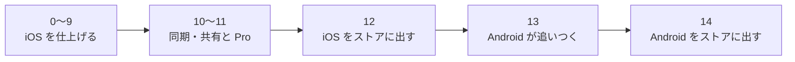

# 画面と作る順番

> [!NOTE]
> kakeibot を作る順番と、その状態、作る画面が分かる。
> 最初のリリースの機能は [overview](overview.md) にある。

## 作る順番

作る順番は、大きく次の段階に分かれる。

| 順 | 中身 | OS | 状態 |
| --- | --- | --- | --- |
| 0 | 土台 | iOS | ✅ 完了 |
| 1 | 入力シート、記録の一覧 → 毎日使い始める | iOS | ✅ 完了 |
| 2 | 財布（`Wallet`）の残高、振替 | iOS | ✅ 完了 |
| 3 | 期間の設定、予算、ホームの「あといくら」 | iOS | ✅ 完了 |
| 4 | 振り返り、カレンダー | iOS | ✅ 完了 |
| 5 | 固定費（`Recurring`）・繰り返し、通知 | iOS | ✅ 完了 |
| 6 | スタンプの一覧、カレンダーのスタンプ（`CalendarStamp`）、アプリアイコンの色違い | iOS | ✅ 完了 |
| 7 | テーマ（`ThemePalette`） | iOS | ✅ 完了 |
| 8 | ごほうび貯金（`RewardRule`・`RewardGoal`・`RewardLog`） | iOS | ✅ 完了 |
| 9 | ウィジェット | iOS | ✅ 完了 |
| 10 | 端末間の同期と家族との共有（iCloud） | iOS | 🚧 作業中 |
| 11 | Pro の課金（サブスクと買い切り） | iOS | ⬜ 未着手 |
| 12 | ストアの準備と公開 | iOS | ⬜ 未着手 |
| 13 | Core を Kotlin に移して fixtures を通し、1〜9 の画面を作る | Android | ⬜ 未着手 |
| 14 | ストアの準備と公開 | Android | ⬜ 未着手 |

## 画面

画面は、タブと、そこから開くシート・設定に分かれる。

### タブと ＋ ボタン

| タブ | 中身 |
| --- | --- |
| ホーム | 今月あといくら、今日の支出、まだ決めていない設定、テンプレート（2 段で横に送る。よく使う順などの並べ替えを選べる。すべてのシートで探す）、最近の記録。最近の記録の行は横に払って削除する。自分好みにカスタマイズ・予算・テンプレート（`EntryTemplate`）・最近の記録・これからの引き落とし・今月のスタンプは、設定で並べ替えたり隠したりできる |
| 記録 | カレンダーと月の一覧の切り替え。カレンダーは日ごとの金額、スタンプ、支出なしの印。一覧の行は横に払って削除する。切り替えの右のボタンから、記録を探し、カテゴリ・口座・タグで絞る。一覧と検索の結果では「選択」から記録を選び、カテゴリ・口座をまとめて変えるか削除する |
| 振り返り | 支出・収入・収支と、月・週・年の切り替え。円グラフ、前の期間との比較、予算の消化、押したスタンプの数。記録と同じく、左右に払って期間を送る |
| 資産 | 手元のお金と動き、純資産、これからの引き落とし、財布ごとの残高（資産の手持ち・投資と、負債のカードの未払い・借入）、ごほうび貯金箱と今日の達成を付けるボタン |

＋ ボタンはタブの右に置き、入力シートを開く。

### シートと設定

| 画面 | 中身 |
| --- | --- |
| 入力シート | 支出・収入・振替、テンキー、カテゴリ、財布、振替の手数料、日付、メモ。新規と編集を兼ねる。新規では「続ける」で閉じずに次を入れる |
| 設定の一覧 | ホームの右上の歯車から開く。記録・期間と予算・楽しみ・見た目・使い方・データとアプリに分けて、下の画面と、通知・期間・バックアップを並べる |
| スタンプ | カレンダーに押すスタンプの一覧と編集。絵柄・絵文字・短い文字と色。その場で見た目を確認 |
| アプリアイコン | 色違いから選ぶ |
| テーマ | その場で見た目を確認 |
| 予算 / 固定費 / ごほうび / カテゴリ / 財布 | 一覧と編集 |
| 最初の設定 | ようこそ（始め方を選ぶ）、月と週の始まり、月の予算、ほかに決めること（口座・カテゴリ・固定費・テンプレート・通知・テーマ） |
