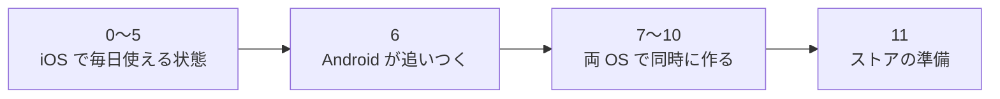

# 画面と作る順番

kakeibot を作る順番と、その状態、作る画面を書く。

## 作る順番

作る順番は、大きく次の段階に分かれる。

| 順 | 中身 | OS | 状態 |
| --- | --- | --- | --- |
| 0 | 土台（下の表） | iOS | 🚧 作業中 |
| 1 | 入力シート、記録の一覧 → 毎日使い始める | iOS | ⬜ 未着手 |
| 2 | 財布の残高、振替 | iOS | ⬜ 未着手 |
| 3 | 期間の設定、予算、ホームの「あといくら」 | iOS | ⬜ 未着手 |
| 4 | 振り返り、カレンダー | iOS | ⬜ 未着手 |
| 5 | 固定費・繰り返し、通知 | iOS | ⬜ 未着手 |
| 6 | Core を Kotlin に移して fixtures を通し、1〜5 の画面を作る | Android | ⬜ 未着手 |
| 7 | 自作のアイコン、カレンダーのスタンプ | 両方 | ⬜ 未着手 |
| 8 | テーマ | 両方 | ⬜ 未着手 |
| 9 | キャラクター、ごほうび貯金 | 両方 | ⬜ 未着手 |
| 10 | ウィジェット | 両方 | ⬜ 未着手 |
| 11 | ストアの準備 | 両方 | ⬜ 未着手 |

### 0 番の中身

| 順 | 作業 | 担当 | 状態 |
| --- | --- | --- | --- |
| 1 | Xcode プロジェクト（アプリ、ウィジェット、App Group、Swift 6、iOS 18、iPhone のみ） | 自分 | ✅ 完了 |
| 2 | KakeibotKit・KakeibotApp の骨組みと、Xcode プロジェクトへのつなぎ | Claude | ✅ 完了 |
| 3 | `spec/fixtures/date` → Core の Date → CoreTests | Claude | ✅ 完了 |
| 4 | DB の最初の形（[data.md](data.md) の表すべて）と Records | Claude | ✅ 完了 |
| 5 | 書き出し V1（Core の Export、Store の Snapshot、往復の fixtures） | Claude | ⬜ 未着手 |
| 6 | 実機で `0xdead10cc` が起きないか確かめる | 自分 | ⬜ 未着手 |

0 番が終わったと言える条件と、その確かめ方を次の表に挙げる。

| 確認すること | 方法 |
| --- | --- |
| fixtures が全部通る | `swift test` |
| 古い DB から最新の形に移せる | 移行のテスト |
| 書き出し → 読み込み → 書き出しで同じ結果になる | `spec/fixtures/export` |
| 裏に回ってもアプリが止められない | 実機 |

## 画面

画面は、タブと、そこから開くシート・設定に分かれる。

### タブと ＋ ボタン

| タブ | 中身 |
| --- | --- |
| ホーム | 今月あといくら、今日の支出、キャラクターの一言、よく使う組み合わせ、最近の記録 |
| カレンダー | 日ごとの合計、スタンプ、支出なしの印。日をタップするとその日の一覧 |
| 振り返り | 月と週の切り替え、合計、前の期間との比較、カテゴリ別・財布別の内訳、予算の消化、「今月の自分」カード |
| 財布 | 財布ごとの残高、ごほうび貯金箱 |

＋ ボタンはどの画面にも浮かせ、入力シートを開く。

### シートと設定

| 画面 | 中身 |
| --- | --- |
| 入力シート | 支出・収入・振替、テンキー、カテゴリ、財布、日付、メモ。新規と編集を兼ねる |
| 設定の一覧 | 下の画面と、通知・期間・バックアップ |
| アイコン | 絵文字・色・短い文字。その場で見た目を確認 |
| テーマ | その場で見た目を確認 |
| キャラクター | 選んで名前を付ける |
| 予算 / 固定費 / ごほうび / カテゴリ | 一覧と編集 |
| 最初の設定 | 財布、給料日、キャラクター |
