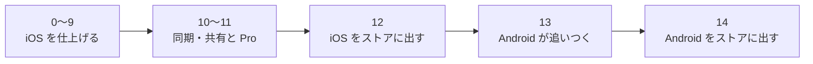

# 画面と作る順番

> [!NOTE]
> kakeibot を作る順番と、その状態、作る画面が分かる。
> 最初のリリースの機能は [overview](overview.md) にある。

## 🗓️ 作る順番

作る順番は、大きく次の段階に分かれる。

| 順 | 中身 | OS | 状態 |
| --- | --- | --- | --- |
| 0 | 土台 | iOS | ✅ 完了 |
| 1 | 入力シート、記録の一覧 → 毎日使い始める | iOS | ✅ 完了 |
| 2 | 財布（`Wallet`）の残高、振替 | iOS | ✅ 完了 |
| 3 | 期間の設定、予算、ホームの「あといくら」 | iOS | ✅ 完了 |
| 4 | 振り返り、カレンダー | iOS | ✅ 完了 |
| 5 | 固定費（`Recurring`）・繰り返し、通知 | iOS | ✅ 完了 |
| 6 | スタンプの一覧、カレンダーのスタンプ（`CalendarStamp`）、アプリアイコンの色違い | iOS | ✅ 完了 |
| 7 | テーマ（`ThemePalette`） | iOS | ✅ 完了 |
| 8 | ごほうび貯金（`RewardRule`・`RewardGoal`・`RewardLog`） | iOS | ✅ 完了 |
| 9 | ウィジェット | iOS | ✅ 完了 |
| 10 | 端末間の同期と家族との共有（iCloud） | iOS | ✅ 完了 |
| 11 | Pro の課金（買い切り） | iOS | ✅ 完了 |
| 12 | ストアの準備と公開 | iOS | ⬜ 未着手 |
| 13 | Core を Kotlin に移して fixtures を通し、1〜9 の画面を作る | Android | ⬜ 未着手 |
| 14 | ストアの準備と公開 | Android | ⬜ 未着手 |

## 📱 画面

画面は、タブと、そこから開くシート・設定に分かれる。

### タブと ＋ ボタン

タブごとに、見た目と操作は次のとおり。

| タブ | 見た目 | 操作 |
| --- | --- | --- |
| ホーム | 今月あといくら、今日の支出、まだ決めていない設定、テンプレート（`EntryTemplate`）、最近の記録 | 最近の記録の行は、横に払って削除する |
| ホームのテンプレート | 2 段で横に送る | よく使う順などの並べ替えを選べる。すべてのシートで探す |
| 記録 | カレンダーと月の一覧の切り替え。カレンダーは日ごとの金額、スタンプ、支出なしの印 | 画面を左右に払って月を送る。消すときは行を選んでまとめて消す |
| 記録の検索 | 切り替えの右のボタン | 記録を探し、カテゴリ・口座・タグで絞る |
| 記録の選択 | 一覧と検索の結果の「選択」 | 記録を選び、カテゴリ・口座をまとめて変えるか削除する |
| 振り返り | 支出・収入・収支と、月・週・年の切り替え。円グラフ、前の期間との比較、これからの固定費と期末の見込み、予算の消化、押したスタンプの数 | 記録と同じく、左右に払って期間を送る |
| 資産 | 手元のお金と動き、今月これからの出入りと月末の見込み、純資産、これからの引き落とし、財布ごとの残高、ごほうび貯金箱 | 月末の見込みを押すと、固定費のこれからの回と予定の記録を日付の順に並べ、行から記録か固定費の編集を開く。貯金箱の、今日の達成を付けるボタンを押す |

資産の財布ごとの残高は、資産の手持ち・投資と、負債のカードの未払い・借入に分けて並べる。手持ちがマイナスの口座は、残高の調整で今の額に合わせられる。

画面の幅が 560 pt 以上ある時は、次の画面を 2 列に並べる。

| 画面 | 右の列 |
| --- | --- |
| 振り返り | カテゴリごと・口座ごと・スタンプ |
| 資産 | 資産と負債の口座 |
| 記録のカレンダー | 選んだ日のカード。日のマスには、その日の支出の大きさに合わせた濃さの色を敷く |

ホームの次のものは、設定で並べ替えたり非表示にしたりできる。

- 自分好みにカスタマイズ
- 予算
- テンプレート
- 最近の記録
- これからの引き落とし
- 押したスタンプ

＋ ボタンはタブの右に置き、入力シートを開く。

横幅が広い時は、タブを左のサイドバーに縦に並べ、右に画面を出す。iPhone Duo を開いた時が当たる。＋ ボタンは、サイドバーの下の「記録する」になる。

### シートと設定

| 画面 | 中身 |
| --- | --- |
| 入力シート | 支出・収入・振替、テンキー、カテゴリ、財布、振替の手数料、日付、メモ、品目、レシートの読み取り、声の入力 |
| 入力シートの新規と編集 | 新規と編集を兼ねる。新規では「続けて記録」で閉じずに次を入れる |
| 設定の一覧 | ホームの右上の歯車から開く。下の画面と、通知・期間・バックアップを並べる |
| 設定の一覧の分け方 | 記録に使うもの・予算と期間・楽しみ・ホームと通知・見た目・データ・このアプリについて・Pro。Pro は見出しの無いカードで、いちばん下にバージョン |
| スタンプ | カレンダーに押すスタンプの一覧と編集。絵柄・絵文字・短い文字と色で作り、その場で見た目を確認する |
| アプリアイコン | 色違いから選ぶ |
| テーマ | その場で見た目を確認 |
| 予算 / 固定費 / ごほうびの決まり / カテゴリ / 財布 / テンプレート | 一覧と編集 |
| 文字 / 形と動き | その場で見た目を確認して選ぶ |
| ホームに出すもの | ホームのカードを出し分け、並べ替える |
| 起動時に開く画面 | 起動したときに開くタブか、入力シートを選ぶ |
| 月の始まり / 週の始まり | 期間の区切りを選ぶ |
| 記録忘れの通知 | 知らせるかどうかと時刻を選ぶ |
| 同期と共有 | 同期の切り替えと、財布の共有 |
| バックアップ | 書き出しと読み込み |
| ウィジェットの置き方 | 置く場所を切り替え、壁紙に置いたウィジェットの見本と、できること・置き方を出す |
| お知らせ | ホームの右上のベルから開く。版ごとに足した機能を、使い方の 3 コマのカードで並べ、その機能の画面を開ける |
| お問い合わせ / レビューを書く | Google フォームと App Store のレビューを、外で開く |
| 記録をすべて削除 | 件数を出す確認のカードを開き、押すと記録を消す |
| 最初の設定 | ようこそ（始め方を選ぶ）、月と週の始まり、月の予算、ほかに決めること |
| 最初の設定のほかに決めること | 口座・カテゴリ・固定費・テンプレート・通知・テーマ |
