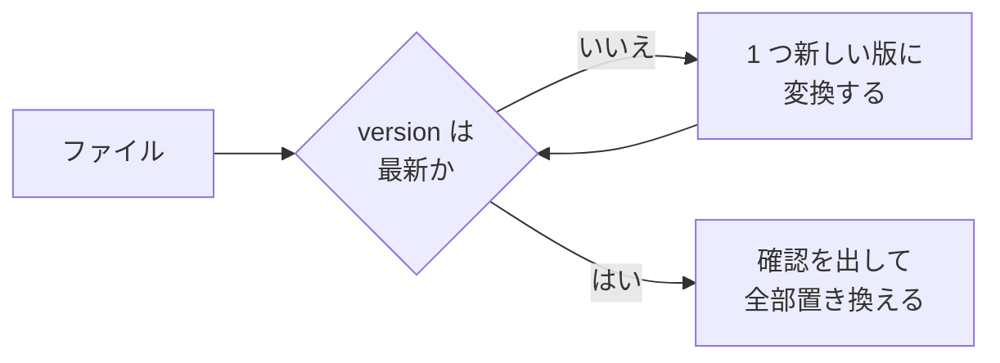

# 書き出しの形式

kakeibot のデータを書き出すときの、JSON と CSV の形式を書く。

> [!IMPORTANT]
> 一度出した版は、読み込めなくしない。互換が壊れる変更は `version` を上げ、古い版からの変換を足す。

## JSON（全データ。読み込みにも使う）

```json
{
  "format": "kakeibot-export",
  "version": 1,
  "exportedAt": "2026-10-09T12:00:00Z",
  "app": { "platform": "ios", "version": "1.0.0" },
  "data": {
    "icons": [],
    "wallets": [],
    "categories": [],
    "tags": [],
    "entries": [],
    "templates": [],
    "budgets": [],
    "recurrings": [],
    "rewardRules": [],
    "rewardLogs": [],
    "rewardGoals": [],
    "calendarStamps": [],
    "noSpendDays": [],
    "themes": [],
    "settings": []
  }
}
```

| 決まり | 中身 |
| --- | --- |
| `version` | 書き出しの形式の版。DB の形の版とは別に数える |
| 古い版 | 読み込みではすべての古い版を受け付ける。読み方は下の図 |
| キー | camelCase。各要素の項目は [data.md](../docs/data.md) の列名を camelCase にしたもの |
| 日付・日時・金額 | [data.md](../docs/data.md) と同じ書き方 |
| 空の値 | `null` |
| 真偽 | `true` `false` |
| 並び | 各配列は主キーの昇順 |
| 読み込み方 | 全部置き換える。読み込む前に確認を出す |
| `templates` | 無いファイルは、空として読む。記録の `templateId` も、無ければ空として読む |
| `tags` | 無いファイルは、空として読む。記録とテンプレートの `tagId` も、無ければ空として読む |

古い版のファイルは、最新の版になるまで版を 1 つずつ上げてから読む。



## CSV（表計算用。書き出しだけ）

| 項目 | 中身 |
| --- | --- |
| 列 | 日付、種類、金額、カテゴリ、タグ、財布、振替先、メモ |
| 文字コード | UTF-8、BOM 付き |
