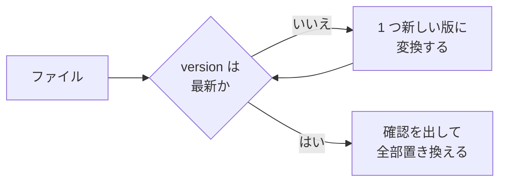

# 書き出しの形式

> [!NOTE]
> kakeibot のデータを書き出すときの JSON と CSV の形式と、読み込める CSV の形が分かる。

## 🗄️ JSON（全データ。読み込みにも使う）

> [!IMPORTANT]
> 一度出した版は、読み込めなくしない。互換が壊れる変更は `version` を上げ、古い版からの変換を足す。

```json
{
  "format": "kakeibot-export",
  "version": 1,
  "exportedAt": "2026-10-09T12:00:00Z",
  "app": { "platform": "ios", "version": "1.0.0" },
  "data": {
    "icons": [],
    "shelfIcons": [],
    "wallets": [],
    "valuations": [],
    "adjustments": [],
    "categories": [],
    "tags": [],
    "entries": [],
    "entryItems": [],
    "itemNames": [],
    "templates": [],
    "budgets": [],
    "recurrings": [],
    "rewardRules": [],
    "rewardLogs": [],
    "rewardGoals": [],
    "calendarStamps": [],
    "noSpendDays": [],
    "themes": [],
    "settings": []
  }
}
```

| 決まり | 中身 |
| --- | --- |
| `version` | 書き出しの形式の版。DB の形の版とは別に数える |
| 古い版 | 読み込みではすべての古い版を受け付ける。読み方は下の図 |
| キー | camelCase。各要素の項目は [data.md](../docs/data.md) の列名を camelCase にしたもの |
| 日付・日時・金額 | [data.md](../docs/data.md) と同じ書き方 |
| 空の値 | `null` |
| 真偽 | `true` `false` |
| 並び | 各配列は主キーの昇順 |
| 読み込み方 | 全部置き換える。読み込む前に確認を出す |
| `templates` | 無いファイルは、空として読む。記録の `templateId` も、無ければ空として読む |
| `shelfIcons` | 無いファイルは、空として読む |
| `archivedAt`（`templates`・`recurrings`） | 無ければ、空として読む |
| `holidayShift`（`recurrings`） | 無ければ、`none` として読む |
| `closingDay`（`recurrings`） | 無ければ、空として読む |
| `walletId`（`categories`） | 無ければ、空として読む |
| `fee`（`recurrings`） | 無ければ、空として読む |
| `billShift`（`templates`・`recurrings`） | 無ければ、`0` として読む |
| `finalAmount`（`recurrings`） | 無ければ、空として読む |
| `loanAmount`（`wallets`） | 無ければ、空として読む |
| `valuations` | 無いファイルは、空として読む |
| `adjustments` | 無いファイルは、空として読む |
| `tags` | 無いファイルは、空として読む。記録とテンプレート（`EntryTemplate`）の `tagId` も、無ければ空として読む |
| `billMonth`（`entries`） | 無ければ、空として読む |
| `transferId`（`entries`） | 無ければ、空として読む |
| `taxIncluded`（`entries`） | 無ければ、外税（`false`）として読む |
| `entryItems`・`itemNames` | 無いファイルは、空として読む |
| `taxRate`（`entryItems`） | 無ければ、空として読む |
| `settings` | 知らないキーの行は、読み飛ばす。DB から書き出すときは、知らないキーの行と `backup_exported_at` を含めない |

古い版のファイルは、最新の版になるまで版を 1 つずつ上げてから読む。



## 🖥️ CSV（表計算用。書き出しだけ）

| 項目 | 中身 |
| --- | --- |
| 列 | 日付・種類・金額・カテゴリ・タグ・財布（`Wallet`）・振替先・メモ。1 行目に列の名前を置く |
| 文字コード | UTF-8、BOM 付き |
| 改行 | CRLF。最後の行の後にも付ける |
| 並び | 日付の古い順。同じ日は `createdAt` の古い順、同じ時刻なら `id` の小さい順 |
| 種類 | `支出`・`収入`・`振替`・`調整`。`調整` は残高の調整（`adjustments`）の行で、カテゴリ・タグ・振替先・メモは空 |
| 金額 | 円の整数で、区切りは付けない。符号は `調整` で残高が減る時だけ `-` を付ける |
| 空の値 | 何も書かない |
| 数式になる字 | 文字の欄（カテゴリ・タグ・財布・振替先・メモ）の値が `=`・`+`・`-`・`@` で始まるときは、先頭に `'` を付ける。日付・種類・金額には付けない |
| 囲み | `,`・`"`・改行を含む値は `"` で囲み、中の `"` は `""` にする |

## 📏 CSV の読み込み

ほかの家計簿や表計算の CSV は、次の形なら読める。読み込みの流れは [storage の「今の家計簿からの乗り換え」](../docs/decisions/storage.md#今の家計簿からの乗り換え)にある。

| 項目 | 読める形 |
| --- | --- |
| 文字コード | UTF-8（BOM の有無は問わない）と Shift_JIS。UTF-8 として読めない時に Shift_JIS で読む |
| 区切りと改行 | 区切りは `,`、改行は CRLF と LF。囲みは書き出しと同じ |
| 1 行目 | 列の名前 |
| 日付 | `2026/11/23`・`2026-11-23`・`2026年11月23日` で、月と日の 0 埋めは問わない。後ろの時刻は読み捨てる |
| 金額 | 整数。`,` の区切り、頭の `¥`・`￥`、後ろの `円` は読み捨て、小数のある行は読めない行にする |
| 種類 | 種類の列を選んだ時は、`支出`・`収入`・`振替` を読む。選ばない時は、`-` の付いた金額を支出、付かない金額を収入にする |
| 振替 | 種類が `振替` で振替先の列を選んだ時だけ、振替として読む。振替先が無い行は読めない行にする |
| 数式を止める `'` | 文字の欄の頭の `'` は読み捨てる |
| 読めない行 | 飛ばして、行の番号と理由を読み込む前に出す |

> [!NOTE]
> kakeibot が書き出した CSV も、この形で読める。`調整` の行は読み捨てる。
